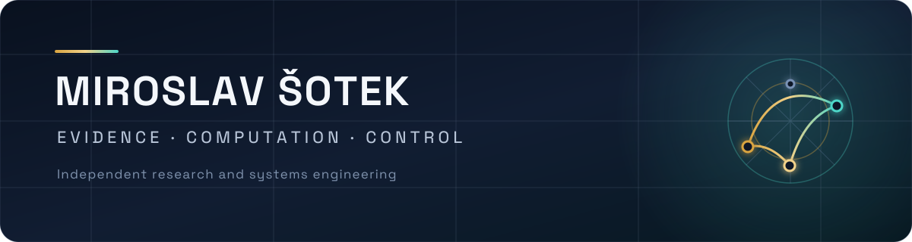
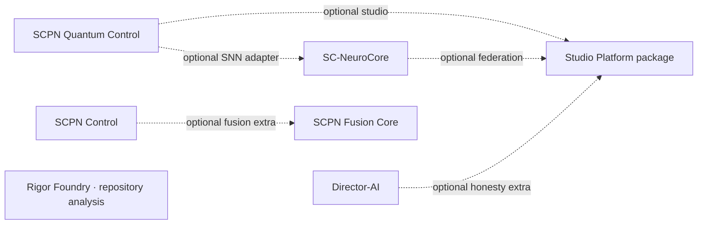
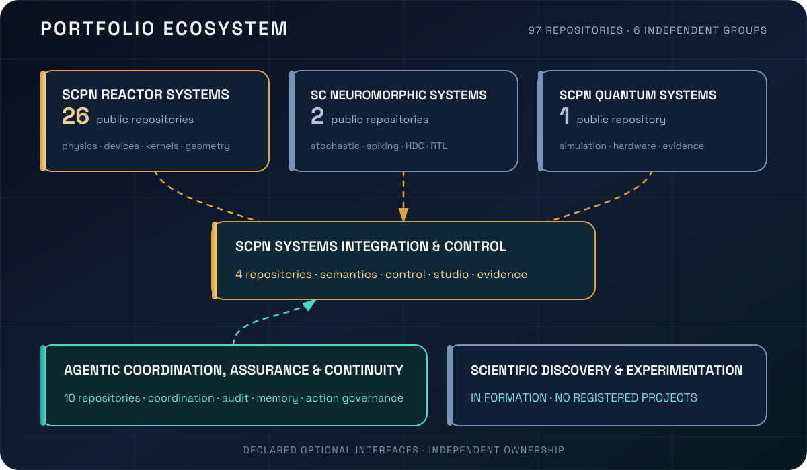

<!--
SPDX-License-Identifier: AGPL-3.0-or-later
Kommerzielle Lizenz verfügbar
© Konzepte 1996–2026 Miroslav Šotek. Alle Rechte vorbehalten.
© Code 2020–2026 Miroslav Šotek. Alle Rechte vorbehalten.
ORCID: 0009-0009-3560-0851
Kontakt: www.anulum.li | protoscience@anulum.li
Persönliche GitHub-Profilübersicht
-->

  <picture>
    <source media="(prefers-color-scheme: dark)" srcset="assets/profile-header-dark.svg">
    <source media="(prefers-color-scheme: light)" srcset="assets/profile-header-light.svg">
    
  </picture>

  
  
  
  
  

  
  
  
  
  
  

  <a href="#projekte">Projekte</a> ·
  <a href="#aktueller-fokus">Aktueller Fokus</a> ·
  <a href="#ökosystemkarte">Ökosystem</a> ·
  <a href="#forschungsergebnisse">Forschungsergebnisse</a> ·
  <a href="#engineering-standards">Standards</a> ·
  <a href="#zusammenarbeit">Zusammenarbeit</a>

Unabhängiger Forscher und Systemingenieur mit Sitz in der Schweiz. Unter dem Namen Anulum entwickle ich wissenschaftliche Software und eine geregelte Forschungsorganisation. Fünf aktive Gruppen arbeiten an Reaktorsystemen, Integration und Regelung, Agentenkoordination und Absicherung, neuromorphem Rechnen und Quantencomputing. Eine sechste Gruppe, Scientific Discovery and Experimentation, befindet sich im Aufbau. Veröffentlichte Software, Architekturarbeit, World Models und angestrebte Hardwareergebnisse haben getrennte Evidenzgrenzen. Forschungsinstitut und Unternehmen werden zur gemeinsamen Gründung mit Partnern angeboten.

<table>
  <tr>
    <td width="20%"><strong>Der Motor</strong> Agentenkoordination mit Quittungen, evidenzgebundene Reviews, Verankerung von Aussagen, auditierbares Gedächtnis</td>
    <td width="20%"><strong>Reaktorsysteme</strong> Katalog von Reaktorkonzepten, 3D/CAD, Level-0-Physik, Reactor Studio</td>
    <td width="20%"><strong>Integration und Regelung</strong> Studio Hub, Regelungs-Runtime, Synchronisationsanalyse, Fail-closed-Freigabe für Hardware</td>
    <td width="20%"><strong>Neuromorphes Rechnen</strong> SNN Studio, Rust-SIMD, Verilog-RTL, FPGA-Synthese</td>
    <td width="20%"><strong>Quantencomputing</strong> Schaltungen auf Simulatoren und echter Hardware, Ergebnispakete mit Rohdaten</td>
  </tr>
</table>

## Einstieg

**[Projekte](#projekte)** für die Software und ihre Evidenz ·
**[Publikationen](https://anulum.li/papers/)** für jede Veröffentlichung und
jedes Softwarearchiv mit BibTeX · **[Kontakt](mailto:protoscience@anulum.li)**
für einen technischen Vorschlag. Für neue Leser wählt
[anulum.li/start/](https://anulum.li/start/) einen Einstieg nach Profil. Jedes
registrierte Projekt, filterbar nach Gruppe, Reaktorfamilie und Evidenz, mit
klickbarer Karte: [anulum.li/portfolio/](https://anulum.li/portfolio/).

## Projekte

Jede Karte verweist auf prüfbare Artefakte, nicht auf zusammenfassende
Aussagen. Evidenzlinks sind an den Commit gebunden, bei dem sie verifiziert
wurden. Release- und CI-Badges melden den Zustand von Registry und Workflow;
sie sind Betriebssignale, keine Bewertung wissenschaftlicher Qualität.

<table>
  <tr>
    <td width="50%" valign="top"><strong><a href="https://github.com/anulum/synapse-channel">Synapse Channel</a></strong> · <strong>Jetzt nutzbar</strong> Control Plane für Coding-Agentenflotten: Claims, Rollen, dauerhafte Mailboxen, Quittungen, Audit und Föderation. <a href="https://anulum.github.io/synapse-channel/">Dokumentation</a> · <a href="https://github.com/anulum/synapse-channel/blob/dd65c898a9693b47fad051e3baa92cef07da2e63/VALIDATION.md">Validierung</a> · <a href="https://github.com/anulum/synapse-channel/blob/dd65c898a9693b47fad051e3baa92cef07da2e63/docs/coordination-spec.md">Koordinationsspezifikation</a> · <a href="https://github.com/anulum/synapse-channel/blob/dd65c898a9693b47fad051e3baa92cef07da2e63/docs/sandbox-threat-model.md">Bedrohungsmodell</a>  </td>
    <td width="50%" valign="top"><strong><a href="https://github.com/anulum/director-ai">Director-AI</a></strong> · <strong>Aktive Forschung</strong> Echtzeit-LLM-Schutz: NLI/RAG-Verankerung, Claim-Prüfung, native Beschleunigung, optionaler Streaming-Stopp auf Claim-Ebene, deklarierte Fähigkeitsgrenzen. <a href="https://anulum.github.io/director-ai/">Dokumentation</a> · <a href="https://github.com/anulum/director-ai/blob/fc155051367bb48180f2f5dc92f4120c2549cddd/VALIDATION.md">Validierung</a> · <a href="https://github.com/anulum/director-ai/blob/fc155051367bb48180f2f5dc92f4120c2549cddd/benchmarks/PUBLIC_BENCHMARKS.md">Öffentliche Benchmarks</a> · <a href="https://github.com/anulum/director-ai/blob/fc155051367bb48180f2f5dc92f4120c2549cddd/docs/_generated/capability_matrix.md">Fähigkeitsmatrix</a>  </td>
  </tr>
  <tr>
    <td width="50%" valign="top"><strong><a href="https://github.com/anulum/rigor-foundry">Rigor Foundry</a></strong> · <strong>Jetzt nutzbar</strong> Evidenzgebundenes Repository-Inventar, Auditkandidaten, Review-Bindung und Sanierungsplanung. <a href="https://anulum.github.io/rigor-foundry/">Dokumentation</a>  </td>
    <td width="50%" valign="top"><strong><a href="https://github.com/anulum/remanentia">Remanentia</a></strong> · <strong>Jetzt nutzbar</strong> Auditierbares Gedächtnis für KI-Agenten und Wissenssysteme: hybrides Retrieval, Graphen, Konsolidierung, CLI, MCP und API. <a href="https://github.com/anulum/remanentia#readme">Dokumentation</a>  </td>
  </tr>
  <tr>
    <td width="50%" valign="top"><strong><a href="https://github.com/anulum/sc-neurocore">SC-NeuroCore</a></strong> · <strong>Aktive Forschung</strong> Stochastisches und neuromorphes Framework: Python-Modelle, Rust-SIMD-Pfade, Verilog-RTL, HDC/VSA, Compiler-Oberflächen und Hardwarenachweise. <a href="https://anulum.github.io/sc-neurocore/">Dokumentation</a> · <a href="https://github.com/anulum/sc-neurocore/blob/4bbc27b808eef0677848c1e484f40bd41e8ce83d/VALIDATION.md">Validierung</a> · <a href="https://github.com/anulum/sc-neurocore/blob/4bbc27b808eef0677848c1e484f40bd41e8ce83d/docs/hardware/SYNTHESIS_RESULTS.md">Syntheseergebnisse</a> · <a href="https://github.com/anulum/sc-neurocore/blob/4bbc27b808eef0677848c1e484f40bd41e8ce83d/docs/safety/TRACEABILITY_MATRIX.md">Rückverfolgbarkeitsmatrix</a>  </td>
    <td width="50%" valign="top"><strong><a href="https://github.com/anulum/scpn-fusion-core">SCPN Fusion Core</a> · <a href="https://github.com/anulum/scpn-control">SCPN Control</a></strong> · <strong>Aktive Forschung</strong> Tokamakphysik, Löser und Validierungskampagnen mit Pfaden zu realen Daten (Fusion Core); regelungstaugliche Laufzeit mit Fail-closed-Zulassung und Replay-Evidenz (Control). <a href="https://github.com/anulum/scpn-fusion-core/blob/3c841fc13109c8efb49bb079d145f70683a4408d/VALIDATION.md">Validierung</a> · <a href="https://github.com/anulum/scpn-fusion-core/blob/3c841fc13109c8efb49bb079d145f70683a4408d/docs/VALIDATION_REAL_DIIID_145419.md">DIII-D-Validierungsakte</a> · <a href="https://doi.org/10.5281/zenodo.18820864">Software-DOI</a>   </td>
  </tr>
  <tr>
    <td width="50%" valign="top"><strong><a href="https://github.com/anulum/scpn-quantum-control">SCPN Quantum Control</a></strong> · <strong>Experimentell</strong> Evidenzbasierte Quantensimulation der Synchronisation gekoppelter Oszillatoren: vor dem Lauf festgeschriebene Protokolle, Hardware-Ergebnispakete, Rohzählungen und ausdrückliche Grenzen ohne Vorteilsbehauptung. <a href="https://github.com/anulum/scpn-quantum-control/blob/2bc0f935b75ae7b85a4835caf754b2bfd8770c98/docs/layout_relaxation_preregistration.md">Layout-Relaxation-Protokoll</a> · <a href="https://github.com/anulum/scpn-quantum-control/blob/2bc0f935b75ae7b85a4835caf754b2bfd8770c98/docs/hardware_result_packs.md">Ergebnispaket-Vertrag</a> · <a href="https://doi.org/10.5281/zenodo.18821929">Software-DOI</a>  </td>
    <td width="50%" valign="top"><strong><a href="https://github.com/anulum/scpn-phase-orchestrator">SCPN Phase Orchestrator</a></strong> · <strong>Aktive Forschung</strong> Evidenzgeführte Synchronisationsanalyse und ausschliesslich zur Prüfung bestimmte Regelungsvorschläge für gekoppelte rhythmische Systeme; Bewertung mit angeglichener Fehlalarmrate, negative Ergebnisse und begrenzte Übertragungsaussagen. <a href="https://github.com/anulum/scpn-phase-orchestrator/blob/1e9eea39fa6681dde2cfbdf074c08ff03a528b58/papers/submissions/README.md">Einreichungsindex</a> · <a href="https://doi.org/10.5281/zenodo.22113062">Preprint mit Negativergebnis</a> · <a href="https://doi.org/10.5281/zenodo.22113116">Preprint zur Netz-Regimekarte</a>  </td>
  </tr>
</table>

| Bezeichnung | Bedeutung |
|---|---|
| **Jetzt nutzbar** | Installierbar, dokumentiert und CI-gestützt; entwickelt sich weiter |
| **Aktive Forschung** | Realer Code und laufende Forschung; kein Stabilitätsversprechen |
| **Experimentell** | Explorativ; Schnittstellen und Aussagen sind nicht als fest zu betrachten |
| **Evidenzgebunden** | Öffentliche Aussagen sind an Messungen oder Artefakte gebunden |

## Aktueller Fokus

Portfoliostand verifiziert am <!-- verified-at -->2026-10-17<!-- /verified-at -->.

<table>
  <tr>
    <td width="33%"><strong>Reaktorportfolio</strong> Konsolidierung gemeinsamer Kerne und kontrollierter Gerätedaten in 26 öffentlichen Reaktor-Repositories.</td>
    <td width="33%"><strong>Agentensicherung</strong> Verbindung von Koordination, Gedächtnis, Antwortsicherung, Aktionsprüfung und Repository-Evidenz ohne Auflösung der Eigentumsgrenzen.</td>
    <td width="33%"><strong>Von der Forschung zur Hardware</strong> Wissenschaftliche Modelle bis zu nativer Beschleunigung, formalen Prüfungen, RTL, Hardwareläufen und prüfbaren Ergebnispaketen.</td>
  </tr>
</table>

<!-- profile-feeds:releases:start -->
### Neueste Releases

| Datum | Projekt | Release | Änderung |
|---|---|---|---|
| 2026-10-02 | Synapse Channel | [v0.99.37](https://doi.org/10.5281/zenodo.23095056) | published software archive |
| 2026-10-01 | Loop Timing Witness | [v0.1.0](https://doi.org/10.5281/zenodo.23092361) | published host software |
| 2026-10-01 | Synapse Channel | [v0.99.36](https://doi.org/10.5281/zenodo.23088472) | historical software archive |
| 2026-09-30 | SYNAPSE CHANNEL | [v0.99.35](https://github.com/anulum/synapse-channel/releases/tag/v0.99.35) | Shared-pool reservations with one authoritative owner (F02, not yet enforced). |
| 2026-09-30 | SYNAPSE CHANNEL | [v0.99.34](https://github.com/anulum/synapse-channel/releases/tag/v0.99.34) | Signed peers behind a TLS-terminating proxy were admitted but served nothing. 0.99.33 said a peer hub's or Fleet follower's signed log pull works behind such a proxy. It did not. |

Gerendert aus [anulum.li/news](https://anulum.li/news/) (den CHANGELOG-Dateien der Projekte) und [Zenodo](https://zenodo.org/search?q=creators.orcid%3A%220009-0009-3560-0851%22) am 2026-10-17.
<!-- profile-feeds:releases:end -->

<!-- profile-feeds:publication:start -->
### Neueste Publikation

| Datum | Typ | Ergebnis | DOI |
|---|---|---|---|
| 2026-10-11 | Preprint | The calibration epoch as the unit of evidence: preregistered parity-leakage and layout-transfer experiments on IQM Garnet | [10.5281/zenodo.23298119](https://doi.org/10.5281/zenodo.23298119) |

Gerendert aus [anulum.li/news](https://anulum.li/news/) (den CHANGELOG-Dateien der Projekte) und [Zenodo](https://zenodo.org/search?q=creators.orcid%3A%220009-0009-3560-0851%22) am 2026-10-17.
<!-- profile-feeds:publication:end -->

## Zeitleiste

| Zeitraum | Öffentlich belegter Meilenstein |
|---|---|
| ab 1996 | Selbst veröffentlichter Horizont der Konzeptentwicklung im breiteren Forschungsprogramm |
| 1998 | Beginn der selbst eingetragenen Gründerrolle bei ANULUM CH&LI im öffentlichen ORCID-Datensatz |
| 2018 | Öffentliches GitHub-Konto eingerichtet |
| 2025 | Öffentliche SCPN-Vorschauen, Framework-Indizes und technische Berichte auf Zenodo hinterlegt |
| 2026 | Ausbau des öffentlichen Software- und Forschungsportfolios in KI-Sicherung, Agenteninfrastruktur, neuromorphem Rechnen, Plasmaregelung und Quantensimulation |

Die Einträge der Zeitleiste unterscheiden Registerfakten von selbst
veröffentlichter Chronologie. Sie implizieren weder akademische Zugehörigkeit
noch externe Validierung, Förderung oder Auszeichnungen.

## Wie der Stack genutzt wird

Die Pfeile zeigen deklarierte optionale Softwareschnittstellen aus den Architekturunterlagen, keinen getesteten wissenschaftlichen Gesamtzyklus. Rigor Foundry analysiert Repositories und erhält hier keine erfundene Runtime-Abhängigkeit. Jede Domäne behält Modelle und Hardwarebefugnisse. Studio Platform ist ein veröffentlichtes Paket mit privatem Repository. Der Netz-Dämpfungsbenchmark des Phase Orchestrator wurde am 12. Oktober 2026 zurückgezogen; weder ein Ergebnis an einem realen Stromnetz noch ein Quantenvorteil wird behauptet.

## Ökosystemkarte

<!-- profile-catalogue:inventory:start -->
**Datierter Bestand: 2026-10-15**

97 Portfolio-Repositories: 37 öffentlich, 6 privat, 54 lokal initialisiert und unveröffentlicht. Weitere 42 Katalogeinträge beschreiben Pakete, Module, Arbeitsbereiche oder Architekturziele. Sämtliche Arbeiten laufen.

Gruppendeklarationen stammen vom 12.–13. Oktober; Repository-Präsenz und öffentliche Sichtbarkeit wurden am 15. Oktober 2026 geprüft. Lizenzangaben sind Quelldeklarationen, kein Rechtsaudit. Paketveröffentlichung und Hardwarequalifikation bleiben getrennt.

  
  
  
  

<picture>
  <source media="(prefers-color-scheme: dark)" srcset="assets/ecosystem-map-dark.svg">
  <source media="(prefers-color-scheme: light)" srcset="assets/ecosystem-map-light.svg">
  
</picture>

Der detaillierte Atlas ist in dieses Repository integriert. Seine 196 Einträge enthalten auch Programme, Unternehmensbedarf, Partnerrollen und Finanzierungswege; es sind keine 196 Repositories. Die Vorschauanleitung öffnet die interaktive Ansicht. Das bestehende Website-Portfolio wird separat gepflegt.

[Quelle des detaillierten Atlas und lokale Vorschau](docs/atlas/README.md) · [anulum.li/portfolio/](https://anulum.li/portfolio/)

Die technischen Beschreibungen zitieren die englischen Quelldatensätze. Ein benanntes Ziel ist keine separat veröffentlichte Fähigkeit. Gemeinsame Einträge werden einmal in ihrer Hauptgruppe gezählt.

<strong>01 · SCPN Reactor Systems</strong> · 55 Repositories · 55 Katalogeinträge

55 zugeordnete Repositories einschliesslich ATLAS-REACTORUM: 26 öffentlich und 29 lokal initialisiert, unveröffentlicht. Fusions-, Spaltungs-, chemische und hybride Modelle, gemeinsame Kerne, Geometrie und Reaktornachweise. World Models, 3D-Simulationen und Geräteentwürfe sind laufende Programmziele; ein Entwurf ist kein validierter Reaktor.

[Architekturkarten der Gruppen](https://github.com/anulum/atlas-reactorum/blob/main/docs/ecosystem.md)

| Projekt / Komponente | Aufgabe und Entwicklungsstand | Repository / Verfügbarkeit | Deklarierte Lizenz | Quelldatum |
|---|---|---|---|---|
| [ATLAS-REACTORUM](https://github.com/anulum/atlas-reactorum) Source and rights library with historical reactor taxonomy and interactive citation views. | In Arbeit · tool · Implementation and integration | Öffentlich | AGPL-3.0-or-later | 2026-10-12 |
| SCPN-ADS-CORE Subcritical blanket plus typed external source/beam-target interface. | In Arbeit · component · Architecture and qualification | Lokal, unveröffentlicht | AGPL-3.0-or-later | 2026-10-12 |
| [SCPN Beam Target Core](https://github.com/anulum/scpn-beam-target-core) Beam/target design and source-scoped reaction/stopping/yield. | In Arbeit · component · Computational prototypes and continued development | Öffentlich | AGPL-3.0-or-later | 2026-10-12 |
| SCPN-BIOCHEM-CORE Source-specific enzyme/fermentation kinetics and reactor transport. | In Arbeit · component · Architecture and qualification | Lokal, unveröffentlicht | AGPL-3.0-or-later | 2026-10-12 |
| SCPN-BREED-BURN-CORE Source-bounded breed-and-burn fuel-management concept. | In Arbeit · component · Architecture and qualification | Lokal, unveröffentlicht | AGPL-3.0-or-later | 2026-10-12 |
| SCPN-BWR-CORE Boiling-channel thermal-spectrum family and void-feedback boundary. | In Arbeit · component · Architecture and qualification | Lokal, unveröffentlicht | AGPL-3.0-or-later | 2026-10-12 |
| SCPN-CATALYTIC-BED-CORE Fixed-bed catalyst/transport/pressure-drop coupling. | In Arbeit · component · Architecture and qualification | Lokal, unveröffentlicht | AGPL-3.0-or-later | 2026-10-12 |
| SCPN-CHANNEL-CORE Graphite-moderated channel reactor only; exclusive from PHWR pressure tubes. | In Arbeit · component · Architecture and qualification | Lokal, unveröffentlicht | AGPL-3.0-or-later | 2026-10-12 |
| SCPN-CHEM-KINETICS-CORE Ideal gas batch/CSTR/PFR named kinetics and thermo models. | In Arbeit · component · Architecture and qualification | Lokal, unveröffentlicht | AGPL-3.0-or-later | 2026-10-12 |
| SCPN-CHEM-PROCESS-HYBRID-CORE Chemical process/recycle/separation and carbon-capture composition. | In Arbeit · component · Architecture and qualification | Lokal, unveröffentlicht | AGPL-3.0-or-later | 2026-10-12 |
| [SCPN Dense Plasma Focus Core](https://github.com/anulum/scpn-dense-plasma-focus-core) Focus device/bank/axial/radial/pinch and source-scoped neutron estimates. | In Arbeit · component · Computational prototypes and continued development | Öffentlich | AGPL-3.0-or-later | 2026-10-12 |
| SCPN-ELECTROCHEM-CORE Electrode/cell transport and charge/reaction interface. | In Arbeit · component · Architecture and qualification | Lokal, unveröffentlicht | AGPL-3.0-or-later | 2026-10-12 |
| [SCPN FRC Core](https://github.com/anulum/scpn-frc-core) Field-reversed configuration, radial pressure-balance and kinetic-scale model. | In Arbeit · component · Computational prototypes and continued development | Öffentlich | AGPL-3.0-or-later | 2026-10-12 |
| [SCPN Fusion Core](https://github.com/anulum/scpn-fusion-core) Canonical plasma solver mathematics, transport/equilibrium and existing research pipeline. | In Arbeit · package · Released software · ongoing development | Öffentlich | AGPL-3.0-or-later | 2026-10-12 |
| [SCPN Fusion-Fission Hybrid Core](https://github.com/anulum/scpn-fusion-fission-hybrid-core) Existing source-owned fusion/fission blanket device and proposed typed member couplings. | In Arbeit · component · Computational prototypes and continued development | Öffentlich | AGPL-3.0-or-later | 2026-10-12 |
| SCPN-FUSION-PROCESS-HEAT-CORE Fusion-source to chemical-process heat/material composition. | In Arbeit · component · Architecture and qualification | Lokal, unveröffentlicht | AGPL-3.0-or-later | 2026-10-12 |
| SCPN-GFR-CORE Gas-cooled fast-spectrum family with high-temperature heat-removal boundary. | In Arbeit · component · Architecture and qualification | Lokal, unveröffentlicht | AGPL-3.0-or-later | 2026-10-12 |
| SCPN-HEAT-PIPE-CORE Solid-core heat-pipe microreactor and source-defined transport limits. | In Arbeit · component · Architecture and qualification | Lokal, unveröffentlicht | AGPL-3.0-or-later | 2026-10-12 |
| SCPN-HTGR-CORE Graphite/TRISO helium-cooled design and distinct process-heat interface. | In Arbeit · component · Architecture and qualification | Lokal, unveröffentlicht | AGPL-3.0-or-later | 2026-10-12 |
| SCPN-HYBRID-ENERGY-CORE Fission/renewable/storage electrical and thermal composition. | In Arbeit · component · Architecture and qualification | Lokal, unveröffentlicht | AGPL-3.0-or-later | 2026-10-12 |
| SCPN-HYDROGEN-PROCESS-CORE HTSE and named thermochemical hydrogen process routes. | In Arbeit · component · Architecture and qualification | Lokal, unveröffentlicht | AGPL-3.0-or-later | 2026-10-12 |
| [SCPN ICF Beam Core](https://github.com/anulum/scpn-icf-beam-core) Particle-beam illumination/capsule design with explicit coupling. | In Arbeit · component · Computational prototypes and continued development | Öffentlich | AGPL-3.0-or-later | 2026-10-12 |
| [SCPN ICF Impact Core](https://github.com/anulum/scpn-icf-impact-core) Impact/projectile/fuel/compression design and source-limited energy relations. | In Arbeit · component · Computational prototypes and continued development | Öffentlich | AGPL-3.0-or-later | 2026-10-12 |
| [SCPN ICF Laser Core](https://github.com/anulum/scpn-icf-laser-core) Laser-driven capsule/implosion design and source-scoped ignition/gain criteria. | In Arbeit · component · Computational prototypes and continued development | Öffentlich | AGPL-3.0-or-later | 2026-10-12 |
| [SCPN IEC Core](https://github.com/anulum/scpn-iec-core) Gridded electrostatic device and distinct nonthermal loss/recirculation models. | In Arbeit · component · Computational prototypes and continued development | Öffentlich | AGPL-3.0-or-later | 2026-10-12 |
| [SCPN Lattice Fusion Core](https://github.com/anulum/scpn-lattice-fusion-core) Source-bounded lattice-confinement fusion research and modelling. | In Arbeit · component · Architecture and qualification | Öffentlich | AGPL-3.0-or-later | 2026-10-12 |
| [SCPN Levitated Dipole Core](https://github.com/anulum/scpn-levitated-dipole-core) Dipole coil/levitation/charging and anisotropic plasma model. | In Arbeit · component · Computational prototypes and continued development | Öffentlich | AGPL-3.0-or-later | 2026-10-12 |
| SCPN-LFR-CORE Lead/LBE fast-spectrum family with materials/corrosion boundary. | In Arbeit · component · Architecture and qualification | Lokal, unveröffentlicht | AGPL-3.0-or-later | 2026-10-12 |
| [SCPN Magnetic Cusp Core](https://github.com/anulum/scpn-magnetic-cusp-core) Cusp coil/configuration ownership and source-specific field/particle-loss model proposal. | In Arbeit · component · Computational prototypes and continued development | Öffentlich | AGPL-3.0-or-later | 2026-10-12 |
| SCPN-MEMBRANE-CORE Reaction-separation with explicit membrane transport. | In Arbeit · component · Architecture and qualification | Lokal, unveröffentlicht | AGPL-3.0-or-later | 2026-10-12 |
| SCPN-METHANE-REFORMER-CORE Steam-methane reforming kinetics and process train. | In Arbeit · component · Architecture and qualification | Lokal, unveröffentlicht | AGPL-3.0-or-later | 2026-10-12 |
| [SCPN MIF Core](https://github.com/anulum/scpn-mif-core) Existing magneto-inertial dynamics/runtime with maintained multi-language/RTL chain. | In Arbeit · package · Released software · ongoing development | Öffentlich | AGPL-3.0-or-later | 2026-10-12 |
| [SCPN MIF Liner Core](https://github.com/anulum/scpn-mif-liner-core) Mechanical/magnetic liner compression and target-energy coupling. | In Arbeit · component · Computational prototypes and continued development | Öffentlich | AGPL-3.0-or-later | 2026-10-12 |
| [SCPN MIF MagLIF Core](https://github.com/anulum/scpn-mif-maglif-core) Magnetised liner drive/preheat/compression family. | In Arbeit · component · Computational prototypes and continued development | Öffentlich | AGPL-3.0-or-later | 2026-10-12 |
| [SCPN MIF Plasma Jet Core](https://github.com/anulum/scpn-mif-plasma-jet-core) Discrete plasma-jet array and spherical liner convergence. | In Arbeit · component · Computational prototypes and continued development | Öffentlich | AGPL-3.0-or-later | 2026-10-12 |
| [SCPN Mirror Core](https://github.com/anulum/scpn-mirror-core) Mirror/tandem confinement and source-specific flux-tube geometry. | In Arbeit · component · Computational prototypes and continued development | Öffentlich | AGPL-3.0-or-later | 2026-10-12 |
| SCPN-MSR-CORE Liquid-fuel molten-salt family with chemistry, circulation and depletion. | In Arbeit · component · Architecture and qualification | Lokal, unveröffentlicht | AGPL-3.0-or-later | 2026-10-12 |
| [SCPN Muon Fusion Core](https://github.com/anulum/scpn-muon-fusion-core) Muon-catalysed reaction models and complete energy accounting. | In Arbeit · component · Architecture and qualification | Öffentlich | AGPL-3.0-or-later | 2026-10-12 |
| SCPN-NTP-CORE Reactor-side thermal propulsion and typed heat/flow interface. | In Arbeit · component · Architecture and qualification | Lokal, unveröffentlicht | AGPL-3.0-or-later | 2026-10-12 |
| SCPN-NUCLEAR-DESALINATION-CORE Fission-to-desalination thermal/material composition. | In Arbeit · component · Architecture and qualification | Lokal, unveröffentlicht | AGPL-3.0-or-later | 2026-10-12 |
| SCPN-NUCLEAR-HYDROGEN-CORE Typed fission-to-hydrogen thermal/electrical/material composition. | In Arbeit · component · Architecture and qualification | Lokal, unveröffentlicht | AGPL-3.0-or-later | 2026-10-12 |
| SCPN-PHOTOCATALYTIC-CORE Photon-flux-driven reaction and optical/source coupling. | In Arbeit · component · Architecture and qualification | Lokal, unveröffentlicht | AGPL-3.0-or-later | 2026-10-12 |
| SCPN-PHWR-CORE Heavy-water pressure-tube family with on-power fuel management. | In Arbeit · component · Architecture and qualification | Lokal, unveröffentlicht | AGPL-3.0-or-later | 2026-10-12 |
| SCPN-PWR-CORE Light-water moderated/cooled vessel and primary-circuit design. | In Arbeit · component · Architecture and qualification | Lokal, unveröffentlicht | AGPL-3.0-or-later | 2026-10-12 |
| SCPN-REACTOR-CATALOGUE Evidence-labelled source-authority catalogue, candidate revision/history and vocabulary. | In Arbeit · component · Architecture and qualification | Lokal, unveröffentlicht | AGPL-3.0-or-later | 2026-10-12 |
| [SCPN Reactor Kernels](https://github.com/anulum/scpn-reactor-kernels) Shared equations, numerical primitives and geometry/CAD/export substrate. | In Arbeit · package · Implementation and integration | Öffentlich | AGPL-3.0-or-later | 2026-10-12 |
| SCPN-RESEARCH-REACTOR-CORE Research/isotope-production core including separately supported pulse operation. | In Arbeit · component · Architecture and qualification | Lokal, unveröffentlicht | AGPL-3.0-or-later | 2026-10-12 |
| [SCPN RFP Core](https://github.com/anulum/scpn-rfp-core) Reversed-field pinch relaxation/profile and toroidal device design. | In Arbeit · component · Computational prototypes and continued development | Öffentlich | AGPL-3.0-or-later | 2026-10-12 |
| SCPN-SCWR-CORE Supercritical-water family with explicit thermophysical transition support. | In Arbeit · component · Architecture and qualification | Lokal, unveröffentlicht | AGPL-3.0-or-later | 2026-10-12 |
| SCPN-SFR-CORE Sodium-cooled fast-spectrum family and fuel/material/heat-removal boundary. | In Arbeit · component · Architecture and qualification | Lokal, unveröffentlicht | AGPL-3.0-or-later | 2026-10-12 |
| [SCPN Spheromak Core](https://github.com/anulum/scpn-spheromak-core) Relaxed compact-torus configuration, flux conserver and formation criteria. | In Arbeit · component · Computational prototypes and continued development | Öffentlich | AGPL-3.0-or-later | 2026-10-12 |
| [SCPN Stellarator Core](https://github.com/anulum/scpn-stellarator-core) Three-dimensional magnetic-confinement configuration and coil/design ownership. | In Arbeit · component · Computational prototypes and continued development | Öffentlich | AGPL-3.0-or-later | 2026-10-12 |
| [SCPN Theta Pinch Core](https://github.com/anulum/scpn-theta-pinch-core) Axial-field compression and pinch configuration with sharp-boundary model. | In Arbeit · component · Computational prototypes and continued development | Öffentlich | AGPL-3.0-or-later | 2026-10-12 |
| [SCPN Tokamak Core](https://github.com/anulum/scpn-tokamak-core) Own tokamak physical modelling and reactor-design geometry, with explicitly qualified canonical plasma-solver dependencies. | In Arbeit · component · Computational prototypes and continued development | Öffentlich | AGPL-3.0-or-later | 2026-10-12 |
| [SCPN Z-Pinch Core](https://github.com/anulum/scpn-z-pinch-core) Current-driven pinch, sheared-flow model and pulsed device design. | In Arbeit · component · Computational prototypes and continued development | Öffentlich | AGPL-3.0-or-later | 2026-10-12 |

**Portale der Reaktorfamilien**: [reactor-systems](https://anulum.li/reactor-systems/) · [compare.html](https://anulum.li/reactor-systems/compare.html) · [closed-magnetic](https://anulum.li/reactor-systems/closed-magnetic/) · [open-magnetic](https://anulum.li/reactor-systems/open-magnetic/) · [pinches](https://anulum.li/reactor-systems/pinches/) · [inertial](https://anulum.li/reactor-systems/inertial/) · [magneto-inertial](https://anulum.li/reactor-systems/magneto-inertial/) · [electrostatic-hybrid](https://anulum.li/reactor-systems/electrostatic-hybrid/)

<strong>02 · SCPN Systems Integration and Control</strong> · 4 Repositories · 4 Katalogeinträge

Vier gleichrangige Produkte. Control und Phase Orchestrator sind öffentlich; Studio Hub und das Studio-Platform-Repository sind privat. Das öffentliche Paket scpn-studio-platform ist separat verfügbar. Deklarierte Studio-Schnittstellen belegen keine getestete Föderation.

| Projekt / Komponente | Aufgabe und Entwicklungsstand | Repository / Verfügbarkeit | Deklarierte Lizenz | Quelldatum |
|---|---|---|---|---|
| [SCPN Phase Orchestrator](https://github.com/anulum/scpn-phase-orchestrator) Synchronisation analysis and evaluation of early-warning detectors on coupled phase-oscillator dynamics, with a Rust kernel. | In Arbeit · package · Released software · ongoing development | Öffentlich | AGPL-3.0-or-later | 2026-10-13 |
| [SCPN Control](https://github.com/anulum/scpn-control) Compiler from stochastic Petri nets to controllers with runtime contracts, and plasma-control research paths. | In Arbeit · package · Released software · ongoing development | Öffentlich | AGPL-3.0-or-later | 2026-10-13 |
| SCPN Studio Platform Domain-neutral SDK for studios: evidence bundles, capability manifests, bounded jobs and tenant-aware identity. | In Arbeit · package · Released software · ongoing development | Privat | AGPL-3.0-or-later | 2026-10-13 |
| SCPN Studio The hub that federates studios over the platform contract: registry, cross-studio evidence audit, rendering and federation gating. | In Arbeit · service · Implementation and integration | Privat | AGPL-3.0-or-later | 2026-10-13 |

<strong>03 · Agentic Coordination, Assurance and Continuity</strong> · 10 Repositories · 10 Katalogeinträge

Zehn Repositories für Koordination, Absicherung, Gedächtnis und geregelte Aktionen. HushLine gehört zu den Gruppenwerkzeugen; SYNAPSE-POLICY-CHECK-ACTION ist enthalten. Jedes Produkt behält seine Lizenz und Fähigkeitsgrenzen.

[Architekturkarten der Gruppen](https://github.com/anulum/synapse-channel/blob/main/docs/ecosystem.md)

| Projekt / Komponente | Aufgabe und Entwicklungsstand | Repository / Verfügbarkeit | Deklarierte Lizenz | Quelldatum |
|---|---|---|---|---|
| [Synapse Channel](https://github.com/anulum/synapse-channel) Local-first coordination bus for AI agents: presence, file-scope work claims, messages, task status, receipts and an audit journal on one hub. | In Arbeit · package · Released software · ongoing development | Öffentlich | AGPL-3.0-or-later | 2026-10-11 |
| Synapse Channel Fleet Multi-machine operation of the bus: durable follower daemon, per-peer trust and configuration, claim forwarding and diagnostics. | In Arbeit · package · Implementation and integration | Privat | LicenseRef-SYNAPSE-Enterprise | 2026-10-11 |
| [SYNAPSE-POLICY-CHECK-ACTION](https://github.com/anulum/synapse-policy-check-action) GitHub Action that checks a SYNAPSE CHANNEL release receipt against a policy file in CI. | In Arbeit · tool · Implementation and integration | Öffentlich | AGPL-3.0-or-later | 2026-10-11 |
| [Director-AI](https://github.com/anulum/director-ai) Response-level guardrail for LLM output: NLI and retrieval grounding, sealed evidence packets and an optional streaming contradiction halt. | In Arbeit · package · Released software · ongoing development | Öffentlich | Apache-2.0 AND BUSL-1.1 | 2026-10-11 |
| Director Class AI Action control between an autonomous agent and its effectors: action-policy checks, human approvals, gateway enforcement and tamper-evident action evidence. | In Arbeit · package · Implementation and integration | Privat | BUSL-1.1 | 2026-10-11 |
| Director AI Cloud Control plane for a hosted Director-AI API: accounts, API-key lifecycle, usage metering, plan quotas and operator exports. | In Arbeit · service · Implementation and integration | Privat | BUSL-1.1 | 2026-10-11 |
| [Rigor Foundry](https://github.com/anulum/rigor-foundry) Evidence-bound repository auditing: inventories Git-tracked content, emits reproducible audit candidates, binds review decisions to exact evidence and prepares remediation inputs. | In Arbeit · package · Released software · ongoing development | Öffentlich | Apache-2.0 | 2026-10-11 |
| [Remanentia](https://github.com/anulum/remanentia) Local-first, auditable memory for AI agents and knowledge-intensive software: project-file indexing, hybrid retrieval, consolidation and an entity graph, through a CLI, an MCP server and an HTTP API. | In Arbeit · package · Released software · ongoing development | Öffentlich | AGPL-3.0-or-later | 2026-10-11 |
| Remanentia Portal Account and billing or licence-request portal for the product family. It runs no customer workload. | In Arbeit · service · Implementation and integration | Privat | AGPL-3.0-or-later | 2026-10-11 |
| [HushLine](https://github.com/anulum/HushLine) Local command-output filter: runs a command, then limits, shapes and redacts its output before it reaches a caller. Four independent cores: Go, Rust, Python and Node. | In Arbeit · tool · Released software · ongoing development | Öffentlich | AGPL-3.0-or-later | 2026-10-11 |

<strong>04 · SC Neuromorphic Computing Systems</strong> · 4 Repositories · 42 Katalogeinträge

Der Kernbestand umfasst 40 benannte Einträge einschliesslich der permanenten SC-NeuroCore-Werkbank und Hilfswerkzeuge; zwei weitere Modul-/bedingte Ziele ergeben 42 Katalogeinträge. LOOP-TIMING-WITNESS besitzt ein öffentliches Host-Paket; die physische Boardqualifikation steht aus. EVIDENCE-MANIFEST-TOOLKIT ist unveröffentlicht. Module und zurückgestellte Ziele sind separat gekennzeichnet.

[Architekturkarten der Gruppen](https://github.com/anulum/sc-neurocore/blob/main/docs/ecosystem.md)

| Projekt / Komponente | Aufgabe und Entwicklungsstand | Repository / Verfügbarkeit | Deklarierte Lizenz | Quelldatum |
|---|---|---|---|---|
| [SC-NeuroCore](https://github.com/anulum/sc-neurocore) Permanent public development, composition and integration workbench for stochastic and spiking neural modelling, encoding, learning, simulation, selected hardware compilation and evidence inspection. | In Arbeit · workbench · Released software · ongoing development | Öffentlich | AGPL-3.0-or-later | 2026-10-13 |
| [Loop Timing Witness](https://github.com/anulum/loop-timing-witness) Fabric-clock instrument for complete control-loop and selected accelerator timing, with simulation/host analysis separated from eventual board timing, fault response and rail-energy evidence. | In Arbeit · tool · Architecture and qualification | Öffentlich | AGPL-3.0-or-later | 2026-10-13 |
| EVIDENCE-MANIFEST-TOOLKIT Canonicalises, references, seals and verifies evidence with explicit schemas, bounded sources and independently selected policy. | In Arbeit · shared · Architecture and qualification | Lokal, unveröffentlicht | AGPL-3.0-or-later | 2026-10-13 |
| RANDOMNESS-WITNESS Assesses number-source suitability for a declared stochastic-computing use; it does not certify randomness for every purpose. | In Arbeit · shared · Design and preparation | Ziel / Modul / Paket | undecided | 2026-10-13 |
| EXPERIMENT-LEDGER Records experiment lineage across tools without owning their raw evidence or running their computations. | In Arbeit · shared · Design and preparation | Ziel / Modul / Paket | undecided | 2026-10-13 |
| SC-NC-CORE Neuron/synapse primitives, network graph, simulation loop, fixed-point semantics, constants and exceptions. | In Arbeit · component · Workbench transition | Ziel / Modul / Paket | Undecided for independent release | 2026-10-13 |
| SC-NC-CATALOGUE Neuron models, model zoo and topology/connectome generators. | In Arbeit · component · Workbench transition | Ziel / Modul / Paket | Undecided for independent release | 2026-10-13 |
| SC-NC-ENGINE Accelerated execution and its maintained language/native interfaces. | In Arbeit · component · Workbench transition | Ziel / Modul / Paket | Undecided for independent release | 2026-10-13 |
| SC-NC-BRIDGES Interchange and cross-domain adapters including NIR, quantum, HDC/VSA and neuro-symbolic routes. | In Arbeit · component · Workbench transition | Ziel / Modul / Paket | Undecided for independent release | 2026-10-13 |
| SC-NC-LEARN Training and adaptation, including surrogate gradients, plasticity, online learning, quantisation-aware training and distillation. | In Arbeit · component · Workbench transition | Ziel / Modul / Paket | Undecided for independent release | 2026-10-13 |
| SC-NC-DATA Datasets, signal/event encoding, augmentation, codecs, sources and recording adapters. | In Arbeit · component · Workbench transition | Ziel / Modul / Paket | Undecided for independent release | 2026-10-13 |
| SC-NC-ANALYSIS Spike-train analysis, visualisation and explainability. | In Arbeit · component · Workbench transition | Ziel / Modul / Paket | Undecided for independent release | 2026-10-13 |
| SC-NC-COMPILER Equation/IR lowering and hardware collateral for supported numerical models. | In Arbeit · component · Workbench transition | Ziel / Modul / Paket | Undecided for independent release | 2026-10-13 |
| SC-NC-HARDWARE Target profiles, mapping, deployment, drivers and power/thermal integration. | In Arbeit · component · Workbench transition | Ziel / Modul / Paket | Undecided for independent release | 2026-10-13 |
| SC-NC-VERIFY Formal, fault, resilience and safety-readiness verification within explicit proof scopes. | In Arbeit · component · Workbench transition | Ziel / Modul / Paket | Undecided for independent release | 2026-10-13 |
| SC-NC-STUDIO Visual composition, inspection and evidence presentation workflows. | In Arbeit · component · Workbench transition | Ziel / Modul / Paket | Undecided for independent release | 2026-10-13 |
| SC-NC-RESEARCH Retained experimental paths, including evolutionary, biological and world-model directions. | In Arbeit · component · Workbench transition | Ziel / Modul / Paket | Undecided for independent release | 2026-10-13 |
| SC-NC-BENCH Catalogue/workload suites and immutable source-bound benchmark records. | In Arbeit · component · Workbench transition | Ziel / Modul / Paket | Undecided for independent release | 2026-10-13 |
| MODEL-PROVENANCE-PACK Binds a model's data, training, conversion, quantisation, encoding and supporting evidence into a verifiable provenance pack. | In Arbeit · tool · Design and implementation | Ziel / Modul / Paket | Undecided for independent release | 2026-10-13 |
| SPIKE-LOG Records, indexes, verifies, slices and replays event streams without losing their provenance or timebase identity. | In Arbeit · tool · Design and implementation | Lokal, unveröffentlicht | Undecided for independent release | 2026-10-13 |
| SPIKE-FORMAT-BRIDGE Converts event recordings between declared formats and reports every permitted loss rather than hiding timestamp, polarity or side-stream changes. | In Arbeit · tool · Design and implementation | Ziel / Modul / Paket | Undecided for independent release | 2026-10-13 |
| SPIKE-CODEC-BENCH Measures compression of existing spike trains, comparing payload ratio, distortion, encode/decode latency and memory. | In Arbeit · tool · Design and implementation | Ziel / Modul / Paket | Undecided for independent release | 2026-10-13 |
| SPIKE-ENCODER-CHARACTERISER Measures the information, spike-rate and latency trade-offs of sensor-to-spike encoders. | In Arbeit · tool · Design and implementation | Ziel / Modul / Paket | Undecided for independent release | 2026-10-13 |
| SPIKE-QUALITY-GATE Checks event data against a named quality policy for timestamp, noise, sensor-health, rate, gap and spatial defects. | In Arbeit · tool · Design and implementation | Ziel / Modul / Paket | Undecided for independent release | 2026-10-13 |
| SPIKE-GROUNDTRUTH Generates reproducible event-vision, audio, sensor and control stimuli with ground truth defined by the generator. | In Arbeit · tool · Design and implementation | Ziel / Modul / Paket | Undecided for independent release | 2026-10-13 |
| SNN-DIVERGENCE-HARNESS Compares the same network and input across implementations under bit-exact, tolerance or statistical oracles. | In Arbeit · tool · Design and implementation | Ziel / Modul / Paket | Undecided for independent release | 2026-10-13 |
| SC-STREAM-PROVER Compares realised stochastic-computing arithmetic error with a declared bound for a specific circuit, source and stream-length regime. | In Arbeit · tool · Design and implementation | Ziel / Modul / Paket | Undecided for independent release | 2026-10-13 |
| MUTATION-SNN Measures test adequacy by generating declared semantic mutants and recording what the suite detects. | In Arbeit · tool · Design and implementation | Ziel / Modul / Paket | Undecided for independent release | 2026-10-13 |
| NIR-CONFORMANCE Tests importer/exporter behaviour against the known semantics of a pinned Neuromorphic Intermediate Representation version. | In Arbeit · tool · Design and implementation | Ziel / Modul / Paket | Undecided for independent release | 2026-10-13 |
| NEURO-EVIDENCE-BENCH Executes declared neuromorphic benchmark plans and traces each scoped result back to its raw evidence. | In Arbeit · tool · Design and implementation | Ziel / Modul / Paket | Undecided for independent release | 2026-10-13 |
| SPIKE-CALIBRATOR Measures classifier confidence against correctness under declared signal definitions, shifts and placements. | In Arbeit · tool · Design and implementation | Ziel / Modul / Paket | Undecided for independent release | 2026-10-13 |
| BITSTREAM-EVIDENCE-CI Captures pinned FPGA build inputs, reports and bitstream identity in a reproducibility-aware chained build ledger. | In Arbeit · tool · Design and implementation | Ziel / Modul / Paket | Undecided for independent release | 2026-10-13 |
| PLASTICITY-WITNESS Compares observed learning-rule updates with an independently defined fixed-point or statistical oracle under stated spike/load/fault protocols. | In Arbeit · tool · Design and implementation | Ziel / Modul / Paket | Undecided for independent release | 2026-10-13 |
| AER-LINK-WITNESS Measures event-link behaviour under load, including loss, reordering, fairness, starvation and forward progress. | In Arbeit · tool · Design and implementation | Ziel / Modul / Paket | Undecided for independent release | 2026-10-13 |
| RELIABILITY-WITNESS Characterises reliability within a declared physical or explicitly simulated exposure, retaining conditions, gaps and rare-event uncertainty. | In Arbeit · tool · Design and implementation | Ziel / Modul / Paket | Undecided for independent release | 2026-10-13 |
| SIM-REAL-WITNESS Quantifies simulation-to-fabric differences for the same model, input and observable population. | In Arbeit · tool · Design and implementation | Ziel / Modul / Paket | Undecided for independent release | 2026-10-13 |
| DEPLOY-PACK Composes validated deployment evidence with bitstream/driver identity into a verifiable install/update package. | In Arbeit · tool · Design and implementation | Ziel / Modul / Paket | Undecided for independent release | 2026-10-13 |
| FIELD-OPS-WITNESS Aggregates compact field health and drift evidence against deployment-time envelopes without actuating devices. | In Arbeit · tool · Design and implementation | Ziel / Modul / Paket | Undecided for independent release | 2026-10-13 |
| FLIGHT-RECORDER Retains a bounded per-device event/state history for gap-honest incident reconstruction. | In Arbeit · tool · Design and implementation | Ziel / Modul / Paket | Undecided for independent release | 2026-10-13 |
| NEURO-SAFETY-CASE Composes scoped evidence and open gaps into an assessor-facing assurance argument; it certifies nothing itself. | In Arbeit · tool · Design and implementation | Ziel / Modul / Paket | Undecided for independent release | 2026-10-13 |
| SC-COMPUTE-ADAPTERS Owns the SC-NeuroCore-side wrappers and numerical/register/handshake contracts needed to put selected generated peripherals into the independent LOOP-TIMING-WITNESS DUT/capture path. | In Arbeit · workbench module · Architecture and interface work | Ziel / Modul / Paket | Independent distribution terms being defined | 2026-10-13 |
| SC-NC-BIO Conditional destination for separately owned biological/biohybrid work if its independent release lifecycle is accepted; current experimental bioware remains in the developmental parent. | In Arbeit · conditional architecture destination · Architecture and interface work | Ziel / Modul / Paket | Independent distribution terms being defined | 2026-10-13 |

<strong>05 · SCPN Quantum Computing Systems</strong> · 24 Repositories · 28 Katalogeinträge

Permanente SCPN-QUANTUM-CONTROL-Werkbank; oscillatools und SCPN-QUANTUM-ENGINE sind separate Distributionen, keine zusätzlichen Werkbänke. Sechzehn Komponentenziele und acht Werkzeugziele entstehen; QUANTUM_LAB ist ein Arbeitsbereich. Unabhängige Paketlizenzen und Veröffentlichungen bleiben vom Elternprojekt getrennt.

[Architekturkarten der Gruppen](https://github.com/anulum/scpn-quantum-control/blob/main/docs/ecosystem.md)

| Projekt / Komponente | Aufgabe und Entwicklungsstand | Repository / Verfügbarkeit | Deklarierte Lizenz | Quelldatum |
|---|---|---|---|---|
| [SCPN Quantum Control](https://github.com/anulum/scpn-quantum-control) Integrated modelling, simulation, compilation, gradients, control, provider workflows, analysis and Quantum Studio. | In Arbeit · workbench · Released software · ongoing development | Öffentlich | AGPL-3.0-or-later | 2026-10-13 |
| oscillatools Classical coupled-phase-oscillator dynamics, observables, sensitivities and control-oriented numerical tools. | In Arbeit · package · Released software · ongoing development | Ziel / Modul / Paket | AGPL-3.0-or-later | 2026-10-13 |
| scpn-quantum-engine Optional Rust/PyO3 numerical acceleration and native computation used by supported workbench paths. | In Arbeit · package · Released software · ongoing development | Ziel / Modul / Paket | AGPL-3.0-or-later | 2026-10-13 |
| QPU-RESULT-PACK Preserve raw results and their provenance, derivations and reviewable presentation. | In Arbeit · tool · Implementation and integration | Lokal, unveröffentlicht | not stated | 2026-10-13 |
| TRANSPILE-WITNESS Retain scoped observations about compilation semantics, layout, global phase and replay. | In Arbeit · tool · Implementation and integration | Ziel / Modul / Paket | AGPL-3.0-or-later by file headers; no licence field in packaging | 2026-10-13 |
| MITIGATION-WITNESS Evaluate mitigation on declared measurement panels with retained inputs and uncertainty. | In Arbeit · tool · Implementation and integration | Lokal, unveröffentlicht | AGPL-3.0-or-later | 2026-10-13 |
| SCPN-QC-CONTRACTS Versioned parameter, result, semantic and evidence interface contracts shared by components. | In Arbeit · component · Workbench transition | Lokal, unveröffentlicht | Undecided for independent release | 2026-10-13 |
| SCPN-QC-CORE Configuration, logging, resource budgets and generic Kuramoto-XY problem foundations, separated from paper-specific research assumptions. | In Arbeit · component · Workbench transition | Lokal, unveröffentlicht | Undecided for independent release | 2026-10-13 |
| SCPN-QC-AD Whole-program automatic differentiation, derivative transforms, batching, optimisation and explicit supported-path contracts. | In Arbeit · component · Workbench transition | Lokal, unveröffentlicht | Undecided for independent release | 2026-10-13 |
| SCPN-QC-SIM Classical and quantum oscillator dynamics, XY/Kuramoto solvers, open-system simulation, tensor-network paths and co-simulation. | In Arbeit · component · Workbench transition | Lokal, unveröffentlicht | Undecided for independent release | 2026-10-13 |
| SCPN-QC-COMPILER Model and circuit frontends, intermediate representations, interchange and code generation. | In Arbeit · component · Workbench transition | Lokal, unveröffentlicht | Undecided for independent release | 2026-10-13 |
| SCPN-QC-QNODE Quantum tapes, gradient execution and framework bridges for supported Qiskit, PennyLane, JAX, PyTorch and TensorFlow paths. | In Arbeit · component · Workbench transition | Lokal, unveröffentlicht | Undecided for independent release | 2026-10-13 |
| SCPN-QC-HAL Provider-neutral workloads, capabilities, job/result contracts and optional provider adapters. | In Arbeit · component · Workbench transition | Lokal, unveröffentlicht | Undecided for independent release | 2026-10-13 |
| SCPN-QC-MITIGATION Error-mitigation implementations and their method taxonomy. | In Arbeit · component · Workbench transition | Lokal, unveröffentlicht | Undecided for independent release | 2026-10-13 |
| SCPN-QC-QEC Quantum error-correction analysis and fault-tolerant resource-reporting surfaces. | In Arbeit · component · Workbench transition | Lokal, unveröffentlicht | Undecided for independent release | 2026-10-13 |
| SCPN-QC-CONTROL Feedback and co-design, chimera and topology-aware control, and DLA-constrained control paths. | In Arbeit · component · Workbench transition | Lokal, unveröffentlicht | Undecided for independent release | 2026-10-13 |
| SCPN-QC-ANALYSIS Observables, synchronisation witnesses, result analysis and the open-data DLA-parity pathway. | In Arbeit · component · Workbench transition | Lokal, unveröffentlicht | Undecided for independent release | 2026-10-13 |
| SCPN-QC-LEARN Forecasting, quantum neural models, surrogate models, kernels and variational learning paths. | In Arbeit · component · Workbench transition | Lokal, unveröffentlicht | Undecided for independent release | 2026-10-13 |
| SCPN-QC-APPS Domain application adapters, quantum randomness, cryptography and sensing workflows, with explicit claim boundaries. | In Arbeit · component · Workbench transition | Lokal, unveröffentlicht | Undecided for independent release | 2026-10-13 |
| SCPN-QC-BENCH Workload-specific benchmark suites, comparison harnesses, campaign reproduction and retained run evidence. | In Arbeit · component · Workbench transition | Lokal, unveröffentlicht | Undecided for independent release | 2026-10-13 |
| SCPN-QC-STUDIO Quantum Studio's visual workflows, inspectors and evidence presentation through the shared Studio platform contract. | In Arbeit · component · Workbench transition | Lokal, unveröffentlicht | Undecided for independent release | 2026-10-13 |
| SCPN-QC-RESEARCH Experimental SCPN theory, paper-specific assumptions and research adapters whose contracts are not stable. | In Arbeit · component · Workbench transition | Lokal, unveröffentlicht | Undecided for independent release | 2026-10-13 |
| NOISE-MODEL-WITNESS Compare model predictions and replay observations for the same circuit and shot identities, with uncertainty, shot floors, calibration epochs and declared tolerances. | In Arbeit · tool · Design and implementation | Lokal, unveröffentlicht | Undecided for independent release | 2026-10-13 |
| VENDOR-CLAIM-RECOMPUTER Recompute released-data quantum-volume, error-per-layer-gate and logical-error claims against fixed definitions, original inputs and declared computation budgets. | In Arbeit · tool · Design and implementation | Lokal, unveröffentlicht | Undecided for independent release | 2026-10-13 |
| DECODER-WITNESS Compare real decoder engines on released shot data with lossless adapters, declared noise conditions and uncertainty-aware reports. | In Arbeit · tool · Design and implementation | Lokal, unveröffentlicht | Undecided for independent release | 2026-10-13 |
| GRADIENT-WITNESS Check software derivatives against declared analytic, parameter-shift and finite-difference references, including complex, finite-shot and cross-framework cases. | In Arbeit · tool · Design and implementation | Lokal, unveröffentlicht | Undecided for independent release | 2026-10-13 |
| CONFORMANCE-WITNESS Check versioned OpenQASM 3, adapter behaviour, provenance fields and repository-evidence criteria against their normative clauses and actual entry points. | In Arbeit · tool · Design and implementation | Lokal, unveröffentlicht | Undecided for independent release | 2026-10-13 |
| QUANTUM_LAB Reserved research workspace name; implementation role is not assigned in the group map. | In Arbeit · workspace · Workspace definition | Ziel / Modul / Paket | Not stated | 2026-10-13 |

↔ EVIDENCE-MANIFEST-TOOLKIT · RANDOMNESS-WITNESS · EXPERIMENT-LEDGER

<strong>06 · Scientific Discovery and Experimentation</strong> · 0 Repositories · 0 Katalogeinträge

Registriert am 12. Oktober 2026; im Aufbau; null registrierte Projekte und Repositories. Zuständig für Hypothese → Experiment → Prüfung → Protokoll → Modelländerungsvorschlag und das gemeinsame Benchmark-/Berichtsformat. Domänenmodelle, Hardware und Ausführungsbefugnisse verbleiben bei den zuständigen Gruppen. Kein geschlossener wissenschaftlicher Zyklus wird behauptet.

**Weiterer öffentlicher Forschungsdatensatz**

Fusion Equilibrium Challenge ist ein öffentliches Reproduktionspaket vom 14. Oktober 2026, nach dem Gruppeninventar. Es wird separat aufgeführt, damit die datierten Gruppensummen erhalten bleiben. Ergebnisse und Einschränkungen stehen im eigenen Datensatz.

- [Fusion Equilibrium Challenge](https://github.com/anulum/fusion-equilibrium-challenge) · In Arbeit · AGPL-3.0-or-later · 2026-10-15
<!-- profile-catalogue:inventory:end -->

## Sponsoring-Ziele

Die offene Arbeit wird über [GitHub Sponsors](https://github.com/sponsors/anulum) finanziert.
Rund **USD 25'000 pro Monat** sind das Minimum, mit dem das Labor ohne
Unterbrechung läuft: Rechenleistung, GPU-, QPU- und FPGA-Zeit, Hardware, CI und
Werkzeuge. Das sind Laborkosten, kein Gehalt. Über diesem Minimum skaliert die
Arbeit, weil der Motor zusätzliche Rechenleistung direkt in mehr entwickelte
und geprüfte Arbeit umsetzt. Sponsoring bezahlt das Labor, es kauft keine
Ergebnisse. Befunde werden veröffentlicht, wie immer sie ausfallen.

Wer die Unterstützung lenken will, nennt beim Sponsoring den Motor oder eine
Domäne; das Geld wird dort eingesetzt und im Quartalsbericht ausgewiesen. Die
Hardware, die das Labor braucht, steht Position für Position in
[LAB_EQUIPMENT.md](LAB_EQUIPMENT.md) (Englisch); Geräte können auch als
Sachspende gegeben werden.

### Der Motor

**03 · Agentic Coordination, Assurance and Continuity.** Das autonome
Programmier- und Verifikationssystem, das jedes Projekt auf dieser Seite
entwickelt und prüft, als offene Infrastruktur bis zur Version 1.0. Es verbindet
[SYNAPSE CHANNEL](https://github.com/anulum/synapse-channel) (Agentenkoordination mit Quittungen),
[Rigor Foundry](https://github.com/anulum/rigor-foundry) (evidenzgebundene Reviews), [Director-AI](https://github.com/anulum/director-ai)
(Verankerung von Aussagen) und [Remanentia](https://github.com/anulum/remanentia) (auditierbares Gedächtnis).
Sponsoring bezahlt Modell- und GPU-Zeit für die Agentenflotte,
Evaluations-Benchmarks und CI.

### Vier Domänen

| Domäne | Ziel | Sponsoring bezahlt |
|---|---|---|
| **01 · Reactor Systems** | 55 zugeordnete Repositories einschliesslich ATLAS-REACTORUM: 26 öffentlich und 29 lokal initialisiert, unveröffentlicht. Fusions-, Spaltungs-, chemische und hybride Modelle, gemeinsame Kerne, Geometrie und Reaktornachweise. World Models, 3D-Simulationen und Geräteentwürfe sind laufende Programmziele; ein Entwurf ist kein validierter Reaktor. | Rechenzeit für Simulationen, CAD-Werkzeuge, Dokumentation |
| **02 · Systems Integration and Control** | Der **SCPN Studio Hub**, der die Studios aller Gruppen verbindet: ein Studio-Katalog, domänenübergreifend geprüfte Evidenz, jede Aussage an ihrer tatsächlichen Grenze dargestellt und ein Fail-closed-Gate für alles, was Hardware berühren könnte. Die Gruppe pflegt auch [scpn-control](https://github.com/anulum/scpn-control) und [scpn-phase-orchestrator](https://github.com/anulum/scpn-phase-orchestrator). | CI, Hardware-in-the-Loop-Replay, Dokumentation |
| **04 · SC Neuromorphic Computing** | **SNN Studio 1.0**, die Browser-IDE für den ganzen Lebenszyklus spikender Netze: Neuronenmodelle entwerfen, Netze bauen, mit Surrogatgradienten trainieren, nach SystemVerilog kompilieren und auf FPGA synthetisieren, mit einem exportierbaren Evidenzdatensatz für jeden Lauf. Aufgebaut auf [sc-neurocore](https://github.com/anulum/sc-neurocore); heute eine Entwicklungsvorschau. | FPGA-Boards und Synthesezeit, Messplatz, CI |
| **05 · SCPN Quantum Computing** | **Quantum Studio**, eine Arbeitsumgebung auf [scpn-quantum-control](https://github.com/anulum/scpn-quantum-control): eine Karte dessen, was existiert und wie es zusammenhängt, Schaltungen, die auf Simulatoren und echter Quantenhardware entworfen und ausgeführt werden, und jedes Ergebnis mit Rohdaten, Hashes, schriftlichem Protokoll und Entscheidungsregel, negative Ergebnisse eingeschlossen. | QPU-Zeit, GPU-Simulation, Dokumentation |

### Für Organisationen

- **Forschungsvereinbarung.** Eine Organisation kann statt eines Sponsorings
  eine abgegrenzte Arbeit über eine schriftliche Forschungsvereinbarung mit
  direkter Rechnungsstellung finanzieren. Umfang und Ergebnisse werden vorab
  vereinbart; Befunde werden nach derselben Regel wie oben veröffentlicht.
- **Kommerzielle Lizenz.** Projekte unter AGPL-3.0-or-later können für
  proprietäre oder geschlossene Nutzung zu kommerziellen Bedingungen lizenziert
  werden, zum Beispiel [SYNAPSE CHANNEL](https://anulum.li/synapse/pricing.html), [SC-NeuroCore](https://anulum.li/sc-neurocore/pricing.html), [SCPN Control](https://anulum.li/scpn-control/pricing.html), [SCPN Fusion Core](https://anulum.li/scpn-fusion-core/pricing.html), [SCPN Phase Orchestrator](https://anulum.li/scpn-phase-orchestrator/pricing.html), [SCPN Quantum Control](https://anulum.li/scpn-quantum-control/pricing.html). Apache-2.0-Projekte wie Director-AI und
  Rigor Foundry brauchen keine Lizenz; [Director-AI Pro](https://anulum.li/director-ai/pricing.html) ist eine
  kommerzielle selbst gehostete Edition, und Support und Integration lassen
  sich für jedes Projekt vertraglich vereinbaren. Welche Lizenz gilt, steht in
  der LICENSE-Datei des jeweiligen Repositorys.
- **Kontakt:** [protoscience@anulum.li](mailto:protoscience@anulum.li), mit „Forschungsvereinbarung“ oder
  „kommerzielle Lizenz“ und dem Projektnamen im Betreff.

## Forschungsergebnisse

| Oberfläche | Verifizierter Weg |
|---|---|
| Vollständiger Forschungsindex | [Publikationen, Preprints und Softwarearchive](PUBLICATIONS.md) |
| Publikations-Hub | [anulum.li/papers/](https://anulum.li/papers/): jeder Zenodo-Eintrag mit BibTeX |
| Releases und Publikationen | [anulum.li/news/](https://anulum.li/news/) · [RSS](https://anulum.li/news/feed.xml) |
| Lebenslauf | [Einseitiges PDF](cv/Miroslav-Sotek-CV.pdf) · [Markdown-Quelle](cv/Miroslav-Sotek-CV.md) · [JSON Resume](cv/resume.json) |
| Forschungsidentität | [ORCID 0009-0009-3560-0851](https://orcid.org/0009-0009-3560-0851) |
| Software | [20 erfasste PyPI-Distributionen](https://pypi.org/user/anulum/) |
| Quantum Control | [DOI 10.5281/zenodo.18821929](https://doi.org/10.5281/zenodo.18821929) |
| Fusion Core | [DOI 10.5281/zenodo.18820864](https://doi.org/10.5281/zenodo.18820864) |
| Phasensystem-Preprints | [Studie mit angeglichener Fehlalarmrate](https://doi.org/10.5281/zenodo.22113062) und [Studie zur Netz-Regimekarte](https://doi.org/10.5281/zenodo.22113116) |
| HushLine | [DOI 10.5281/zenodo.20775432](https://doi.org/10.5281/zenodo.20775432) |

## PyPI-Veröffentlichungen

[PyPI](https://pypi.org/user/anulum/)

<!-- profile-catalogue:packages:start -->
20 benannte Distributionen wurden am 2026-10-15 einzeln über die PyPI-JSON-API geprüft. Dies ist eine geprüfte Liste, kein vollständiger Kontoindex. Versionen sind Paketmetadaten, keine wissenschaftliche Validierung oder Zuordnung zu historischen DOI-Versionen.

<strong>Veröffentlichte Distributionen</strong> · 20

| PyPI | Version |
|---|---|
| [synapse-channel](https://pypi.org/project/synapse-channel/) | 0.99.38 |
| [scpn-phase-orchestrator](https://pypi.org/project/scpn-phase-orchestrator/) | 1.4.3 |
| [spo-kernel](https://pypi.org/project/spo-kernel/) | 0.5.10 |
| [director-ai](https://pypi.org/project/director-ai/) | 3.21.0 |
| [director-ai-lite](https://pypi.org/project/director-ai-lite/) | 3.21.0 |
| [scpn-quantum-control](https://pypi.org/project/scpn-quantum-control/) | 1.2.0 |
| [scpn-fusion-rs](https://pypi.org/project/scpn-fusion-rs/) | 4.0.0 |
| [scpn-fusion](https://pypi.org/project/scpn-fusion/) | 4.0.0 |
| [rigor-foundry](https://pypi.org/project/rigor-foundry/) | 1.0.0 |
| [scpn-control](https://pypi.org/project/scpn-control/) | 0.23.0 |
| [oscillatools](https://pypi.org/project/oscillatools/) | 0.1.0 |
| [scpn-quantum-engine](https://pypi.org/project/scpn-quantum-engine/) | 0.2.0 |
| [scpn-studio-platform](https://pypi.org/project/scpn-studio-platform/) | 0.11.2 |
| [sc-neurocore-engine](https://pypi.org/project/sc-neurocore-engine/) | 3.16.0 |
| [sc-neurocore](https://pypi.org/project/sc-neurocore/) | 3.16.0 |
| [scpn-mif-core](https://pypi.org/project/scpn-mif-core/) | 0.1.1 |
| [remanentia](https://pypi.org/project/remanentia/) | 0.5.0 |
| [backfire-kernel](https://pypi.org/project/backfire-kernel/) | 0.1.3 |
| [hushline](https://pypi.org/project/hushline/) | 0.1.5 |
| [loop-timing-witness](https://pypi.org/project/loop-timing-witness/) | 0.1.0 |

<!-- profile-catalogue:packages:end -->

## Sprachen und Plattformen

**Primäre Implementierung**

  
  
  
  
  

<strong>Erweiterter wissenschaftlicher, formaler, Hardware- und Betriebsstack</strong>

**Wissenschaftliche, native und formale Arbeit**

  
  
  
  
  
  
  

**Hardware, Web und Betrieb**

  
  
  
  
  
  
  

Das Portfolio enthält ausserdem gepflegte protobuf/gRPC-Verträge, mit PyO3 und
Maturin gebaute Python-Rust-Brücken, WebAssembly-Ziele, native SIMD-Pfade,
wissenschaftliche Notebooks und mehrsprachige API-Dokumentation.

## Engineering-Standards

  
  
  
  
  
  
  

Die konkrete Auswahl richtet sich nach Risiko und Umfang des jeweiligen
Repositorys; nicht jedes Repository führt jedes Werkzeug aus.

| Qualitätsbereich | Verwendete Praktiken |
|---|---|
| Korrektheit | Deterministische pytest- und Cargo-Suiten, zweigsensitive Coverage-Gates, Paritätstests, Regressions-Fixtures und explizite Negativfälle |
| Statische Qualität | Ruff-Formatierung und -Linting, striktes mypy wo deklariert, Cargo fmt, Clippy mit verbotenen Warnungen und API-Vertragsprüfungen |
| Reproduzierbarkeit | Hash-fixierte Abhängigkeiten, vor dem Lauf festgeschriebene Protokolle, Rohdatenpakete, Inhaltsdigests, Benchmark-Metadaten und wiederholbare Auditaufzeichnungen |
| Sicherheit | Bandit, CodeQL und Scorecards wo aktiviert, Bedrohungsmodelle, minimale Autorität, Geheimnisgrenzen und Abhängigkeitsprüfung |
| Lieferkette | SPDX-Header, REUSE-3.x-Prüfungen, SBOMs wo anwendbar, fixierte CI-Actions, signierte oder digestgebundene Evidenz und Release-Manifeste |
| Polyglotte Prüfung | Python/Rust-Parität, PyO3- und Maturin-Brücken, Go- und Julia-Tests, Lean-Builds, WebAssembly-Ziele sowie RTL- und Formalprüfungen wo relevant |
| Dokumentation | Warnungsfatale oder strikte MkDocs/Sphinx-Builds, generierte API-Referenzen, Architekturentscheidungen, Validierungsakten und explizite Nicht-Claims |
| Auslieferung | Repository-lokale Preflight-Gates, CI-Workflows, PyPI-Pakete, Wheels und Quelldistributionen, Container und Benchmark-Harnische |

## Evidenz statt Schlagworte

Negative und Nullresultate werden veröffentlicht, wenn sie real sind.
Öffentliche Aussagen bleiben an Messungen, vor dem Lauf festgeschriebene Protokolle,
Rohdatenpakete, quellengebundene Reviews oder ausführbare Verifikation gebunden.

Beispiel: SCPN Quantum Control veröffentlicht vor dem Lauf festgeschriebene Protokolle und
hashgebundene Ergebnispakete, statt experimentelle Aktivität in eine Reife-
oder Vorteilsbehauptung umzudeuten.

## Arbeitsprinzipien

- Evidenz vor Aussagen.
- Reproduzierbare Artefakte vor Präsentation.
- Klare Grenzen zwischen Forschung, Validierung und Produktreife.
- Sprachübergreifende Implementierungen, wenn Leistung oder Hardwareintegration
  sie rechtfertigen.
- Fail closed, wenn Herkunft, Befugnis oder Evidenz unvollständig sind.
- Negative Ergebnisse und Fehleraufzeichnungen bleiben Teil des
  Forschungsergebnisses.

## Zusammenarbeit

<!-- profile-catalogue:partner:start -->
### Gründungs- und Forschungspartner

Wir suchen Pre-Seed-Kapital und Partner zur gemeinsamen Gründung eines Forschungsinstituts, eines Unternehmens und einer gemeinnützigen Forschungsgesellschaft. Das Programm gehört derzeit einer Einzelperson; Rechtsträger und Standorte sind Vorschläge, keine bereits gegründeten Institutionen. Das anfängliche geografische Bild umfasst die Schweiz oder Liechtenstein, Tschechien oder die Slowakei sowie einen noch offenen dritten Standort im Nahen Osten. Wir bringen Software, Forschungsprogramm und eine geregelte Agentenorganisation ein. Partner können Kapital, unabhängige Replikation, gemessene Domänendaten, Chipentwurf und Fertigung, Labore, Instrumente oder Hardware-in-the-Loop-Einrichtungen beitragen. Eine erste Zusammenarbeit sollte ein Problem, ein Ergebnis und die Erfolgskriterien festlegen. Weder eine Partnerzusage noch eine bewilligte Finanzierung wird behauptet.
<!-- profile-catalogue:partner:end -->

### Lizenzmodelle

| Modell | Typische Grenze |
|---|---|
| Apache-2.0 | Freizügige öffentliche Kerne wie Director-AI und Rigor Foundry |
| AGPL-3.0-or-later | Öffentliche Netzwerk- und Forschungssysteme mit Quellcodepflichten |
| Open Core | Öffentlicher Kern mit separat lizenzierten erweiterten oder verwalteten Bereichen |
| BUSL-1.1 | Ausgewählte private kommerzielle Systeme mit angekündigter späterer Lizenzänderung |
| Kommerzielle Lizenz | Alternative Bedingungen für Organisationen, die die öffentliche Lizenz nicht einsetzen können |

| Modus | Umfang |
|---|---|
| Forschungskooperation | Reproduzierbare Studien in KI-Sicherung, neuromorphen Systemen, Quantensimulation, Plasmaphysik und Regelung |
| Technische Kooperation | Architekturprüfung, Validierungsdesign, Formal- oder Hardwarepfade und evidenzgebundene Softwareentwicklung |
| Kommerzielle Lizenzierung | Dual lizenzierte und verwaltete Produktbereiche über den [Lizenzweg von Anulum](#für-organisationen) |
| Förderung offener Arbeit | CI, Rechenzeit, Hardware- und Quantenexperimente sowie öffentliche Dokumentation über [GitHub Sponsors](https://github.com/sponsors/anulum) |

Ich begrüsse technisch fundierte Zusammenarbeit in zuverlässiger
KI-Infrastruktur, Multi-Agenten-Systemen, neuromorphem Rechnen,
wissenschaftlicher Software, formaler Verifikation, Quantensimulation,
Plasmaphysik und Regelung.

Aufträge werden selektiv angenommen. Das öffentliche GitHub-Profil ist derzeit
als hireable markiert; dies garantiert keine sofortige Kapazität.

Eine hilfreiche erste Nachricht enthält Problem, Randbedingungen, relevante
Vorarbeiten und die Evidenz, die als Erfolg gelten würde. Kontakt über
[protoscience@anulum.li](mailto:protoscience@anulum.li) oder
[anulum.li](https://anulum.li).

Ich antworte auf technische Vorschläge. Ich übernehme keine unbelegte
Hype-Arbeit, kein Wissenschaftstheater „nur zur Demonstration“ und keine
Aussagen, die nicht überprüft werden können.

[GitHub Sponsors](https://github.com/sponsors/anulum) finanziert für dauerhafte
offene Arbeit CI-Runner, Rechenzeit, Hardware- und Quantenexperimentzeit sowie
öffentliche Dokumentation, nicht Marketing.

> **Transparenz:** Diese Repositories umfassen Forschungssoftware,
> Entwicklerwerkzeuge, private Systeme und Produktkandidaten. Aktive
> Entwicklung bedeutet weder Produktionsreife noch wissenschaftliche
> Validierung, sofern ein Projekt dafür keine ausdrückliche Evidenz vorlegt.

<em>I AM THAT</em>

  

