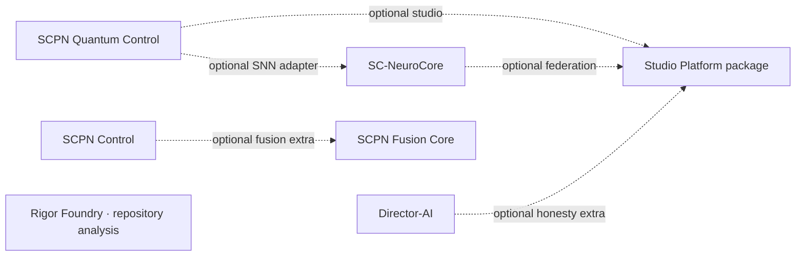

<!--
SPDX-License-Identifier: AGPL-3.0-or-later
商用ライセンスを提供可能
© Concepts 1996–2026 Miroslav Šotek. All rights reserved.
© Code 2020–2026 Miroslav Šotek. All rights reserved.
ORCID: 0009-0009-3560-0851
連絡先：www.anulum.li | protoscience@anulum.li
GitHub 個人プロフィール概要
-->

  <picture>
    <source media="(prefers-color-scheme: dark)" srcset="assets/profile-header-dark.svg">
    <source media="(prefers-color-scheme: light)" srcset="assets/profile-header-light.svg">
    
  </picture>

  
  
  
  
  

  
  
  
  
  
  

  <a href="#verified-work">検証済み成果</a> · <a href="#current-focus">現在の重点</a> ·
  <a href="#portfolio-ecosystem">エコシステム</a> · <a href="#engineering-practice">標準</a> ·
  <a href="#research-output">研究成果</a> · <a href="#collaboration">協力</a>

# Miroslav Šotek

スイスを拠点とする独立研究者・システムエンジニアとして、Anulum の名で科学ソフトウェアと統制された研究組織を開発しています。五つの活動中グループが、原子炉システム、統合と制御、エージェント協調と保証、ニューロモーフィック計算、量子計算を担当します。第六の Scientific Discovery and Experimentation は組成中です。公開ソフトウェア、設計作業、ワールドモデル開発、将来のハードウェア成果は、それぞれの証拠境界を持ちます。研究所と会社の共同設立をパートナーに提案しています。

## 言語とプラットフォーム

**主要実装：** Python、Rust、TypeScript、JavaScript、Go。

**科学・ネイティブ・形式手法：** Julia、Mojo、C++、C、Lean 4、Jupyter、LaTeX。

**ハードウェア、Web、運用：** Verilog、SystemVerilog、WGSL/WebGPU、
HTML/CSS、Shell、Docker、Linux。

  
  
  
  
  
  
  
  
  
  
  
  

## はじめに

| 必要なもの | プロジェクト |
|---|---|
| 互いの作業を上書きしない並列コーディングエージェント | [Synapse Channel](https://github.com/anulum/synapse-channel) · [ドキュメント](https://anulum.github.io/synapse-channel/) |
| LLM の主張保護と事実整合性チェック | [Director-AI](https://github.com/anulum/director-ai) · [ドキュメント](https://anulum.github.io/director-ai/) |
| リポジトリ監査と修復計画 | [Rigor Foundry](https://github.com/anulum/rigor-foundry) · [ドキュメント](https://anulum.github.io/rigor-foundry/) |
| ニューロモーフィックおよび確率的コンピューティング研究 | [SC-NeuroCore](https://github.com/anulum/sc-neurocore) · [ドキュメント](https://anulum.github.io/sc-neurocore/) |
| 結合振動子と量子シミュレーションの研究 | [SCPN Quantum Control](https://github.com/anulum/scpn-quantum-control) |

各プロジェクトのドキュメントは、それぞれの Pages サイトと
[anulum.li](https://anulum.li) にも掲載されています。

## 検証済みの成果

| 分野 | 確認可能なエビデンス |
|---|---|
| マルチエージェント協調 | [検証](https://github.com/anulum/synapse-channel/blob/dd65c898a9693b47fad051e3baa92cef07da2e63/VALIDATION.md)、[協調仕様](https://github.com/anulum/synapse-channel/blob/dd65c898a9693b47fad051e3baa92cef07da2e63/docs/coordination-spec.md)、[脅威モデル](https://github.com/anulum/synapse-channel/blob/dd65c898a9693b47fad051e3baa92cef07da2e63/docs/sandbox-threat-model.md) |
| LLM 応答保証 | [検証](https://github.com/anulum/director-ai/blob/fc155051367bb48180f2f5dc92f4120c2549cddd/VALIDATION.md)、[公開ベンチマーク](https://github.com/anulum/director-ai/blob/fc155051367bb48180f2f5dc92f4120c2549cddd/benchmarks/PUBLIC_BENCHMARKS.md)、[機能マトリクス](https://github.com/anulum/director-ai/blob/fc155051367bb48180f2f5dc92f4120c2549cddd/docs/_generated/capability_matrix.md) |
| ニューロモーフィックから RTL | [検証](https://github.com/anulum/sc-neurocore/blob/4bbc27b808eef0677848c1e484f40bd41e8ce83d/VALIDATION.md)、[合成結果](https://github.com/anulum/sc-neurocore/blob/4bbc27b808eef0677848c1e484f40bd41e8ce83d/docs/hardware/SYNTHESIS_RESULTS.md)、[トレーサビリティ](https://github.com/anulum/sc-neurocore/blob/4bbc27b808eef0677848c1e484f40bd41e8ce83d/docs/safety/TRACEABILITY_MATRIX.md) |
| プラズマと量子 | [核融合検証](https://github.com/anulum/scpn-fusion-core/blob/3c841fc13109c8efb49bb079d145f70683a4408d/VALIDATION.md)、[レイアウト緩和プロトコル](https://github.com/anulum/scpn-quantum-control/blob/2bc0f935b75ae7b85a4835caf754b2bfd8770c98/docs/layout_relaxation_preregistration.md)、[ハードウェア結果パック](https://github.com/anulum/scpn-quantum-control/blob/2bc0f935b75ae7b85a4835caf754b2bfd8770c98/docs/hardware_result_packs.md) |

## 現在の重点

ポートフォリオ状態は <!-- verified-at -->2026-10-18<!-- /verified-at --> に検証済みです。

- 26 の公開 Reactor リポジトリにおける共有カーネルと管理された装置情報。
- 所有権境界を保った協調、メモリ、応答保証、アクション審査、リポジトリエビデンス。
- 科学モデルからネイティブ高速化、形式検査、RTL、確認可能な結果パックまでの経路。

<!-- profile-feeds:releases:start -->
### 最新リリース

| 日付 | プロジェクト | リリース | 変更 |
|---|---|---|---|
| 2026-10-02 | Synapse Channel | [v0.99.37](https://doi.org/10.5281/zenodo.23095056) | published software archive |
| 2026-10-01 | Loop Timing Witness | [v0.1.0](https://doi.org/10.5281/zenodo.23092361) | published host software |
| 2026-10-01 | Synapse Channel | [v0.99.36](https://doi.org/10.5281/zenodo.23088472) | historical software archive |
| 2026-09-30 | SYNAPSE CHANNEL | [v0.99.35](https://github.com/anulum/synapse-channel/releases/tag/v0.99.35) | Shared-pool reservations with one authoritative owner (F02, not yet enforced). |
| 2026-09-30 | SYNAPSE CHANNEL | [v0.99.34](https://github.com/anulum/synapse-channel/releases/tag/v0.99.34) | Signed peers behind a TLS-terminating proxy were admitted but served nothing. 0.99.33 said a peer hub's or Fleet follower's signed log pull works behind such a proxy. It did not. |

[anulum.li/news](https://anulum.li/news/)（各プロジェクトの CHANGELOG）と [Zenodo](https://zenodo.org/search?q=creators.orcid%3A%220009-0009-3560-0851%22) から 2026-10-18 に生成。
<!-- profile-feeds:releases:end -->

<!-- profile-feeds:publication:start -->
### 最新の出版物

| 日付 | 種別 | 成果 | DOI |
|---|---|---|---|
| 2026-10-11 | Preprint | The calibration epoch as the unit of evidence: preregistered parity-leakage and layout-transfer experiments on IQM Garnet | [10.5281/zenodo.23298119](https://doi.org/10.5281/zenodo.23298119) |

[anulum.li/news](https://anulum.li/news/)（各プロジェクトの CHANGELOG）と [Zenodo](https://zenodo.org/search?q=creators.orcid%3A%220009-0009-3560-0851%22) から 2026-10-18 に生成。
<!-- profile-feeds:publication:end -->

## タイムライン

| 期間 | 公開情報で確認できるマイルストーン |
|---|---|
| 1996 年以降 | 自己公開された概念開発の期間 |
| 1998 | 公開 ORCID に自己申告された ANULUM CH&LI 創設者役割の開始 |
| 2018 | 公開 GitHub アカウント開設 |
| 2025 | SCPN プレビューと技術報告を Zenodo に公開 |
| 2026 | AI 保証、ニューロモーフィック、プラズマ、量子システムへ公開ソフトウェア・研究ポートフォリオを拡大 |

## ラボマップ

矢印はグループの設計記録にある任意のソフトウェア接続であり、実証された科学的な全体ループではありません。Rigor Foundry はリポジトリを分析するもので、架空の実行時依存は加えていません。各領域はモデルとハードウェア権限を保持します。Studio Platform は公開パッケージですがリポジトリは非公開です。Phase Orchestrator の電力系統モード減衰ベンチマークは 2026 年 10 月 12 日に撤回されました。本ページは実系統での成果や量子優位性を主張しません。

## エコシステムマップ

<!-- profile-catalogue:inventory:start -->
**日付付き一覧: 2026-10-15**

ポートフォリオのリポジトリは 97 件で、公開 37 件、非公開 6 件、ローカルで初期化済み・未公開 54 件です。別に 42 件のカタログ項目が、パッケージ、モジュール、作業領域、設計上の移行先を示します。すべての作業が進行中です。

グループの申告は 10 月 12–13 日付、リポジトリの存在と公開状態は 2026 年 10 月 15 日に確認しました。ライセンスは資料上の申告であり、法的監査ではありません。パッケージの公開とハードウェア適格性は別の事項です。

  
  
  
  

<picture>
  <source media="(prefers-color-scheme: dark)" srcset="assets/ecosystem-map-dark.svg">
  <source media="(prefers-color-scheme: light)" srcset="assets/ecosystem-map-light.svg">
  
</picture>

詳細アトラスをこのリポジトリに統合しました。196 件の項目には、研究計画、組織の需要、パートナーの役割、資金調達経路も含まれ、196 件のリポジトリではありません。対話表示はアトラスのプレビュー手順から開けます。既存の Web ポートフォリオは別途管理されています。

[詳細アトラスのソースとローカルプレビュー](docs/atlas/README.md) · [anulum.li/portfolio/](https://anulum.li/portfolio/)

以下の技術説明は英語の原資料を引用しています。名称のある移行先は、独立してリリースされた機能を意味しません。共有項目は主担当グループで一度だけ数えます。

<strong>01 · SCPN Reactor Systems</strong> · 55 リポジトリ · 55 カタログ項目

ATLAS-REACTORUM を含む 55 件の所属リポジトリ。26 件が公開、29 件がローカルで初期化済み・未公開です。核融合、核分裂、化学・ハイブリッドモデル、共通カーネル、形状、原子炉の証拠を扱います。ワールドモデル、3D シミュレーション、装置設計は開発中の成果目標であり、設計は検証済み原子炉を意味しません。

[グループ別の設計図](https://github.com/anulum/atlas-reactorum/blob/main/docs/ecosystem.md)

| プロジェクト / コンポーネント | 役割と開発段階 | リポジトリ / 公開状況 | 申告ライセンス | 資料日付 |
|---|---|---|---|---|
| [ATLAS-REACTORUM](https://github.com/anulum/atlas-reactorum) Source and rights library with historical reactor taxonomy and interactive citation views. | 進行中 · tool · Implementation and integration | 公開 | AGPL-3.0-or-later | 2026-10-12 |
| SCPN-ADS-CORE Subcritical blanket plus typed external source/beam-target interface. | 進行中 · component · Architecture and qualification | ローカル、未公開 | AGPL-3.0-or-later | 2026-10-12 |
| [SCPN Beam Target Core](https://github.com/anulum/scpn-beam-target-core) Beam/target design and source-scoped reaction/stopping/yield. | 進行中 · component · Computational prototypes and continued development | 公開 | AGPL-3.0-or-later | 2026-10-12 |
| SCPN-BIOCHEM-CORE Source-specific enzyme/fermentation kinetics and reactor transport. | 進行中 · component · Architecture and qualification | ローカル、未公開 | AGPL-3.0-or-later | 2026-10-12 |
| SCPN-BREED-BURN-CORE Source-bounded breed-and-burn fuel-management concept. | 進行中 · component · Architecture and qualification | ローカル、未公開 | AGPL-3.0-or-later | 2026-10-12 |
| SCPN-BWR-CORE Boiling-channel thermal-spectrum family and void-feedback boundary. | 進行中 · component · Architecture and qualification | ローカル、未公開 | AGPL-3.0-or-later | 2026-10-12 |
| SCPN-CATALYTIC-BED-CORE Fixed-bed catalyst/transport/pressure-drop coupling. | 進行中 · component · Architecture and qualification | ローカル、未公開 | AGPL-3.0-or-later | 2026-10-12 |
| SCPN-CHANNEL-CORE Graphite-moderated channel reactor only; exclusive from PHWR pressure tubes. | 進行中 · component · Architecture and qualification | ローカル、未公開 | AGPL-3.0-or-later | 2026-10-12 |
| SCPN-CHEM-KINETICS-CORE Ideal gas batch/CSTR/PFR named kinetics and thermo models. | 進行中 · component · Architecture and qualification | ローカル、未公開 | AGPL-3.0-or-later | 2026-10-12 |
| SCPN-CHEM-PROCESS-HYBRID-CORE Chemical process/recycle/separation and carbon-capture composition. | 進行中 · component · Architecture and qualification | ローカル、未公開 | AGPL-3.0-or-later | 2026-10-12 |
| [SCPN Dense Plasma Focus Core](https://github.com/anulum/scpn-dense-plasma-focus-core) Focus device/bank/axial/radial/pinch and source-scoped neutron estimates. | 進行中 · component · Computational prototypes and continued development | 公開 | AGPL-3.0-or-later | 2026-10-12 |
| SCPN-ELECTROCHEM-CORE Electrode/cell transport and charge/reaction interface. | 進行中 · component · Architecture and qualification | ローカル、未公開 | AGPL-3.0-or-later | 2026-10-12 |
| [SCPN FRC Core](https://github.com/anulum/scpn-frc-core) Field-reversed configuration, radial pressure-balance and kinetic-scale model. | 進行中 · component · Computational prototypes and continued development | 公開 | AGPL-3.0-or-later | 2026-10-12 |
| [SCPN Fusion Core](https://github.com/anulum/scpn-fusion-core) Canonical plasma solver mathematics, transport/equilibrium and existing research pipeline. | 進行中 · package · Released software · ongoing development | 公開 | AGPL-3.0-or-later | 2026-10-12 |
| [SCPN Fusion-Fission Hybrid Core](https://github.com/anulum/scpn-fusion-fission-hybrid-core) Existing source-owned fusion/fission blanket device and proposed typed member couplings. | 進行中 · component · Computational prototypes and continued development | 公開 | AGPL-3.0-or-later | 2026-10-12 |
| SCPN-FUSION-PROCESS-HEAT-CORE Fusion-source to chemical-process heat/material composition. | 進行中 · component · Architecture and qualification | ローカル、未公開 | AGPL-3.0-or-later | 2026-10-12 |
| SCPN-GFR-CORE Gas-cooled fast-spectrum family with high-temperature heat-removal boundary. | 進行中 · component · Architecture and qualification | ローカル、未公開 | AGPL-3.0-or-later | 2026-10-12 |
| SCPN-HEAT-PIPE-CORE Solid-core heat-pipe microreactor and source-defined transport limits. | 進行中 · component · Architecture and qualification | ローカル、未公開 | AGPL-3.0-or-later | 2026-10-12 |
| SCPN-HTGR-CORE Graphite/TRISO helium-cooled design and distinct process-heat interface. | 進行中 · component · Architecture and qualification | ローカル、未公開 | AGPL-3.0-or-later | 2026-10-12 |
| SCPN-HYBRID-ENERGY-CORE Fission/renewable/storage electrical and thermal composition. | 進行中 · component · Architecture and qualification | ローカル、未公開 | AGPL-3.0-or-later | 2026-10-12 |
| SCPN-HYDROGEN-PROCESS-CORE HTSE and named thermochemical hydrogen process routes. | 進行中 · component · Architecture and qualification | ローカル、未公開 | AGPL-3.0-or-later | 2026-10-12 |
| [SCPN ICF Beam Core](https://github.com/anulum/scpn-icf-beam-core) Particle-beam illumination/capsule design with explicit coupling. | 進行中 · component · Computational prototypes and continued development | 公開 | AGPL-3.0-or-later | 2026-10-12 |
| [SCPN ICF Impact Core](https://github.com/anulum/scpn-icf-impact-core) Impact/projectile/fuel/compression design and source-limited energy relations. | 進行中 · component · Computational prototypes and continued development | 公開 | AGPL-3.0-or-later | 2026-10-12 |
| [SCPN ICF Laser Core](https://github.com/anulum/scpn-icf-laser-core) Laser-driven capsule/implosion design and source-scoped ignition/gain criteria. | 進行中 · component · Computational prototypes and continued development | 公開 | AGPL-3.0-or-later | 2026-10-12 |
| [SCPN IEC Core](https://github.com/anulum/scpn-iec-core) Gridded electrostatic device and distinct nonthermal loss/recirculation models. | 進行中 · component · Computational prototypes and continued development | 公開 | AGPL-3.0-or-later | 2026-10-12 |
| [SCPN Lattice Fusion Core](https://github.com/anulum/scpn-lattice-fusion-core) Source-bounded lattice-confinement fusion research and modelling. | 進行中 · component · Architecture and qualification | 公開 | AGPL-3.0-or-later | 2026-10-12 |
| [SCPN Levitated Dipole Core](https://github.com/anulum/scpn-levitated-dipole-core) Dipole coil/levitation/charging and anisotropic plasma model. | 進行中 · component · Computational prototypes and continued development | 公開 | AGPL-3.0-or-later | 2026-10-12 |
| SCPN-LFR-CORE Lead/LBE fast-spectrum family with materials/corrosion boundary. | 進行中 · component · Architecture and qualification | ローカル、未公開 | AGPL-3.0-or-later | 2026-10-12 |
| [SCPN Magnetic Cusp Core](https://github.com/anulum/scpn-magnetic-cusp-core) Cusp coil/configuration ownership and source-specific field/particle-loss model proposal. | 進行中 · component · Computational prototypes and continued development | 公開 | AGPL-3.0-or-later | 2026-10-12 |
| SCPN-MEMBRANE-CORE Reaction-separation with explicit membrane transport. | 進行中 · component · Architecture and qualification | ローカル、未公開 | AGPL-3.0-or-later | 2026-10-12 |
| SCPN-METHANE-REFORMER-CORE Steam-methane reforming kinetics and process train. | 進行中 · component · Architecture and qualification | ローカル、未公開 | AGPL-3.0-or-later | 2026-10-12 |
| [SCPN MIF Core](https://github.com/anulum/scpn-mif-core) Existing magneto-inertial dynamics/runtime with maintained multi-language/RTL chain. | 進行中 · package · Released software · ongoing development | 公開 | AGPL-3.0-or-later | 2026-10-12 |
| [SCPN MIF Liner Core](https://github.com/anulum/scpn-mif-liner-core) Mechanical/magnetic liner compression and target-energy coupling. | 進行中 · component · Computational prototypes and continued development | 公開 | AGPL-3.0-or-later | 2026-10-12 |
| [SCPN MIF MagLIF Core](https://github.com/anulum/scpn-mif-maglif-core) Magnetised liner drive/preheat/compression family. | 進行中 · component · Computational prototypes and continued development | 公開 | AGPL-3.0-or-later | 2026-10-12 |
| [SCPN MIF Plasma Jet Core](https://github.com/anulum/scpn-mif-plasma-jet-core) Discrete plasma-jet array and spherical liner convergence. | 進行中 · component · Computational prototypes and continued development | 公開 | AGPL-3.0-or-later | 2026-10-12 |
| [SCPN Mirror Core](https://github.com/anulum/scpn-mirror-core) Mirror/tandem confinement and source-specific flux-tube geometry. | 進行中 · component · Computational prototypes and continued development | 公開 | AGPL-3.0-or-later | 2026-10-12 |
| SCPN-MSR-CORE Liquid-fuel molten-salt family with chemistry, circulation and depletion. | 進行中 · component · Architecture and qualification | ローカル、未公開 | AGPL-3.0-or-later | 2026-10-12 |
| [SCPN Muon Fusion Core](https://github.com/anulum/scpn-muon-fusion-core) Muon-catalysed reaction models and complete energy accounting. | 進行中 · component · Architecture and qualification | 公開 | AGPL-3.0-or-later | 2026-10-12 |
| SCPN-NTP-CORE Reactor-side thermal propulsion and typed heat/flow interface. | 進行中 · component · Architecture and qualification | ローカル、未公開 | AGPL-3.0-or-later | 2026-10-12 |
| SCPN-NUCLEAR-DESALINATION-CORE Fission-to-desalination thermal/material composition. | 進行中 · component · Architecture and qualification | ローカル、未公開 | AGPL-3.0-or-later | 2026-10-12 |
| SCPN-NUCLEAR-HYDROGEN-CORE Typed fission-to-hydrogen thermal/electrical/material composition. | 進行中 · component · Architecture and qualification | ローカル、未公開 | AGPL-3.0-or-later | 2026-10-12 |
| SCPN-PHOTOCATALYTIC-CORE Photon-flux-driven reaction and optical/source coupling. | 進行中 · component · Architecture and qualification | ローカル、未公開 | AGPL-3.0-or-later | 2026-10-12 |
| SCPN-PHWR-CORE Heavy-water pressure-tube family with on-power fuel management. | 進行中 · component · Architecture and qualification | ローカル、未公開 | AGPL-3.0-or-later | 2026-10-12 |
| SCPN-PWR-CORE Light-water moderated/cooled vessel and primary-circuit design. | 進行中 · component · Architecture and qualification | ローカル、未公開 | AGPL-3.0-or-later | 2026-10-12 |
| SCPN-REACTOR-CATALOGUE Evidence-labelled source-authority catalogue, candidate revision/history and vocabulary. | 進行中 · component · Architecture and qualification | ローカル、未公開 | AGPL-3.0-or-later | 2026-10-12 |
| [SCPN Reactor Kernels](https://github.com/anulum/scpn-reactor-kernels) Shared equations, numerical primitives and geometry/CAD/export substrate. | 進行中 · package · Implementation and integration | 公開 | AGPL-3.0-or-later | 2026-10-12 |
| SCPN-RESEARCH-REACTOR-CORE Research/isotope-production core including separately supported pulse operation. | 進行中 · component · Architecture and qualification | ローカル、未公開 | AGPL-3.0-or-later | 2026-10-12 |
| [SCPN RFP Core](https://github.com/anulum/scpn-rfp-core) Reversed-field pinch relaxation/profile and toroidal device design. | 進行中 · component · Computational prototypes and continued development | 公開 | AGPL-3.0-or-later | 2026-10-12 |
| SCPN-SCWR-CORE Supercritical-water family with explicit thermophysical transition support. | 進行中 · component · Architecture and qualification | ローカル、未公開 | AGPL-3.0-or-later | 2026-10-12 |
| SCPN-SFR-CORE Sodium-cooled fast-spectrum family and fuel/material/heat-removal boundary. | 進行中 · component · Architecture and qualification | ローカル、未公開 | AGPL-3.0-or-later | 2026-10-12 |
| [SCPN Spheromak Core](https://github.com/anulum/scpn-spheromak-core) Relaxed compact-torus configuration, flux conserver and formation criteria. | 進行中 · component · Computational prototypes and continued development | 公開 | AGPL-3.0-or-later | 2026-10-12 |
| [SCPN Stellarator Core](https://github.com/anulum/scpn-stellarator-core) Three-dimensional magnetic-confinement configuration and coil/design ownership. | 進行中 · component · Computational prototypes and continued development | 公開 | AGPL-3.0-or-later | 2026-10-12 |
| [SCPN Theta Pinch Core](https://github.com/anulum/scpn-theta-pinch-core) Axial-field compression and pinch configuration with sharp-boundary model. | 進行中 · component · Computational prototypes and continued development | 公開 | AGPL-3.0-or-later | 2026-10-12 |
| [SCPN Tokamak Core](https://github.com/anulum/scpn-tokamak-core) Own tokamak physical modelling and reactor-design geometry, with explicitly qualified canonical plasma-solver dependencies. | 進行中 · component · Computational prototypes and continued development | 公開 | AGPL-3.0-or-later | 2026-10-12 |
| [SCPN Z-Pinch Core](https://github.com/anulum/scpn-z-pinch-core) Current-driven pinch, sheared-flow model and pulsed device design. | 進行中 · component · Computational prototypes and continued development | 公開 | AGPL-3.0-or-later | 2026-10-12 |

**原子炉ファミリーのポータル**: [reactor-systems](https://anulum.li/reactor-systems/) · [compare.html](https://anulum.li/reactor-systems/compare.html) · [closed-magnetic](https://anulum.li/reactor-systems/closed-magnetic/) · [open-magnetic](https://anulum.li/reactor-systems/open-magnetic/) · [pinches](https://anulum.li/reactor-systems/pinches/) · [inertial](https://anulum.li/reactor-systems/inertial/) · [magneto-inertial](https://anulum.li/reactor-systems/magneto-inertial/) · [electrostatic-hybrid](https://anulum.li/reactor-systems/electrostatic-hybrid/)

<strong>02 · SCPN Systems Integration and Control</strong> · 4 リポジトリ · 4 カタログ項目

同等の立場にある四つの製品です。Control と Phase Orchestrator は公開、Studio Hub と Studio Platform のリポジトリは非公開です。公開パッケージ scpn-studio-platform は別に入手できます。申告された Studio インターフェースは、連携試験済みであることを意味しません。

| プロジェクト / コンポーネント | 役割と開発段階 | リポジトリ / 公開状況 | 申告ライセンス | 資料日付 |
|---|---|---|---|---|
| [SCPN Phase Orchestrator](https://github.com/anulum/scpn-phase-orchestrator) Synchronisation analysis and evaluation of early-warning detectors on coupled phase-oscillator dynamics, with a Rust kernel. | 進行中 · package · Released software · ongoing development | 公開 | AGPL-3.0-or-later | 2026-10-13 |
| [SCPN Control](https://github.com/anulum/scpn-control) Compiler from stochastic Petri nets to controllers with runtime contracts, and plasma-control research paths. | 進行中 · package · Released software · ongoing development | 公開 | AGPL-3.0-or-later | 2026-10-13 |
| SCPN Studio Platform Domain-neutral SDK for studios: evidence bundles, capability manifests, bounded jobs and tenant-aware identity. | 進行中 · package · Released software · ongoing development | 非公開 | AGPL-3.0-or-later | 2026-10-13 |
| SCPN Studio The hub that federates studios over the platform contract: registry, cross-studio evidence audit, rendering and federation gating. | 進行中 · service · Implementation and integration | 非公開 | AGPL-3.0-or-later | 2026-10-13 |

<strong>03 · Agentic Coordination, Assurance and Continuity</strong> · 10 リポジトリ · 10 カタログ項目

協調、保証、記憶、統制された行動を扱う十件のリポジトリです。HushLine はグループのツールであり、SYNAPSE-POLICY-CHECK-ACTION も含まれます。各製品のライセンスと機能境界は独立しています。

[グループ別の設計図](https://github.com/anulum/synapse-channel/blob/main/docs/ecosystem.md)

| プロジェクト / コンポーネント | 役割と開発段階 | リポジトリ / 公開状況 | 申告ライセンス | 資料日付 |
|---|---|---|---|---|
| [Synapse Channel](https://github.com/anulum/synapse-channel) Local-first coordination bus for AI agents: presence, file-scope work claims, messages, task status, receipts and an audit journal on one hub. | 進行中 · package · Released software · ongoing development | 公開 | AGPL-3.0-or-later | 2026-10-11 |
| Synapse Channel Fleet Multi-machine operation of the bus: durable follower daemon, per-peer trust and configuration, claim forwarding and diagnostics. | 進行中 · package · Implementation and integration | 非公開 | LicenseRef-SYNAPSE-Enterprise | 2026-10-11 |
| [SYNAPSE-POLICY-CHECK-ACTION](https://github.com/anulum/synapse-policy-check-action) GitHub Action that checks a SYNAPSE CHANNEL release receipt against a policy file in CI. | 進行中 · tool · Implementation and integration | 公開 | AGPL-3.0-or-later | 2026-10-11 |
| [Director-AI](https://github.com/anulum/director-ai) Response-level guardrail for LLM output: NLI and retrieval grounding, sealed evidence packets and an optional streaming contradiction halt. | 進行中 · package · Released software · ongoing development | 公開 | Apache-2.0 AND BUSL-1.1 | 2026-10-11 |
| Director Class AI Action control between an autonomous agent and its effectors: action-policy checks, human approvals, gateway enforcement and tamper-evident action evidence. | 進行中 · package · Implementation and integration | 非公開 | BUSL-1.1 | 2026-10-11 |
| Director AI Cloud Control plane for a hosted Director-AI API: accounts, API-key lifecycle, usage metering, plan quotas and operator exports. | 進行中 · service · Implementation and integration | 非公開 | BUSL-1.1 | 2026-10-11 |
| [Rigor Foundry](https://github.com/anulum/rigor-foundry) Evidence-bound repository auditing: inventories Git-tracked content, emits reproducible audit candidates, binds review decisions to exact evidence and prepares remediation inputs. | 進行中 · package · Released software · ongoing development | 公開 | Apache-2.0 | 2026-10-11 |
| [Remanentia](https://github.com/anulum/remanentia) Local-first, auditable memory for AI agents and knowledge-intensive software: project-file indexing, hybrid retrieval, consolidation and an entity graph, through a CLI, an MCP server and an HTTP API. | 進行中 · package · Released software · ongoing development | 公開 | AGPL-3.0-or-later | 2026-10-11 |
| Remanentia Portal Account and billing or licence-request portal for the product family. It runs no customer workload. | 進行中 · service · Implementation and integration | 非公開 | AGPL-3.0-or-later | 2026-10-11 |
| [HushLine](https://github.com/anulum/HushLine) Local command-output filter: runs a command, then limits, shapes and redacts its output before it reaches a caller. Four independent cores: Go, Rust, Python and Node. | 進行中 · tool · Released software · ongoing development | 公開 | AGPL-3.0-or-later | 2026-10-11 |

<strong>04 · SC Neuromorphic Computing Systems</strong> · 4 リポジトリ · 42 カタログ項目

基本一覧は恒久的な SC-NeuroCore ワークベンチと補助ツールを含む 40 件で、二つの追加モジュール/条件付き移行先を合わせて計 42 件です。 LOOP-TIMING-WITNESS には公開ホスト用パッケージがありますが、実機ボードの適格性確認は未完了です。EVIDENCE-MANIFEST-TOOLKIT は未公開です。モジュールと保留された移行先を区別しています。

[グループ別の設計図](https://github.com/anulum/sc-neurocore/blob/main/docs/ecosystem.md)

| プロジェクト / コンポーネント | 役割と開発段階 | リポジトリ / 公開状況 | 申告ライセンス | 資料日付 |
|---|---|---|---|---|
| [SC-NeuroCore](https://github.com/anulum/sc-neurocore) Permanent public development, composition and integration workbench for stochastic and spiking neural modelling, encoding, learning, simulation, selected hardware compilation and evidence inspection. | 進行中 · workbench · Released software · ongoing development | 公開 | AGPL-3.0-or-later | 2026-10-13 |
| [Loop Timing Witness](https://github.com/anulum/loop-timing-witness) Fabric-clock instrument for complete control-loop and selected accelerator timing, with simulation/host analysis separated from eventual board timing, fault response and rail-energy evidence. | 進行中 · tool · Architecture and qualification | 公開 | AGPL-3.0-or-later | 2026-10-13 |
| EVIDENCE-MANIFEST-TOOLKIT Canonicalises, references, seals and verifies evidence with explicit schemas, bounded sources and independently selected policy. | 進行中 · shared · Architecture and qualification | ローカル、未公開 | AGPL-3.0-or-later | 2026-10-13 |
| RANDOMNESS-WITNESS Assesses number-source suitability for a declared stochastic-computing use; it does not certify randomness for every purpose. | 進行中 · shared · Design and preparation | 移行先 / モジュール / パッケージ | undecided | 2026-10-13 |
| EXPERIMENT-LEDGER Records experiment lineage across tools without owning their raw evidence or running their computations. | 進行中 · shared · Design and preparation | 移行先 / モジュール / パッケージ | undecided | 2026-10-13 |
| SC-NC-CORE Neuron/synapse primitives, network graph, simulation loop, fixed-point semantics, constants and exceptions. | 進行中 · component · Workbench transition | 移行先 / モジュール / パッケージ | Undecided for independent release | 2026-10-13 |
| SC-NC-CATALOGUE Neuron models, model zoo and topology/connectome generators. | 進行中 · component · Workbench transition | 移行先 / モジュール / パッケージ | Undecided for independent release | 2026-10-13 |
| SC-NC-ENGINE Accelerated execution and its maintained language/native interfaces. | 進行中 · component · Workbench transition | 移行先 / モジュール / パッケージ | Undecided for independent release | 2026-10-13 |
| SC-NC-BRIDGES Interchange and cross-domain adapters including NIR, quantum, HDC/VSA and neuro-symbolic routes. | 進行中 · component · Workbench transition | 移行先 / モジュール / パッケージ | Undecided for independent release | 2026-10-13 |
| SC-NC-LEARN Training and adaptation, including surrogate gradients, plasticity, online learning, quantisation-aware training and distillation. | 進行中 · component · Workbench transition | 移行先 / モジュール / パッケージ | Undecided for independent release | 2026-10-13 |
| SC-NC-DATA Datasets, signal/event encoding, augmentation, codecs, sources and recording adapters. | 進行中 · component · Workbench transition | 移行先 / モジュール / パッケージ | Undecided for independent release | 2026-10-13 |
| SC-NC-ANALYSIS Spike-train analysis, visualisation and explainability. | 進行中 · component · Workbench transition | 移行先 / モジュール / パッケージ | Undecided for independent release | 2026-10-13 |
| SC-NC-COMPILER Equation/IR lowering and hardware collateral for supported numerical models. | 進行中 · component · Workbench transition | 移行先 / モジュール / パッケージ | Undecided for independent release | 2026-10-13 |
| SC-NC-HARDWARE Target profiles, mapping, deployment, drivers and power/thermal integration. | 進行中 · component · Workbench transition | 移行先 / モジュール / パッケージ | Undecided for independent release | 2026-10-13 |
| SC-NC-VERIFY Formal, fault, resilience and safety-readiness verification within explicit proof scopes. | 進行中 · component · Workbench transition | 移行先 / モジュール / パッケージ | Undecided for independent release | 2026-10-13 |
| SC-NC-STUDIO Visual composition, inspection and evidence presentation workflows. | 進行中 · component · Workbench transition | 移行先 / モジュール / パッケージ | Undecided for independent release | 2026-10-13 |
| SC-NC-RESEARCH Retained experimental paths, including evolutionary, biological and world-model directions. | 進行中 · component · Workbench transition | 移行先 / モジュール / パッケージ | Undecided for independent release | 2026-10-13 |
| SC-NC-BENCH Catalogue/workload suites and immutable source-bound benchmark records. | 進行中 · component · Workbench transition | 移行先 / モジュール / パッケージ | Undecided for independent release | 2026-10-13 |
| MODEL-PROVENANCE-PACK Binds a model's data, training, conversion, quantisation, encoding and supporting evidence into a verifiable provenance pack. | 進行中 · tool · Design and implementation | 移行先 / モジュール / パッケージ | Undecided for independent release | 2026-10-13 |
| SPIKE-LOG Records, indexes, verifies, slices and replays event streams without losing their provenance or timebase identity. | 進行中 · tool · Design and implementation | ローカル、未公開 | Undecided for independent release | 2026-10-13 |
| SPIKE-FORMAT-BRIDGE Converts event recordings between declared formats and reports every permitted loss rather than hiding timestamp, polarity or side-stream changes. | 進行中 · tool · Design and implementation | 移行先 / モジュール / パッケージ | Undecided for independent release | 2026-10-13 |
| SPIKE-CODEC-BENCH Measures compression of existing spike trains, comparing payload ratio, distortion, encode/decode latency and memory. | 進行中 · tool · Design and implementation | 移行先 / モジュール / パッケージ | Undecided for independent release | 2026-10-13 |
| SPIKE-ENCODER-CHARACTERISER Measures the information, spike-rate and latency trade-offs of sensor-to-spike encoders. | 進行中 · tool · Design and implementation | 移行先 / モジュール / パッケージ | Undecided for independent release | 2026-10-13 |
| SPIKE-QUALITY-GATE Checks event data against a named quality policy for timestamp, noise, sensor-health, rate, gap and spatial defects. | 進行中 · tool · Design and implementation | 移行先 / モジュール / パッケージ | Undecided for independent release | 2026-10-13 |
| SPIKE-GROUNDTRUTH Generates reproducible event-vision, audio, sensor and control stimuli with ground truth defined by the generator. | 進行中 · tool · Design and implementation | 移行先 / モジュール / パッケージ | Undecided for independent release | 2026-10-13 |
| SNN-DIVERGENCE-HARNESS Compares the same network and input across implementations under bit-exact, tolerance or statistical oracles. | 進行中 · tool · Design and implementation | 移行先 / モジュール / パッケージ | Undecided for independent release | 2026-10-13 |
| SC-STREAM-PROVER Compares realised stochastic-computing arithmetic error with a declared bound for a specific circuit, source and stream-length regime. | 進行中 · tool · Design and implementation | 移行先 / モジュール / パッケージ | Undecided for independent release | 2026-10-13 |
| MUTATION-SNN Measures test adequacy by generating declared semantic mutants and recording what the suite detects. | 進行中 · tool · Design and implementation | 移行先 / モジュール / パッケージ | Undecided for independent release | 2026-10-13 |
| NIR-CONFORMANCE Tests importer/exporter behaviour against the known semantics of a pinned Neuromorphic Intermediate Representation version. | 進行中 · tool · Design and implementation | 移行先 / モジュール / パッケージ | Undecided for independent release | 2026-10-13 |
| NEURO-EVIDENCE-BENCH Executes declared neuromorphic benchmark plans and traces each scoped result back to its raw evidence. | 進行中 · tool · Design and implementation | 移行先 / モジュール / パッケージ | Undecided for independent release | 2026-10-13 |
| SPIKE-CALIBRATOR Measures classifier confidence against correctness under declared signal definitions, shifts and placements. | 進行中 · tool · Design and implementation | 移行先 / モジュール / パッケージ | Undecided for independent release | 2026-10-13 |
| BITSTREAM-EVIDENCE-CI Captures pinned FPGA build inputs, reports and bitstream identity in a reproducibility-aware chained build ledger. | 進行中 · tool · Design and implementation | 移行先 / モジュール / パッケージ | Undecided for independent release | 2026-10-13 |
| PLASTICITY-WITNESS Compares observed learning-rule updates with an independently defined fixed-point or statistical oracle under stated spike/load/fault protocols. | 進行中 · tool · Design and implementation | 移行先 / モジュール / パッケージ | Undecided for independent release | 2026-10-13 |
| AER-LINK-WITNESS Measures event-link behaviour under load, including loss, reordering, fairness, starvation and forward progress. | 進行中 · tool · Design and implementation | 移行先 / モジュール / パッケージ | Undecided for independent release | 2026-10-13 |
| RELIABILITY-WITNESS Characterises reliability within a declared physical or explicitly simulated exposure, retaining conditions, gaps and rare-event uncertainty. | 進行中 · tool · Design and implementation | 移行先 / モジュール / パッケージ | Undecided for independent release | 2026-10-13 |
| SIM-REAL-WITNESS Quantifies simulation-to-fabric differences for the same model, input and observable population. | 進行中 · tool · Design and implementation | 移行先 / モジュール / パッケージ | Undecided for independent release | 2026-10-13 |
| DEPLOY-PACK Composes validated deployment evidence with bitstream/driver identity into a verifiable install/update package. | 進行中 · tool · Design and implementation | 移行先 / モジュール / パッケージ | Undecided for independent release | 2026-10-13 |
| FIELD-OPS-WITNESS Aggregates compact field health and drift evidence against deployment-time envelopes without actuating devices. | 進行中 · tool · Design and implementation | 移行先 / モジュール / パッケージ | Undecided for independent release | 2026-10-13 |
| FLIGHT-RECORDER Retains a bounded per-device event/state history for gap-honest incident reconstruction. | 進行中 · tool · Design and implementation | 移行先 / モジュール / パッケージ | Undecided for independent release | 2026-10-13 |
| NEURO-SAFETY-CASE Composes scoped evidence and open gaps into an assessor-facing assurance argument; it certifies nothing itself. | 進行中 · tool · Design and implementation | 移行先 / モジュール / パッケージ | Undecided for independent release | 2026-10-13 |
| SC-COMPUTE-ADAPTERS Owns the SC-NeuroCore-side wrappers and numerical/register/handshake contracts needed to put selected generated peripherals into the independent LOOP-TIMING-WITNESS DUT/capture path. | 進行中 · workbench module · Architecture and interface work | 移行先 / モジュール / パッケージ | Independent distribution terms being defined | 2026-10-13 |
| SC-NC-BIO Conditional destination for separately owned biological/biohybrid work if its independent release lifecycle is accepted; current experimental bioware remains in the developmental parent. | 進行中 · conditional architecture destination · Architecture and interface work | 移行先 / モジュール / パッケージ | Independent distribution terms being defined | 2026-10-13 |

<strong>05 · SCPN Quantum Computing Systems</strong> · 24 リポジトリ · 28 カタログ項目

恒久的な SCPN-QUANTUM-CONTROL ワークベンチを維持します。oscillatools と SCPN-QUANTUM-ENGINE は独立した配布物であり、追加のワークベンチではありません。16 件のコンポーネント移行先と 8 件のツール移行先を開発中です。QUANTUM_LAB は作業領域です。独立パッケージのライセンスとリリースは親プロジェクトから区別します。

[グループ別の設計図](https://github.com/anulum/scpn-quantum-control/blob/main/docs/ecosystem.md)

| プロジェクト / コンポーネント | 役割と開発段階 | リポジトリ / 公開状況 | 申告ライセンス | 資料日付 |
|---|---|---|---|---|
| [SCPN Quantum Control](https://github.com/anulum/scpn-quantum-control) Integrated modelling, simulation, compilation, gradients, control, provider workflows, analysis and Quantum Studio. | 進行中 · workbench · Released software · ongoing development | 公開 | AGPL-3.0-or-later | 2026-10-13 |
| oscillatools Classical coupled-phase-oscillator dynamics, observables, sensitivities and control-oriented numerical tools. | 進行中 · package · Released software · ongoing development | 移行先 / モジュール / パッケージ | AGPL-3.0-or-later | 2026-10-13 |
| scpn-quantum-engine Optional Rust/PyO3 numerical acceleration and native computation used by supported workbench paths. | 進行中 · package · Released software · ongoing development | 移行先 / モジュール / パッケージ | AGPL-3.0-or-later | 2026-10-13 |
| QPU-RESULT-PACK Preserve raw results and their provenance, derivations and reviewable presentation. | 進行中 · tool · Implementation and integration | ローカル、未公開 | not stated | 2026-10-13 |
| TRANSPILE-WITNESS Retain scoped observations about compilation semantics, layout, global phase and replay. | 進行中 · tool · Implementation and integration | 移行先 / モジュール / パッケージ | AGPL-3.0-or-later by file headers; no licence field in packaging | 2026-10-13 |
| MITIGATION-WITNESS Evaluate mitigation on declared measurement panels with retained inputs and uncertainty. | 進行中 · tool · Implementation and integration | ローカル、未公開 | AGPL-3.0-or-later | 2026-10-13 |
| SCPN-QC-CONTRACTS Versioned parameter, result, semantic and evidence interface contracts shared by components. | 進行中 · component · Workbench transition | ローカル、未公開 | Undecided for independent release | 2026-10-13 |
| SCPN-QC-CORE Configuration, logging, resource budgets and generic Kuramoto-XY problem foundations, separated from paper-specific research assumptions. | 進行中 · component · Workbench transition | ローカル、未公開 | Undecided for independent release | 2026-10-13 |
| SCPN-QC-AD Whole-program automatic differentiation, derivative transforms, batching, optimisation and explicit supported-path contracts. | 進行中 · component · Workbench transition | ローカル、未公開 | Undecided for independent release | 2026-10-13 |
| SCPN-QC-SIM Classical and quantum oscillator dynamics, XY/Kuramoto solvers, open-system simulation, tensor-network paths and co-simulation. | 進行中 · component · Workbench transition | ローカル、未公開 | Undecided for independent release | 2026-10-13 |
| SCPN-QC-COMPILER Model and circuit frontends, intermediate representations, interchange and code generation. | 進行中 · component · Workbench transition | ローカル、未公開 | Undecided for independent release | 2026-10-13 |
| SCPN-QC-QNODE Quantum tapes, gradient execution and framework bridges for supported Qiskit, PennyLane, JAX, PyTorch and TensorFlow paths. | 進行中 · component · Workbench transition | ローカル、未公開 | Undecided for independent release | 2026-10-13 |
| SCPN-QC-HAL Provider-neutral workloads, capabilities, job/result contracts and optional provider adapters. | 進行中 · component · Workbench transition | ローカル、未公開 | Undecided for independent release | 2026-10-13 |
| SCPN-QC-MITIGATION Error-mitigation implementations and their method taxonomy. | 進行中 · component · Workbench transition | ローカル、未公開 | Undecided for independent release | 2026-10-13 |
| SCPN-QC-QEC Quantum error-correction analysis and fault-tolerant resource-reporting surfaces. | 進行中 · component · Workbench transition | ローカル、未公開 | Undecided for independent release | 2026-10-13 |
| SCPN-QC-CONTROL Feedback and co-design, chimera and topology-aware control, and DLA-constrained control paths. | 進行中 · component · Workbench transition | ローカル、未公開 | Undecided for independent release | 2026-10-13 |
| SCPN-QC-ANALYSIS Observables, synchronisation witnesses, result analysis and the open-data DLA-parity pathway. | 進行中 · component · Workbench transition | ローカル、未公開 | Undecided for independent release | 2026-10-13 |
| SCPN-QC-LEARN Forecasting, quantum neural models, surrogate models, kernels and variational learning paths. | 進行中 · component · Workbench transition | ローカル、未公開 | Undecided for independent release | 2026-10-13 |
| SCPN-QC-APPS Domain application adapters, quantum randomness, cryptography and sensing workflows, with explicit claim boundaries. | 進行中 · component · Workbench transition | ローカル、未公開 | Undecided for independent release | 2026-10-13 |
| SCPN-QC-BENCH Workload-specific benchmark suites, comparison harnesses, campaign reproduction and retained run evidence. | 進行中 · component · Workbench transition | ローカル、未公開 | Undecided for independent release | 2026-10-13 |
| SCPN-QC-STUDIO Quantum Studio's visual workflows, inspectors and evidence presentation through the shared Studio platform contract. | 進行中 · component · Workbench transition | ローカル、未公開 | Undecided for independent release | 2026-10-13 |
| SCPN-QC-RESEARCH Experimental SCPN theory, paper-specific assumptions and research adapters whose contracts are not stable. | 進行中 · component · Workbench transition | ローカル、未公開 | Undecided for independent release | 2026-10-13 |
| NOISE-MODEL-WITNESS Compare model predictions and replay observations for the same circuit and shot identities, with uncertainty, shot floors, calibration epochs and declared tolerances. | 進行中 · tool · Design and implementation | ローカル、未公開 | Undecided for independent release | 2026-10-13 |
| VENDOR-CLAIM-RECOMPUTER Recompute released-data quantum-volume, error-per-layer-gate and logical-error claims against fixed definitions, original inputs and declared computation budgets. | 進行中 · tool · Design and implementation | ローカル、未公開 | Undecided for independent release | 2026-10-13 |
| DECODER-WITNESS Compare real decoder engines on released shot data with lossless adapters, declared noise conditions and uncertainty-aware reports. | 進行中 · tool · Design and implementation | ローカル、未公開 | Undecided for independent release | 2026-10-13 |
| GRADIENT-WITNESS Check software derivatives against declared analytic, parameter-shift and finite-difference references, including complex, finite-shot and cross-framework cases. | 進行中 · tool · Design and implementation | ローカル、未公開 | Undecided for independent release | 2026-10-13 |
| CONFORMANCE-WITNESS Check versioned OpenQASM 3, adapter behaviour, provenance fields and repository-evidence criteria against their normative clauses and actual entry points. | 進行中 · tool · Design and implementation | ローカル、未公開 | Undecided for independent release | 2026-10-13 |
| QUANTUM_LAB Reserved research workspace name; implementation role is not assigned in the group map. | 進行中 · workspace · Workspace definition | 移行先 / モジュール / パッケージ | Not stated | 2026-10-13 |

↔ EVIDENCE-MANIFEST-TOOLKIT · RANDOMNESS-WITNESS · EXPERIMENT-LEDGER

<strong>06 · Scientific Discovery and Experimentation</strong> · 0 リポジトリ · 0 カタログ項目

2026 年 10 月 12 日登録、組成中。登録済みプロジェクトとリポジトリはいずれもゼロです。仮説 → 実験 → 検査 → 記録 → モデル更新提案と、共通のベンチマーク・報告形式を担当します。領域モデル、ハードウェア、実行権限は各担当グループに残ります。完結した科学的発見ループは主張しません。

**追加の公開研究記録**

Fusion Equilibrium Challenge はグループ一覧作成後の 2026 年 10 月 14 日に作成された公開再現パッケージです。日付付きグループ総数を維持するため、別に掲載します。結果と制約はその記録に記載されています。

- [Fusion Equilibrium Challenge](https://github.com/anulum/fusion-equilibrium-challenge) · 進行中 · AGPL-3.0-or-later · 2026-10-15
<!-- profile-catalogue:inventory:end -->

## スポンサーシップの目標

オープンな研究は [GitHub Sponsors](https://github.com/sponsors/anulum) を通じて支えられています。
ラボを途切れなく運営するための最低額は **月額およそ 25,000 米ドル** です。内訳は計算資源、GPU・QPU・FPGA の利用時間、ハードウェア、CI、ツールであり、給与ではなくラボの運営費です。この最低額を超えれば研究は拡張できます。エンジンが追加の計算資源をそのまま、より多くの開発・検証済みの成果に変えるからです。スポンサーシップはラボの費用であり、結果を買うものではありません。結果はどちらに転んでも公開します。

支援先を指定したい場合は、スポンサー時にエンジンまたは一つの領域をお知らせください。資金はそこで使われ、四半期報告で報告します。ラボに必要なハードウェアは [LAB_EQUIPMENT.md](LAB_EQUIPMENT.md)（英語）に品目ごとに記載しており、機器の現物提供も歓迎します。

### エンジン

**03 · Agentic Coordination, Assurance and Continuity.** このページのすべてのプロジェクトを開発・検証する自律型コーディング・検証システムを、オープンなインフラとして 1.0 へ。[SYNAPSE CHANNEL](https://github.com/anulum/synapse-channel)（受領記録付きのエージェント協調）、[Rigor Foundry](https://github.com/anulum/rigor-foundry)（エビデンスに基づくレビュー）、[Director-AI](https://github.com/anulum/director-ai)（主張の根拠づけ）、[Remanentia](https://github.com/anulum/remanentia)（監査可能なメモリ）で構成されます。スポンサーシップはエージェント群のモデル・GPU 時間、評価ベンチマーク、CI に充てられます。

### 四つの領域

| 領域 | 目標 | スポンサーシップの用途 |
|---|---|---|
| **01 · Reactor Systems** | ATLAS-REACTORUM を含む 55 件の所属リポジトリ。26 件が公開、29 件がローカルで初期化済み・未公開です。核融合、核分裂、化学・ハイブリッドモデル、共通カーネル、形状、原子炉の証拠を扱います。ワールドモデル、3D シミュレーション、装置設計は開発中の成果目標であり、設計は検証済み原子炉を意味しません。 | シミュレーション計算、CAD ツール、ドキュメント |
| **02 · Systems Integration and Control** | 全グループのスタジオを連携する **SCPN Studio Hub**：スタジオカタログ、ドメイン横断のエビデンス監査、すべての主張を実際の境界で表示し、ハードウェアに触れうる操作をフェイルクローズでゲートします。[scpn-control](https://github.com/anulum/scpn-control) と [scpn-phase-orchestrator](https://github.com/anulum/scpn-phase-orchestrator) も保守しています。 | CI、ハードウェア・イン・ザ・ループ再生、ドキュメント |
| **04 · SC Neuromorphic Computing** | **SNN Studio 1.0**：スパイキングネットワークのライフサイクル全体を扱うブラウザ IDE。ニューロンモデルの設計、ネットワーク構築、代理勾配による学習、SystemVerilog へのコンパイル、FPGA への合成までを行い、各実行のエビデンス記録を出力できます。[sc-neurocore](https://github.com/anulum/sc-neurocore) 上に構築され、現在は開発プレビューです。 | FPGA ボードと合成時間、測定ベンチ、CI |
| **05 · SCPN Quantum Computing** | **Quantum Studio**：[scpn-quantum-control](https://github.com/anulum/scpn-quantum-control) 上のワークベンチ。何が存在しどうつながるかのマップ、シミュレーターと実機の量子ハードウェアで設計・実行する回路、そして生データ、ハッシュ、書面のプロトコルと判定ルールを伴うすべての結果（否定的な結果を含む）。 | QPU 時間、GPU シミュレーション、ドキュメント |

### 組織の方へ

- **研究契約。** 組織はスポンサーシップの代わりに、書面の研究契約に基づき直接請求で、範囲を定めた作業に資金を提供できます。範囲と成果物は事前に合意し、結果は上記と同じルールで公開します。
- **商用ライセンス。** AGPL-3.0-or-later のプロジェクトは、独自またはクローズドな用途向けに商用条件でライセンスできます。例：[SYNAPSE CHANNEL](https://anulum.li/synapse/pricing.html), [SC-NeuroCore](https://anulum.li/sc-neurocore/pricing.html), [SCPN Control](https://anulum.li/scpn-control/pricing.html), [SCPN Fusion Core](https://anulum.li/scpn-fusion-core/pricing.html), [SCPN Phase Orchestrator](https://anulum.li/scpn-phase-orchestrator/pricing.html), [SCPN Quantum Control](https://anulum.li/scpn-quantum-control/pricing.html)。Director-AI や Rigor Foundry などの Apache-2.0 プロジェクトにはライセンスは不要です。[Director-AI Pro](https://anulum.li/director-ai/pricing.html) は商用のセルフホスト版で、どのプロジェクトでもサポートと統合を契約できます。適用されるライセンスは各リポジトリの LICENSE ファイルに記載されています。
- **連絡先：** [protoscience@anulum.li](mailto:protoscience@anulum.li)。件名に「研究契約」または「商用ライセンス」とプロジェクト名をご記入ください。

## エンジニアリング標準

  
  
  
  
  
  

具体的な実践は各リポジトリのリスクと範囲に応じて選択され、すべての
リポジトリがすべてのツールを実行するわけではありません。

| 品質領域 | ポートフォリオで使用する実践 |
|---|---|
| 正確性 | 決定論的 pytest/Cargo テスト、カバレッジゲート、同等性テスト、回帰フィクスチャ、明示的な負例 |
| 静的品質 | Ruff、宣言された範囲での strict mypy、Cargo fmt、警告を拒否する Clippy、API 契約チェック |
| 再現性 | ハッシュ固定依存関係、実行前にコミットされたプロトコル、生の結果パック、コンテンツダイジェスト、再生可能な監査記録 |
| セキュリティ | 必要に応じた Bandit、CodeQL、Scorecards、脅威モデル、最小権限、依存関係レビュー |
| サプライチェーン | SPDX、REUSE 3.x、適用時の SBOM、固定 CI Actions、リリースマニフェスト |
| 多言語検証 | Python/Rust 同等性、PyO3/Maturin、Go/Julia テスト、Lean ビルド、WebAssembly、RTL、形式チェック |
| ドキュメント | strict MkDocs/Sphinx、API リファレンス、設計判断、検証記録、明示的な非主張 |

## PyPI 公開

[PyPI](https://pypi.org/user/anulum/)

<!-- profile-catalogue:packages:start -->
2026-10-15 に PyPI JSON API で 20 件の名称付き配布物を個別確認しました。確認済み一覧であり、アカウント全体の網羅的な索引ではありません。バージョンはパッケージのメタデータで、科学的検証や過去の DOI 版との一致を意味しません。

<strong>公開配布物</strong> · 20

| PyPI | バージョン |
|---|---|
| [synapse-channel](https://pypi.org/project/synapse-channel/) | 0.99.38 |
| [scpn-phase-orchestrator](https://pypi.org/project/scpn-phase-orchestrator/) | 1.4.3 |
| [spo-kernel](https://pypi.org/project/spo-kernel/) | 0.5.10 |
| [director-ai](https://pypi.org/project/director-ai/) | 3.21.0 |
| [director-ai-lite](https://pypi.org/project/director-ai-lite/) | 3.21.0 |
| [scpn-quantum-control](https://pypi.org/project/scpn-quantum-control/) | 1.2.0 |
| [scpn-fusion-rs](https://pypi.org/project/scpn-fusion-rs/) | 4.0.0 |
| [scpn-fusion](https://pypi.org/project/scpn-fusion/) | 4.0.0 |
| [rigor-foundry](https://pypi.org/project/rigor-foundry/) | 1.0.0 |
| [scpn-control](https://pypi.org/project/scpn-control/) | 0.23.0 |
| [oscillatools](https://pypi.org/project/oscillatools/) | 0.1.0 |
| [scpn-quantum-engine](https://pypi.org/project/scpn-quantum-engine/) | 0.2.0 |
| [scpn-studio-platform](https://pypi.org/project/scpn-studio-platform/) | 0.11.2 |
| [sc-neurocore-engine](https://pypi.org/project/sc-neurocore-engine/) | 3.16.0 |
| [sc-neurocore](https://pypi.org/project/sc-neurocore/) | 3.16.0 |
| [scpn-mif-core](https://pypi.org/project/scpn-mif-core/) | 0.1.1 |
| [remanentia](https://pypi.org/project/remanentia/) | 0.5.0 |
| [backfire-kernel](https://pypi.org/project/backfire-kernel/) | 0.1.3 |
| [hushline](https://pypi.org/project/hushline/) | 0.1.5 |
| [loop-timing-witness](https://pypi.org/project/loop-timing-witness/) | 0.1.0 |

<!-- profile-catalogue:packages:end -->

## 研究成果

| 領域 | 検証済み経路 |
|---|---|
| 完全な研究索引 | [出版物、プレプリント、ソフトウェアアーカイブ](PUBLICATIONS.md) |
| 出版物ハブ | [anulum.li/papers/](https://anulum.li/papers/)：Zenodo の全レコードと BibTeX |
| リリースと出版物のストリーム | [anulum.li/news/](https://anulum.li/news/) · [RSS](https://anulum.li/news/feed.xml) |
| 履歴書 | [1 ページ PDF](cv/Miroslav-Sotek-CV.pdf)、[Markdown ソース](cv/Miroslav-Sotek-CV.md)、[JSON Resume](cv/resume.json) |
| 研究者識別子 | [ORCID 0009-0009-3560-0851](https://orcid.org/0009-0009-3560-0851) |
| ソフトウェア公開 | [PyPI の掲載済み配布物 20 件](https://pypi.org/user/anulum/) |
| Quantum Control | [DOI 10.5281/zenodo.18821929](https://doi.org/10.5281/zenodo.18821929) |
| Fusion Core | [DOI 10.5281/zenodo.18820864](https://doi.org/10.5281/zenodo.18820864) |
| 位相系プレプリント | [Matched false-alarm](https://doi.org/10.5281/zenodo.22113062)、[grid regime map](https://doi.org/10.5281/zenodo.22113116) |
| HushLine | [DOI 10.5281/zenodo.20775432](https://doi.org/10.5281/zenodo.20775432) |

## 主なプロジェクト

| プロジェクト | 役割 | 成熟度 |
|---|---|---|
| [Synapse Channel](https://github.com/anulum/synapse-channel) | コーディングエージェント群向けのローカルファースト・コントロールプレーン：主張、役割、永続メールボックス、受領記録、監査、フェデレーション | **現在利用可能**: 機能するコア、活発に開発中 |
| [Rigor Foundry](https://github.com/anulum/rigor-foundry) | エビデンスに結び付いたリポジトリ監査と修復計画 | **現在利用可能**: 強化作業を継続中 |
| [Director-AI](https://github.com/anulum/director-ai) | NLI と RAG の事実確認、任意の主張単位ストリーミング停止を備えるリアルタイム LLM ガードレール | **研究進行中**: 検証中の機能的システム |
| [SC-NeuroCore](https://github.com/anulum/sc-neurocore) | 多言語の確率的・ニューロモーフィックフレームワーク（Python、Rust SIMD、Verilog、HDC/VSA） | **研究進行中**: 継続的に開発中のプラットフォーム |
| [SCPN Quantum Control](https://github.com/anulum/scpn-quantum-control) | エビデンスに基づく結合振動子同期の量子シミュレーション | **実験的**: 実行前にプロトコルをコミットする研究プログラム |

関連する制御・核融合研究は SCPN スイートにあります：
[control](https://github.com/anulum/scpn-control)、
[fusion-core](https://github.com/anulum/scpn-fusion-core)、
[phase orchestrator](https://github.com/anulum/scpn-phase-orchestrator)、
[MIF-core](https://github.com/anulum/scpn-mif-core)。

### 成熟度ラベル

| ラベル | 意味 |
|---|---|
| **現在利用可能** | インストール可能、文書化済み、CI 対応。現在も進化中 |
| **研究進行中** | 実際のコードと継続中の研究。安定性を保証するものではない |
| **実験的** | 探索段階。インターフェースや主張を固定と見なさないこと |
| **エビデンス準拠** | 公開主張が測定または成果物に結び付いている |

## スローガンではなくエビデンス

否定的結果や帰無結果も、実在する場合は公開します。公開主張はスローガン
ではなく、測定、実行前にコミットされたプロトコル、生の結果パック、実行可能な検証などの
成果物に結び付けます。

例：[scpn-quantum-control](https://github.com/anulum/scpn-quantum-control)
にある実行前にコミットされた量子制御プロトコルとハッシュ結合結果パック。

## 作業原則

- 主張より先にエビデンスを示す。
- 発表より先に再現可能な成果物を作る。
- 研究、検証、製品準備状態の境界を明確にする。
- 性能またはハードウェア統合に有用な場合は言語横断実装を行う。
- 失敗を正直に記録する。否定的結果も研究成果の一部である。

## 共同研究・協力

<!-- profile-catalogue:partner:start -->
### 共同設立・研究パートナー

研究所、会社、非営利研究会社を共同設立するため、プレシード資金とパートナーを求めています。現在の計画は一人の個人に属しており、法人や拠点は提案段階で、設立済み機関ではありません。初期の地理的構想は、スイスまたはリヒテンシュタイン、チェコまたはスロバキア、そして場所未定の中東の第三拠点です。私たちはソフトウェア、研究計画、統制されたエージェント組織を提供します。パートナーには資金、独立再現、実測データ、半導体設計・製造、研究室、計測器、ハードウェア・イン・ザ・ループ設備などを期待します。最初の協力では、一つの課題、一つの成果、成功を判定する証拠を定めます。既存の参加確約や資金獲得は示唆しません。
<!-- profile-catalogue:partner:end -->

### ライセンスモデル

| モデル | 代表的な境界 |
|---|---|
| Apache-2.0 | Director-AI、Rigor Foundry などの寛容な公開コア |
| AGPL-3.0-or-later | ソース共有義務を伴う公開ネットワーク・研究システム |
| Open core | 公開コアと別途ライセンスされる高度・管理製品領域 |
| BUSL-1.1 | 将来のライセンス変更が宣言された一部の非公開システム |
| 商用ライセンス | 公開ライセンスを利用できない場合の代替条件 |

| 形態 | 対象 |
|---|---|
| 研究協力 | AI 保証、ニューロモーフィック、量子シミュレーション、プラズマ物理、制御の再現可能な研究 |
| 技術協力 | アーキテクチャ審査、検証設計、形式手法・ハードウェア経路、エビデンス準拠ソフトウェア開発 |
| 商用ライセンス | [Anulum licensing](#組織の方へ) を通じたデュアルライセンスと管理製品 |
| 公開作業の支援 | [GitHub Sponsors](https://github.com/sponsors/anulum) による CI、計算、ハードウェア・量子実験、公開文書の支援 |

ニューロモーフィックシステム、信頼できる AI インフラストラクチャ、
科学技術計算、形式検証、制御に関する技術的根拠のある協力を歓迎します。

協力案件は選択的に受けています。公開 GitHub プロフィールは現在 hireable
ですが、即時対応可能であることを保証するものではありません。

最初の連絡には、課題、制約、関連する先行研究、成功を示すエビデンスを
含めてください。[protoscience@anulum.li](mailto:protoscience@anulum.li)
または [anulum.li](https://anulum.li) の連絡窓口をご利用ください。

技術提案には対応します。根拠のない誇大宣伝、「デモだけ」の科学演出、
検証できない主張を伴う仕事は引き受けません。

[GitHub Sponsors](https://github.com/sponsors/anulum) からの支援は、継続的な
オープンワークの CI ランナー、量子・ハードウェア実験時間、公開
ドキュメントに充てられ、マーケティングには使用しません。

> **透明性：** これらのリポジトリには、研究用ソフトウェア、開発者向け
> ツール、製品候補が含まれます。プロジェクトが明示的なエビデンスを提示
> しない限り、活発な開発は製品運用準備完了や科学的検証を意味しません。

<em>I AM THAT</em>

  

