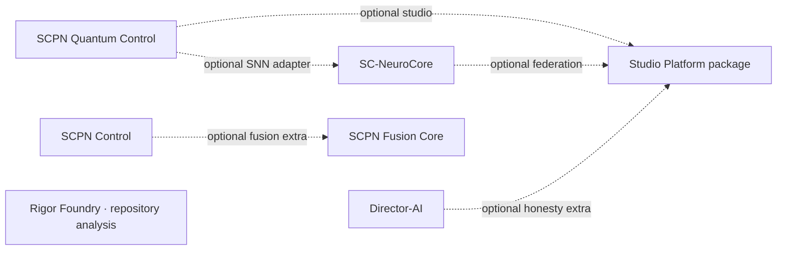

<!--
SPDX-License-Identifier: AGPL-3.0-or-later
Commercial licence available
© Concepts 1996–2026 Miroslav Šotek. All rights reserved.
© Code 2020–2026 Miroslav Šotek. All rights reserved.
ORCID: 0009-0009-3560-0851
Contact: www.anulum.li | protoscience@anulum.li
Personal GitHub profile overview
-->

  <picture>
    <source media="(prefers-color-scheme: dark)" srcset="assets/profile-header-dark.svg">
    <source media="(prefers-color-scheme: light)" srcset="assets/profile-header-light.svg">
    
  </picture>

  
  
  
  
  

  
  
  
  
  
  

  <a href="#projects">Projects</a> ·
  <a href="#current-focus">Current focus</a> ·
  <a href="#portfolio-ecosystem">Ecosystem</a> ·
  <a href="#research-output">Research output</a> ·
  <a href="#engineering-practice">Standards</a> ·
  <a href="#collaboration">Collaboration</a>

Independent researcher and systems engineer based in Switzerland, developing scientific software and a governed research organisation under the Anulum name. Five active groups cover reactor systems, integration and control, agentic coordination and assurance, neuromorphic computing, and quantum computing. A sixth group, Scientific Discovery and Experimentation, is in formation. Released software, architecture work, world-model development and intended hardware outputs have separate evidence boundaries. The research institute and company are offered for joint founding with partners.

<table>
  <tr>
    <td width="20%"><strong>The engine</strong> Agent coordination with receipts, evidence-bound review, claim grounding, auditable memory</td>
    <td width="20%"><strong>Reactor systems</strong> Reactor concept catalogue, 3D/CAD, level-0 physics, Reactor Studio</td>
    <td width="20%"><strong>Integration and control</strong> Studio Hub, control runtime, synchronisation analysis, fail-closed hardware gating</td>
    <td width="20%"><strong>Neuromorphic computing</strong> SNN Studio, Rust SIMD, Verilog RTL, FPGA synthesis</td>
    <td width="20%"><strong>Quantum computing</strong> Circuits on simulators and real hardware, result packs with raw counts</td>
  </tr>
</table>

## Start here

**[Projects](#projects)** for the software and its evidence ·
**[Papers](https://anulum.li/papers/)** for every publication and software
archive with BibTeX · **[Contact](mailto:protoscience@anulum.li)** for a
technical proposal. Cold readers: [anulum.li/start/](https://anulum.li/start/)
picks an entry point by profile. Every registered project, filterable by group,
reactor family and evidence, with a clickable map:
[anulum.li/portfolio/](https://anulum.li/portfolio/).

## Projects

Each card links to inspectable artefacts, not summary claims. Evidence links
are pinned to the commit they were verified at. Release and CI badges report
registry and workflow state; they are operational signals, not scientific-quality
scores.

<table>
  <tr>
    <td width="50%" valign="top"><strong><a href="https://github.com/anulum/synapse-channel">Synapse Channel</a></strong> · <strong>Usable now</strong> Control plane for coding-agent fleets: claims, roles, durable mailboxes, receipts, audit, and federation. <a href="https://anulum.github.io/synapse-channel/">Documentation</a> · <a href="https://github.com/anulum/synapse-channel/blob/dd65c898a9693b47fad051e3baa92cef07da2e63/VALIDATION.md">Validation</a> · <a href="https://github.com/anulum/synapse-channel/blob/dd65c898a9693b47fad051e3baa92cef07da2e63/docs/coordination-spec.md">Coordination specification</a> · <a href="https://github.com/anulum/synapse-channel/blob/dd65c898a9693b47fad051e3baa92cef07da2e63/docs/sandbox-threat-model.md">Threat model</a>  </td>
    <td width="50%" valign="top"><strong><a href="https://github.com/anulum/director-ai">Director-AI</a></strong> · <strong>Research active</strong> Real-time LLM guardrail: NLI/RAG grounding, claim review, native acceleration, optional claim-level streaming halt, declared capability boundaries. <a href="https://anulum.github.io/director-ai/">Documentation</a> · <a href="https://github.com/anulum/director-ai/blob/fc155051367bb48180f2f5dc92f4120c2549cddd/VALIDATION.md">Validation</a> · <a href="https://github.com/anulum/director-ai/blob/fc155051367bb48180f2f5dc92f4120c2549cddd/benchmarks/PUBLIC_BENCHMARKS.md">Public benchmarks</a> · <a href="https://github.com/anulum/director-ai/blob/fc155051367bb48180f2f5dc92f4120c2549cddd/docs/_generated/capability_matrix.md">Capability matrix</a>  </td>
  </tr>
  <tr>
    <td width="50%" valign="top"><strong><a href="https://github.com/anulum/rigor-foundry">Rigor Foundry</a></strong> · <strong>Usable now</strong> Evidence-bound repository inventory, audit candidates, review binding, and remediation planning. <a href="https://anulum.github.io/rigor-foundry/">Documentation</a>  </td>
    <td width="50%" valign="top"><strong><a href="https://github.com/anulum/remanentia">Remanentia</a></strong> · <strong>Usable now</strong> Auditable memory for AI agents and knowledge systems: hybrid retrieval, graphs, consolidation, CLI, MCP, and API surfaces. <a href="https://github.com/anulum/remanentia#readme">Documentation</a>  </td>
  </tr>
  <tr>
    <td width="50%" valign="top"><strong><a href="https://github.com/anulum/sc-neurocore">SC-NeuroCore</a></strong> · <strong>Research active</strong> Stochastic and neuromorphic framework: Python models, Rust SIMD paths, Verilog RTL, HDC/VSA, compiler surfaces, and hardware evidence. <a href="https://anulum.github.io/sc-neurocore/">Documentation</a> · <a href="https://github.com/anulum/sc-neurocore/blob/4bbc27b808eef0677848c1e484f40bd41e8ce83d/VALIDATION.md">Validation</a> · <a href="https://github.com/anulum/sc-neurocore/blob/4bbc27b808eef0677848c1e484f40bd41e8ce83d/docs/hardware/SYNTHESIS_RESULTS.md">Synthesis results</a> · <a href="https://github.com/anulum/sc-neurocore/blob/4bbc27b808eef0677848c1e484f40bd41e8ce83d/docs/safety/TRACEABILITY_MATRIX.md">Traceability matrix</a>  </td>
    <td width="50%" valign="top"><strong><a href="https://github.com/anulum/scpn-fusion-core">SCPN Fusion Core</a> · <a href="https://github.com/anulum/scpn-control">SCPN Control</a></strong> · <strong>Research active</strong> Tokamak physics, solvers, and validation campaigns with real-data paths (Fusion Core); control-grade runtime with fail-closed admission and replay evidence (Control). <a href="https://github.com/anulum/scpn-fusion-core/blob/3c841fc13109c8efb49bb079d145f70683a4408d/VALIDATION.md">Validation</a> · <a href="https://github.com/anulum/scpn-fusion-core/blob/3c841fc13109c8efb49bb079d145f70683a4408d/docs/VALIDATION_REAL_DIIID_145419.md">DIII-D validation record</a> · <a href="https://doi.org/10.5281/zenodo.18820864">Software DOI</a>   </td>
  </tr>
  <tr>
    <td width="50%" valign="top"><strong><a href="https://github.com/anulum/scpn-quantum-control">SCPN Quantum Control</a></strong> · <strong>Experimental</strong> Evidence-governed quantum simulation of coupled-oscillator synchronisation: protocols committed before the run, hardware result packs, raw counts, and explicit non-advantage boundaries. <a href="https://github.com/anulum/scpn-quantum-control/blob/2bc0f935b75ae7b85a4835caf754b2bfd8770c98/docs/layout_relaxation_preregistration.md">Layout-relaxation protocol</a> · <a href="https://github.com/anulum/scpn-quantum-control/blob/2bc0f935b75ae7b85a4835caf754b2bfd8770c98/docs/hardware_result_packs.md">Result-pack contract</a> · <a href="https://doi.org/10.5281/zenodo.18821929">Software DOI</a>  </td>
    <td width="50%" valign="top"><strong><a href="https://github.com/anulum/scpn-phase-orchestrator">SCPN Phase Orchestrator</a></strong> · <strong>Research active</strong> Evidence-first synchronisation analysis and review-only control proposals for coupled rhythmic systems; matched-false-alarm evaluation, negative results, and bounded transfer claims. <a href="https://github.com/anulum/scpn-phase-orchestrator/blob/1e9eea39fa6681dde2cfbdf074c08ff03a528b58/papers/submissions/README.md">Submission index</a> · <a href="https://doi.org/10.5281/zenodo.22113062">Negative-result preprint</a> · <a href="https://doi.org/10.5281/zenodo.22113116">Grid regime-map preprint</a>  </td>
  </tr>
</table>

| Label | Meaning |
|---|---|
| **Usable now** | Installable, documented, and CI-backed; still evolving |
| **Research active** | Real code and ongoing science; not a stability promise |
| **Experimental** | Exploratory; interfaces and claims are not fixed |
| **Evidence-bound** | Public claims are tied to measurements or artefacts |

## Current focus

Portfolio state verified <!-- verified-at -->2026-10-19<!-- /verified-at -->.

<table>
  <tr>
    <td width="33%"><strong>Reactor portfolio</strong> Consolidating shared kernels and governed device truth across 26 public reactor repositories.</td>
    <td width="33%"><strong>Agentic assurance</strong> Joining coordination, memory, response assurance, action review, and repository evidence without collapsing ownership boundaries.</td>
    <td width="33%"><strong>Research to hardware</strong> Carrying scientific models through native acceleration, formal checks, RTL, hardware runs, and inspectable result packs.</td>
  </tr>
</table>

<!-- profile-feeds:releases:start -->
### Latest releases

| Date | Project | Release | Change |
|---|---|---|---|
| 2026-10-13 | Synapse Channel | [v0.99.38](https://doi.org/10.5281/zenodo.23328518) | published software archive |
| 2026-10-13 | SYNAPSE CHANNEL | [v0.99.38](https://github.com/anulum/synapse-channel/releases/tag/v0.99.38) | Read-only delivery receipt projection joining the aggregate to its exact source event in one snapshot, with message/state binding, optional row MAC verification and SQLCipher key support. |
| 2026-10-02 | Synapse Channel | [v0.99.37](https://doi.org/10.5281/zenodo.23095056) | published software archive |
| 2026-10-02 | SYNAPSE CHANNEL | [v0.99.37](https://github.com/anulum/synapse-channel/releases/tag/v0.99.37) | Bind durable delivery decisions to the receiving hub, preserving the immutable request origin. Forwarded requests can expire and resolve replaced sessions; forwarded-only journals refuse startup under another hub identity. |
| 2026-10-01 | Loop Timing Witness | [v0.1.0](https://doi.org/10.5281/zenodo.23092361) | published host software |

Rendered from [anulum.li/news](https://anulum.li/news/) (the projects' CHANGELOG files) and [Zenodo](https://zenodo.org/search?q=creators.orcid%3A%220009-0009-3560-0851%22) on 2026-10-19.
<!-- profile-feeds:releases:end -->

<!-- profile-feeds:publication:start -->
### Latest publication

| Date | Type | Output | DOI |
|---|---|---|---|
| 2026-10-11 | Preprint | The calibration epoch as the unit of evidence: preregistered parity-leakage and layout-transfer experiments on IQM Garnet | [10.5281/zenodo.23298119](https://doi.org/10.5281/zenodo.23298119) |

Rendered from [anulum.li/news](https://anulum.li/news/) (the projects' CHANGELOG files) and [Zenodo](https://zenodo.org/search?q=creators.orcid%3A%220009-0009-3560-0851%22) on 2026-10-19.
<!-- profile-feeds:publication:end -->

## Timeline

| Period | Publicly supported milestone |
|---|---|
| 1996 onward | Self-published concept-development horizon across the broader research programme |
| 1998 | Founder role at ANULUM CH&LI begins in the self-entered public ORCID record |
| 2018 | Public GitHub account established |
| 2025 | Public SCPN previews, framework indexes, and technical reports deposited on Zenodo |
| 2026 | Public software and research portfolio expands across AI assurance, agent infrastructure, neuromorphic computing, plasma control, and quantum simulation |

Timeline entries distinguish registry facts from self-published chronology. They
do not imply academic affiliation, external validation, funding, or awards.

## How the stack is used

These arrows are declared optional software interfaces from the group architecture records, not a tested end-to-end scientific loop. Rigor Foundry provides repository analysis; it is shown without an invented runtime dependency. Each domain keeps model and hardware authority. Studio Platform is a published package with a private repository. The Phase Orchestrator grid modal-damping benchmark was withdrawn on 12 October 2026; this profile makes no real-grid or quantum-advantage claim.

## Portfolio ecosystem

<!-- profile-catalogue:inventory:start -->
**Dated inventory: 2026-10-15**

97 portfolio repositories: 37 public, 6 private, 54 locally initialised and unpublished. A further 42 catalogue entries describe packages, modules, workspaces or architecture destinations. All work is in progress.

Group declarations are dated 12–13 October; repository presence and public visibility were checked on 15 October 2026. Licence statements are source declarations, not a legal audit. Package publication and hardware qualification are separate.

  
  
  
  

<picture>
  <source media="(prefers-color-scheme: dark)" srcset="assets/ecosystem-map-dark.svg">
  <source media="(prefers-color-scheme: light)" srcset="assets/ecosystem-map-light.svg">
  
</picture>

The detailed atlas is integrated in this repository. Its 196 entries also include programmes, company needs, partner roles and funding routes; they are not 196 repositories. Use the atlas preview instructions for the interactive view. The existing website portfolio is maintained separately.

[Detailed atlas source and local preview](docs/atlas/README.md) · [anulum.li/portfolio/](https://anulum.li/portfolio/)

Technical scope descriptions below quote the English source records. A named destination is not a separately released capability. Shared items are counted once under their primary group.

<strong>01 · SCPN Reactor Systems</strong> · 55 repositories · 55 catalogue entries

55 owning repositories, including ATLAS-REACTORUM: 26 public and 29 locally initialised but unpublished. Fusion, fission, chemical and hybrid models, shared kernels, geometry and reactor evidence. World models, 3D simulations and device designs are programme outputs under development; a design is not a validated reactor.

[Group architecture maps](https://github.com/anulum/atlas-reactorum/blob/main/docs/ecosystem.md)

| Project / component | Role and development stage | Repository / availability | Declared licence | Source date |
|---|---|---|---|---|
| [ATLAS-REACTORUM](https://github.com/anulum/atlas-reactorum) Source and rights library with historical reactor taxonomy and interactive citation views. | In progress · tool · Implementation and integration | Public | AGPL-3.0-or-later | 2026-10-12 |
| SCPN-ADS-CORE Subcritical blanket plus typed external source/beam-target interface. | In progress · component · Architecture and qualification | Local, unpublished | AGPL-3.0-or-later | 2026-10-12 |
| [SCPN Beam Target Core](https://github.com/anulum/scpn-beam-target-core) Beam/target design and source-scoped reaction/stopping/yield. | In progress · component · Computational prototypes and continued development | Public | AGPL-3.0-or-later | 2026-10-12 |
| SCPN-BIOCHEM-CORE Source-specific enzyme/fermentation kinetics and reactor transport. | In progress · component · Architecture and qualification | Local, unpublished | AGPL-3.0-or-later | 2026-10-12 |
| SCPN-BREED-BURN-CORE Source-bounded breed-and-burn fuel-management concept. | In progress · component · Architecture and qualification | Local, unpublished | AGPL-3.0-or-later | 2026-10-12 |
| SCPN-BWR-CORE Boiling-channel thermal-spectrum family and void-feedback boundary. | In progress · component · Architecture and qualification | Local, unpublished | AGPL-3.0-or-later | 2026-10-12 |
| SCPN-CATALYTIC-BED-CORE Fixed-bed catalyst/transport/pressure-drop coupling. | In progress · component · Architecture and qualification | Local, unpublished | AGPL-3.0-or-later | 2026-10-12 |
| SCPN-CHANNEL-CORE Graphite-moderated channel reactor only; exclusive from PHWR pressure tubes. | In progress · component · Architecture and qualification | Local, unpublished | AGPL-3.0-or-later | 2026-10-12 |
| SCPN-CHEM-KINETICS-CORE Ideal gas batch/CSTR/PFR named kinetics and thermo models. | In progress · component · Architecture and qualification | Local, unpublished | AGPL-3.0-or-later | 2026-10-12 |
| SCPN-CHEM-PROCESS-HYBRID-CORE Chemical process/recycle/separation and carbon-capture composition. | In progress · component · Architecture and qualification | Local, unpublished | AGPL-3.0-or-later | 2026-10-12 |
| [SCPN Dense Plasma Focus Core](https://github.com/anulum/scpn-dense-plasma-focus-core) Focus device/bank/axial/radial/pinch and source-scoped neutron estimates. | In progress · component · Computational prototypes and continued development | Public | AGPL-3.0-or-later | 2026-10-12 |
| SCPN-ELECTROCHEM-CORE Electrode/cell transport and charge/reaction interface. | In progress · component · Architecture and qualification | Local, unpublished | AGPL-3.0-or-later | 2026-10-12 |
| [SCPN FRC Core](https://github.com/anulum/scpn-frc-core) Field-reversed configuration, radial pressure-balance and kinetic-scale model. | In progress · component · Computational prototypes and continued development | Public | AGPL-3.0-or-later | 2026-10-12 |
| [SCPN Fusion Core](https://github.com/anulum/scpn-fusion-core) Canonical plasma solver mathematics, transport/equilibrium and existing research pipeline. | In progress · package · Released software · ongoing development | Public | AGPL-3.0-or-later | 2026-10-12 |
| [SCPN Fusion-Fission Hybrid Core](https://github.com/anulum/scpn-fusion-fission-hybrid-core) Existing source-owned fusion/fission blanket device and proposed typed member couplings. | In progress · component · Computational prototypes and continued development | Public | AGPL-3.0-or-later | 2026-10-12 |
| SCPN-FUSION-PROCESS-HEAT-CORE Fusion-source to chemical-process heat/material composition. | In progress · component · Architecture and qualification | Local, unpublished | AGPL-3.0-or-later | 2026-10-12 |
| SCPN-GFR-CORE Gas-cooled fast-spectrum family with high-temperature heat-removal boundary. | In progress · component · Architecture and qualification | Local, unpublished | AGPL-3.0-or-later | 2026-10-12 |
| SCPN-HEAT-PIPE-CORE Solid-core heat-pipe microreactor and source-defined transport limits. | In progress · component · Architecture and qualification | Local, unpublished | AGPL-3.0-or-later | 2026-10-12 |
| SCPN-HTGR-CORE Graphite/TRISO helium-cooled design and distinct process-heat interface. | In progress · component · Architecture and qualification | Local, unpublished | AGPL-3.0-or-later | 2026-10-12 |
| SCPN-HYBRID-ENERGY-CORE Fission/renewable/storage electrical and thermal composition. | In progress · component · Architecture and qualification | Local, unpublished | AGPL-3.0-or-later | 2026-10-12 |
| SCPN-HYDROGEN-PROCESS-CORE HTSE and named thermochemical hydrogen process routes. | In progress · component · Architecture and qualification | Local, unpublished | AGPL-3.0-or-later | 2026-10-12 |
| [SCPN ICF Beam Core](https://github.com/anulum/scpn-icf-beam-core) Particle-beam illumination/capsule design with explicit coupling. | In progress · component · Computational prototypes and continued development | Public | AGPL-3.0-or-later | 2026-10-12 |
| [SCPN ICF Impact Core](https://github.com/anulum/scpn-icf-impact-core) Impact/projectile/fuel/compression design and source-limited energy relations. | In progress · component · Computational prototypes and continued development | Public | AGPL-3.0-or-later | 2026-10-12 |
| [SCPN ICF Laser Core](https://github.com/anulum/scpn-icf-laser-core) Laser-driven capsule/implosion design and source-scoped ignition/gain criteria. | In progress · component · Computational prototypes and continued development | Public | AGPL-3.0-or-later | 2026-10-12 |
| [SCPN IEC Core](https://github.com/anulum/scpn-iec-core) Gridded electrostatic device and distinct nonthermal loss/recirculation models. | In progress · component · Computational prototypes and continued development | Public | AGPL-3.0-or-later | 2026-10-12 |
| [SCPN Lattice Fusion Core](https://github.com/anulum/scpn-lattice-fusion-core) Source-bounded lattice-confinement fusion research and modelling. | In progress · component · Architecture and qualification | Public | AGPL-3.0-or-later | 2026-10-12 |
| [SCPN Levitated Dipole Core](https://github.com/anulum/scpn-levitated-dipole-core) Dipole coil/levitation/charging and anisotropic plasma model. | In progress · component · Computational prototypes and continued development | Public | AGPL-3.0-or-later | 2026-10-12 |
| SCPN-LFR-CORE Lead/LBE fast-spectrum family with materials/corrosion boundary. | In progress · component · Architecture and qualification | Local, unpublished | AGPL-3.0-or-later | 2026-10-12 |
| [SCPN Magnetic Cusp Core](https://github.com/anulum/scpn-magnetic-cusp-core) Cusp coil/configuration ownership and source-specific field/particle-loss model proposal. | In progress · component · Computational prototypes and continued development | Public | AGPL-3.0-or-later | 2026-10-12 |
| SCPN-MEMBRANE-CORE Reaction-separation with explicit membrane transport. | In progress · component · Architecture and qualification | Local, unpublished | AGPL-3.0-or-later | 2026-10-12 |
| SCPN-METHANE-REFORMER-CORE Steam-methane reforming kinetics and process train. | In progress · component · Architecture and qualification | Local, unpublished | AGPL-3.0-or-later | 2026-10-12 |
| [SCPN MIF Core](https://github.com/anulum/scpn-mif-core) Existing magneto-inertial dynamics/runtime with maintained multi-language/RTL chain. | In progress · package · Released software · ongoing development | Public | AGPL-3.0-or-later | 2026-10-12 |
| [SCPN MIF Liner Core](https://github.com/anulum/scpn-mif-liner-core) Mechanical/magnetic liner compression and target-energy coupling. | In progress · component · Computational prototypes and continued development | Public | AGPL-3.0-or-later | 2026-10-12 |
| [SCPN MIF MagLIF Core](https://github.com/anulum/scpn-mif-maglif-core) Magnetised liner drive/preheat/compression family. | In progress · component · Computational prototypes and continued development | Public | AGPL-3.0-or-later | 2026-10-12 |
| [SCPN MIF Plasma Jet Core](https://github.com/anulum/scpn-mif-plasma-jet-core) Discrete plasma-jet array and spherical liner convergence. | In progress · component · Computational prototypes and continued development | Public | AGPL-3.0-or-later | 2026-10-12 |
| [SCPN Mirror Core](https://github.com/anulum/scpn-mirror-core) Mirror/tandem confinement and source-specific flux-tube geometry. | In progress · component · Computational prototypes and continued development | Public | AGPL-3.0-or-later | 2026-10-12 |
| SCPN-MSR-CORE Liquid-fuel molten-salt family with chemistry, circulation and depletion. | In progress · component · Architecture and qualification | Local, unpublished | AGPL-3.0-or-later | 2026-10-12 |
| [SCPN Muon Fusion Core](https://github.com/anulum/scpn-muon-fusion-core) Muon-catalysed reaction models and complete energy accounting. | In progress · component · Architecture and qualification | Public | AGPL-3.0-or-later | 2026-10-12 |
| SCPN-NTP-CORE Reactor-side thermal propulsion and typed heat/flow interface. | In progress · component · Architecture and qualification | Local, unpublished | AGPL-3.0-or-later | 2026-10-12 |
| SCPN-NUCLEAR-DESALINATION-CORE Fission-to-desalination thermal/material composition. | In progress · component · Architecture and qualification | Local, unpublished | AGPL-3.0-or-later | 2026-10-12 |
| SCPN-NUCLEAR-HYDROGEN-CORE Typed fission-to-hydrogen thermal/electrical/material composition. | In progress · component · Architecture and qualification | Local, unpublished | AGPL-3.0-or-later | 2026-10-12 |
| SCPN-PHOTOCATALYTIC-CORE Photon-flux-driven reaction and optical/source coupling. | In progress · component · Architecture and qualification | Local, unpublished | AGPL-3.0-or-later | 2026-10-12 |
| SCPN-PHWR-CORE Heavy-water pressure-tube family with on-power fuel management. | In progress · component · Architecture and qualification | Local, unpublished | AGPL-3.0-or-later | 2026-10-12 |
| SCPN-PWR-CORE Light-water moderated/cooled vessel and primary-circuit design. | In progress · component · Architecture and qualification | Local, unpublished | AGPL-3.0-or-later | 2026-10-12 |
| SCPN-REACTOR-CATALOGUE Evidence-labelled source-authority catalogue, candidate revision/history and vocabulary. | In progress · component · Architecture and qualification | Local, unpublished | AGPL-3.0-or-later | 2026-10-12 |
| [SCPN Reactor Kernels](https://github.com/anulum/scpn-reactor-kernels) Shared equations, numerical primitives and geometry/CAD/export substrate. | In progress · package · Implementation and integration | Public | AGPL-3.0-or-later | 2026-10-12 |
| SCPN-RESEARCH-REACTOR-CORE Research/isotope-production core including separately supported pulse operation. | In progress · component · Architecture and qualification | Local, unpublished | AGPL-3.0-or-later | 2026-10-12 |
| [SCPN RFP Core](https://github.com/anulum/scpn-rfp-core) Reversed-field pinch relaxation/profile and toroidal device design. | In progress · component · Computational prototypes and continued development | Public | AGPL-3.0-or-later | 2026-10-12 |
| SCPN-SCWR-CORE Supercritical-water family with explicit thermophysical transition support. | In progress · component · Architecture and qualification | Local, unpublished | AGPL-3.0-or-later | 2026-10-12 |
| SCPN-SFR-CORE Sodium-cooled fast-spectrum family and fuel/material/heat-removal boundary. | In progress · component · Architecture and qualification | Local, unpublished | AGPL-3.0-or-later | 2026-10-12 |
| [SCPN Spheromak Core](https://github.com/anulum/scpn-spheromak-core) Relaxed compact-torus configuration, flux conserver and formation criteria. | In progress · component · Computational prototypes and continued development | Public | AGPL-3.0-or-later | 2026-10-12 |
| [SCPN Stellarator Core](https://github.com/anulum/scpn-stellarator-core) Three-dimensional magnetic-confinement configuration and coil/design ownership. | In progress · component · Computational prototypes and continued development | Public | AGPL-3.0-or-later | 2026-10-12 |
| [SCPN Theta Pinch Core](https://github.com/anulum/scpn-theta-pinch-core) Axial-field compression and pinch configuration with sharp-boundary model. | In progress · component · Computational prototypes and continued development | Public | AGPL-3.0-or-later | 2026-10-12 |
| [SCPN Tokamak Core](https://github.com/anulum/scpn-tokamak-core) Own tokamak physical modelling and reactor-design geometry, with explicitly qualified canonical plasma-solver dependencies. | In progress · component · Computational prototypes and continued development | Public | AGPL-3.0-or-later | 2026-10-12 |
| [SCPN Z-Pinch Core](https://github.com/anulum/scpn-z-pinch-core) Current-driven pinch, sheared-flow model and pulsed device design. | In progress · component · Computational prototypes and continued development | Public | AGPL-3.0-or-later | 2026-10-12 |

**Reactor family portals**: [reactor-systems](https://anulum.li/reactor-systems/) · [compare.html](https://anulum.li/reactor-systems/compare.html) · [closed-magnetic](https://anulum.li/reactor-systems/closed-magnetic/) · [open-magnetic](https://anulum.li/reactor-systems/open-magnetic/) · [pinches](https://anulum.li/reactor-systems/pinches/) · [inertial](https://anulum.li/reactor-systems/inertial/) · [magneto-inertial](https://anulum.li/reactor-systems/magneto-inertial/) · [electrostatic-hybrid](https://anulum.li/reactor-systems/electrostatic-hybrid/)

<strong>02 · SCPN Systems Integration and Control</strong> · 4 repositories · 4 catalogue entries

Four products of equal standing. Control and Phase Orchestrator are public; Studio Hub and the Studio Platform repository are private. The public scpn-studio-platform package is available separately. Declared Studio interfaces do not prove tested federation.

| Project / component | Role and development stage | Repository / availability | Declared licence | Source date |
|---|---|---|---|---|
| [SCPN Phase Orchestrator](https://github.com/anulum/scpn-phase-orchestrator) Synchronisation analysis and evaluation of early-warning detectors on coupled phase-oscillator dynamics, with a Rust kernel. | In progress · package · Released software · ongoing development | Public | AGPL-3.0-or-later | 2026-10-13 |
| [SCPN Control](https://github.com/anulum/scpn-control) Compiler from stochastic Petri nets to controllers with runtime contracts, and plasma-control research paths. | In progress · package · Released software · ongoing development | Public | AGPL-3.0-or-later | 2026-10-13 |
| SCPN Studio Platform Domain-neutral SDK for studios: evidence bundles, capability manifests, bounded jobs and tenant-aware identity. | In progress · package · Released software · ongoing development | Private | AGPL-3.0-or-later | 2026-10-13 |
| SCPN Studio The hub that federates studios over the platform contract: registry, cross-studio evidence audit, rendering and federation gating. | In progress · service · Implementation and integration | Private | AGPL-3.0-or-later | 2026-10-13 |

<strong>03 · Agentic Coordination, Assurance and Continuity</strong> · 10 repositories · 10 catalogue entries

Ten repositories covering coordination, assurance, memory and governed action. HushLine is a group tool; SYNAPSE-POLICY-CHECK-ACTION is included. Each product keeps its own licence and capability boundary.

[Group architecture maps](https://github.com/anulum/synapse-channel/blob/main/docs/ecosystem.md)

| Project / component | Role and development stage | Repository / availability | Declared licence | Source date |
|---|---|---|---|---|
| [Synapse Channel](https://github.com/anulum/synapse-channel) Local-first coordination bus for AI agents: presence, file-scope work claims, messages, task status, receipts and an audit journal on one hub. | In progress · package · Released software · ongoing development | Public | AGPL-3.0-or-later | 2026-10-11 |
| Synapse Channel Fleet Multi-machine operation of the bus: durable follower daemon, per-peer trust and configuration, claim forwarding and diagnostics. | In progress · package · Implementation and integration | Private | LicenseRef-SYNAPSE-Enterprise | 2026-10-11 |
| [SYNAPSE-POLICY-CHECK-ACTION](https://github.com/anulum/synapse-policy-check-action) GitHub Action that checks a SYNAPSE CHANNEL release receipt against a policy file in CI. | In progress · tool · Implementation and integration | Public | AGPL-3.0-or-later | 2026-10-11 |
| [Director-AI](https://github.com/anulum/director-ai) Response-level guardrail for LLM output: NLI and retrieval grounding, sealed evidence packets and an optional streaming contradiction halt. | In progress · package · Released software · ongoing development | Public | Apache-2.0 AND BUSL-1.1 | 2026-10-11 |
| Director Class AI Action control between an autonomous agent and its effectors: action-policy checks, human approvals, gateway enforcement and tamper-evident action evidence. | In progress · package · Implementation and integration | Private | BUSL-1.1 | 2026-10-11 |
| Director AI Cloud Control plane for a hosted Director-AI API: accounts, API-key lifecycle, usage metering, plan quotas and operator exports. | In progress · service · Implementation and integration | Private | BUSL-1.1 | 2026-10-11 |
| [Rigor Foundry](https://github.com/anulum/rigor-foundry) Evidence-bound repository auditing: inventories Git-tracked content, emits reproducible audit candidates, binds review decisions to exact evidence and prepares remediation inputs. | In progress · package · Released software · ongoing development | Public | Apache-2.0 | 2026-10-11 |
| [Remanentia](https://github.com/anulum/remanentia) Local-first, auditable memory for AI agents and knowledge-intensive software: project-file indexing, hybrid retrieval, consolidation and an entity graph, through a CLI, an MCP server and an HTTP API. | In progress · package · Released software · ongoing development | Public | AGPL-3.0-or-later | 2026-10-11 |
| Remanentia Portal Account and billing or licence-request portal for the product family. It runs no customer workload. | In progress · service · Implementation and integration | Private | AGPL-3.0-or-later | 2026-10-11 |
| [HushLine](https://github.com/anulum/HushLine) Local command-output filter: runs a command, then limits, shapes and redacts its output before it reaches a caller. Four independent cores: Go, Rust, Python and Node. | In progress · tool · Released software · ongoing development | Public | AGPL-3.0-or-later | 2026-10-11 |

<strong>04 · SC Neuromorphic Computing Systems</strong> · 4 repositories · 42 catalogue entries

The core inventory has 40 named entries including the permanent SC-NeuroCore workbench and its supporting tools; two additional module/conditional destinations bring the catalogue to 42 entries. LOOP-TIMING-WITNESS has a public host package; physical board qualification remains pending. EVIDENCE-MANIFEST-TOOLKIT is unpublished. Named modules and deferred destinations are labelled separately.

[Group architecture maps](https://github.com/anulum/sc-neurocore/blob/main/docs/ecosystem.md)

| Project / component | Role and development stage | Repository / availability | Declared licence | Source date |
|---|---|---|---|---|
| [SC-NeuroCore](https://github.com/anulum/sc-neurocore) Permanent public development, composition and integration workbench for stochastic and spiking neural modelling, encoding, learning, simulation, selected hardware compilation and evidence inspection. | In progress · workbench · Released software · ongoing development | Public | AGPL-3.0-or-later | 2026-10-13 |
| [Loop Timing Witness](https://github.com/anulum/loop-timing-witness) Fabric-clock instrument for complete control-loop and selected accelerator timing, with simulation/host analysis separated from eventual board timing, fault response and rail-energy evidence. | In progress · tool · Architecture and qualification | Public | AGPL-3.0-or-later | 2026-10-13 |
| EVIDENCE-MANIFEST-TOOLKIT Canonicalises, references, seals and verifies evidence with explicit schemas, bounded sources and independently selected policy. | In progress · shared · Architecture and qualification | Local, unpublished | AGPL-3.0-or-later | 2026-10-13 |
| RANDOMNESS-WITNESS Assesses number-source suitability for a declared stochastic-computing use; it does not certify randomness for every purpose. | In progress · shared · Design and preparation | Destination / module / package | undecided | 2026-10-13 |
| EXPERIMENT-LEDGER Records experiment lineage across tools without owning their raw evidence or running their computations. | In progress · shared · Design and preparation | Destination / module / package | undecided | 2026-10-13 |
| SC-NC-CORE Neuron/synapse primitives, network graph, simulation loop, fixed-point semantics, constants and exceptions. | In progress · component · Workbench transition | Destination / module / package | Undecided for independent release | 2026-10-13 |
| SC-NC-CATALOGUE Neuron models, model zoo and topology/connectome generators. | In progress · component · Workbench transition | Destination / module / package | Undecided for independent release | 2026-10-13 |
| SC-NC-ENGINE Accelerated execution and its maintained language/native interfaces. | In progress · component · Workbench transition | Destination / module / package | Undecided for independent release | 2026-10-13 |
| SC-NC-BRIDGES Interchange and cross-domain adapters including NIR, quantum, HDC/VSA and neuro-symbolic routes. | In progress · component · Workbench transition | Destination / module / package | Undecided for independent release | 2026-10-13 |
| SC-NC-LEARN Training and adaptation, including surrogate gradients, plasticity, online learning, quantisation-aware training and distillation. | In progress · component · Workbench transition | Destination / module / package | Undecided for independent release | 2026-10-13 |
| SC-NC-DATA Datasets, signal/event encoding, augmentation, codecs, sources and recording adapters. | In progress · component · Workbench transition | Destination / module / package | Undecided for independent release | 2026-10-13 |
| SC-NC-ANALYSIS Spike-train analysis, visualisation and explainability. | In progress · component · Workbench transition | Destination / module / package | Undecided for independent release | 2026-10-13 |
| SC-NC-COMPILER Equation/IR lowering and hardware collateral for supported numerical models. | In progress · component · Workbench transition | Destination / module / package | Undecided for independent release | 2026-10-13 |
| SC-NC-HARDWARE Target profiles, mapping, deployment, drivers and power/thermal integration. | In progress · component · Workbench transition | Destination / module / package | Undecided for independent release | 2026-10-13 |
| SC-NC-VERIFY Formal, fault, resilience and safety-readiness verification within explicit proof scopes. | In progress · component · Workbench transition | Destination / module / package | Undecided for independent release | 2026-10-13 |
| SC-NC-STUDIO Visual composition, inspection and evidence presentation workflows. | In progress · component · Workbench transition | Destination / module / package | Undecided for independent release | 2026-10-13 |
| SC-NC-RESEARCH Retained experimental paths, including evolutionary, biological and world-model directions. | In progress · component · Workbench transition | Destination / module / package | Undecided for independent release | 2026-10-13 |
| SC-NC-BENCH Catalogue/workload suites and immutable source-bound benchmark records. | In progress · component · Workbench transition | Destination / module / package | Undecided for independent release | 2026-10-13 |
| MODEL-PROVENANCE-PACK Binds a model's data, training, conversion, quantisation, encoding and supporting evidence into a verifiable provenance pack. | In progress · tool · Design and implementation | Destination / module / package | Undecided for independent release | 2026-10-13 |
| SPIKE-LOG Records, indexes, verifies, slices and replays event streams without losing their provenance or timebase identity. | In progress · tool · Design and implementation | Local, unpublished | Undecided for independent release | 2026-10-13 |
| SPIKE-FORMAT-BRIDGE Converts event recordings between declared formats and reports every permitted loss rather than hiding timestamp, polarity or side-stream changes. | In progress · tool · Design and implementation | Destination / module / package | Undecided for independent release | 2026-10-13 |
| SPIKE-CODEC-BENCH Measures compression of existing spike trains, comparing payload ratio, distortion, encode/decode latency and memory. | In progress · tool · Design and implementation | Destination / module / package | Undecided for independent release | 2026-10-13 |
| SPIKE-ENCODER-CHARACTERISER Measures the information, spike-rate and latency trade-offs of sensor-to-spike encoders. | In progress · tool · Design and implementation | Destination / module / package | Undecided for independent release | 2026-10-13 |
| SPIKE-QUALITY-GATE Checks event data against a named quality policy for timestamp, noise, sensor-health, rate, gap and spatial defects. | In progress · tool · Design and implementation | Destination / module / package | Undecided for independent release | 2026-10-13 |
| SPIKE-GROUNDTRUTH Generates reproducible event-vision, audio, sensor and control stimuli with ground truth defined by the generator. | In progress · tool · Design and implementation | Destination / module / package | Undecided for independent release | 2026-10-13 |
| SNN-DIVERGENCE-HARNESS Compares the same network and input across implementations under bit-exact, tolerance or statistical oracles. | In progress · tool · Design and implementation | Destination / module / package | Undecided for independent release | 2026-10-13 |
| SC-STREAM-PROVER Compares realised stochastic-computing arithmetic error with a declared bound for a specific circuit, source and stream-length regime. | In progress · tool · Design and implementation | Destination / module / package | Undecided for independent release | 2026-10-13 |
| MUTATION-SNN Measures test adequacy by generating declared semantic mutants and recording what the suite detects. | In progress · tool · Design and implementation | Destination / module / package | Undecided for independent release | 2026-10-13 |
| NIR-CONFORMANCE Tests importer/exporter behaviour against the known semantics of a pinned Neuromorphic Intermediate Representation version. | In progress · tool · Design and implementation | Destination / module / package | Undecided for independent release | 2026-10-13 |
| NEURO-EVIDENCE-BENCH Executes declared neuromorphic benchmark plans and traces each scoped result back to its raw evidence. | In progress · tool · Design and implementation | Destination / module / package | Undecided for independent release | 2026-10-13 |
| SPIKE-CALIBRATOR Measures classifier confidence against correctness under declared signal definitions, shifts and placements. | In progress · tool · Design and implementation | Destination / module / package | Undecided for independent release | 2026-10-13 |
| BITSTREAM-EVIDENCE-CI Captures pinned FPGA build inputs, reports and bitstream identity in a reproducibility-aware chained build ledger. | In progress · tool · Design and implementation | Destination / module / package | Undecided for independent release | 2026-10-13 |
| PLASTICITY-WITNESS Compares observed learning-rule updates with an independently defined fixed-point or statistical oracle under stated spike/load/fault protocols. | In progress · tool · Design and implementation | Destination / module / package | Undecided for independent release | 2026-10-13 |
| AER-LINK-WITNESS Measures event-link behaviour under load, including loss, reordering, fairness, starvation and forward progress. | In progress · tool · Design and implementation | Destination / module / package | Undecided for independent release | 2026-10-13 |
| RELIABILITY-WITNESS Characterises reliability within a declared physical or explicitly simulated exposure, retaining conditions, gaps and rare-event uncertainty. | In progress · tool · Design and implementation | Destination / module / package | Undecided for independent release | 2026-10-13 |
| SIM-REAL-WITNESS Quantifies simulation-to-fabric differences for the same model, input and observable population. | In progress · tool · Design and implementation | Destination / module / package | Undecided for independent release | 2026-10-13 |
| DEPLOY-PACK Composes validated deployment evidence with bitstream/driver identity into a verifiable install/update package. | In progress · tool · Design and implementation | Destination / module / package | Undecided for independent release | 2026-10-13 |
| FIELD-OPS-WITNESS Aggregates compact field health and drift evidence against deployment-time envelopes without actuating devices. | In progress · tool · Design and implementation | Destination / module / package | Undecided for independent release | 2026-10-13 |
| FLIGHT-RECORDER Retains a bounded per-device event/state history for gap-honest incident reconstruction. | In progress · tool · Design and implementation | Destination / module / package | Undecided for independent release | 2026-10-13 |
| NEURO-SAFETY-CASE Composes scoped evidence and open gaps into an assessor-facing assurance argument; it certifies nothing itself. | In progress · tool · Design and implementation | Destination / module / package | Undecided for independent release | 2026-10-13 |
| SC-COMPUTE-ADAPTERS Owns the SC-NeuroCore-side wrappers and numerical/register/handshake contracts needed to put selected generated peripherals into the independent LOOP-TIMING-WITNESS DUT/capture path. | In progress · workbench module · Architecture and interface work | Destination / module / package | Independent distribution terms being defined | 2026-10-13 |
| SC-NC-BIO Conditional destination for separately owned biological/biohybrid work if its independent release lifecycle is accepted; current experimental bioware remains in the developmental parent. | In progress · conditional architecture destination · Architecture and interface work | Destination / module / package | Independent distribution terms being defined | 2026-10-13 |

<strong>05 · SCPN Quantum Computing Systems</strong> · 24 repositories · 28 catalogue entries

Permanent SCPN-QUANTUM-CONTROL workbench; oscillatools and SCPN-QUANTUM-ENGINE are separate distributions, not extra workbenches. Sixteen component destinations and eight tool destinations are being developed; QUANTUM_LAB is a workspace. Independent package licences and releases remain separate from the parent.

[Group architecture maps](https://github.com/anulum/scpn-quantum-control/blob/main/docs/ecosystem.md)

| Project / component | Role and development stage | Repository / availability | Declared licence | Source date |
|---|---|---|---|---|
| [SCPN Quantum Control](https://github.com/anulum/scpn-quantum-control) Integrated modelling, simulation, compilation, gradients, control, provider workflows, analysis and Quantum Studio. | In progress · workbench · Released software · ongoing development | Public | AGPL-3.0-or-later | 2026-10-13 |
| oscillatools Classical coupled-phase-oscillator dynamics, observables, sensitivities and control-oriented numerical tools. | In progress · package · Released software · ongoing development | Destination / module / package | AGPL-3.0-or-later | 2026-10-13 |
| scpn-quantum-engine Optional Rust/PyO3 numerical acceleration and native computation used by supported workbench paths. | In progress · package · Released software · ongoing development | Destination / module / package | AGPL-3.0-or-later | 2026-10-13 |
| QPU-RESULT-PACK Preserve raw results and their provenance, derivations and reviewable presentation. | In progress · tool · Implementation and integration | Local, unpublished | not stated | 2026-10-13 |
| TRANSPILE-WITNESS Retain scoped observations about compilation semantics, layout, global phase and replay. | In progress · tool · Implementation and integration | Destination / module / package | AGPL-3.0-or-later by file headers; no licence field in packaging | 2026-10-13 |
| MITIGATION-WITNESS Evaluate mitigation on declared measurement panels with retained inputs and uncertainty. | In progress · tool · Implementation and integration | Local, unpublished | AGPL-3.0-or-later | 2026-10-13 |
| SCPN-QC-CONTRACTS Versioned parameter, result, semantic and evidence interface contracts shared by components. | In progress · component · Workbench transition | Local, unpublished | Undecided for independent release | 2026-10-13 |
| SCPN-QC-CORE Configuration, logging, resource budgets and generic Kuramoto-XY problem foundations, separated from paper-specific research assumptions. | In progress · component · Workbench transition | Local, unpublished | Undecided for independent release | 2026-10-13 |
| SCPN-QC-AD Whole-program automatic differentiation, derivative transforms, batching, optimisation and explicit supported-path contracts. | In progress · component · Workbench transition | Local, unpublished | Undecided for independent release | 2026-10-13 |
| SCPN-QC-SIM Classical and quantum oscillator dynamics, XY/Kuramoto solvers, open-system simulation, tensor-network paths and co-simulation. | In progress · component · Workbench transition | Local, unpublished | Undecided for independent release | 2026-10-13 |
| SCPN-QC-COMPILER Model and circuit frontends, intermediate representations, interchange and code generation. | In progress · component · Workbench transition | Local, unpublished | Undecided for independent release | 2026-10-13 |
| SCPN-QC-QNODE Quantum tapes, gradient execution and framework bridges for supported Qiskit, PennyLane, JAX, PyTorch and TensorFlow paths. | In progress · component · Workbench transition | Local, unpublished | Undecided for independent release | 2026-10-13 |
| SCPN-QC-HAL Provider-neutral workloads, capabilities, job/result contracts and optional provider adapters. | In progress · component · Workbench transition | Local, unpublished | Undecided for independent release | 2026-10-13 |
| SCPN-QC-MITIGATION Error-mitigation implementations and their method taxonomy. | In progress · component · Workbench transition | Local, unpublished | Undecided for independent release | 2026-10-13 |
| SCPN-QC-QEC Quantum error-correction analysis and fault-tolerant resource-reporting surfaces. | In progress · component · Workbench transition | Local, unpublished | Undecided for independent release | 2026-10-13 |
| SCPN-QC-CONTROL Feedback and co-design, chimera and topology-aware control, and DLA-constrained control paths. | In progress · component · Workbench transition | Local, unpublished | Undecided for independent release | 2026-10-13 |
| SCPN-QC-ANALYSIS Observables, synchronisation witnesses, result analysis and the open-data DLA-parity pathway. | In progress · component · Workbench transition | Local, unpublished | Undecided for independent release | 2026-10-13 |
| SCPN-QC-LEARN Forecasting, quantum neural models, surrogate models, kernels and variational learning paths. | In progress · component · Workbench transition | Local, unpublished | Undecided for independent release | 2026-10-13 |
| SCPN-QC-APPS Domain application adapters, quantum randomness, cryptography and sensing workflows, with explicit claim boundaries. | In progress · component · Workbench transition | Local, unpublished | Undecided for independent release | 2026-10-13 |
| SCPN-QC-BENCH Workload-specific benchmark suites, comparison harnesses, campaign reproduction and retained run evidence. | In progress · component · Workbench transition | Local, unpublished | Undecided for independent release | 2026-10-13 |
| SCPN-QC-STUDIO Quantum Studio's visual workflows, inspectors and evidence presentation through the shared Studio platform contract. | In progress · component · Workbench transition | Local, unpublished | Undecided for independent release | 2026-10-13 |
| SCPN-QC-RESEARCH Experimental SCPN theory, paper-specific assumptions and research adapters whose contracts are not stable. | In progress · component · Workbench transition | Local, unpublished | Undecided for independent release | 2026-10-13 |
| NOISE-MODEL-WITNESS Compare model predictions and replay observations for the same circuit and shot identities, with uncertainty, shot floors, calibration epochs and declared tolerances. | In progress · tool · Design and implementation | Local, unpublished | Undecided for independent release | 2026-10-13 |
| VENDOR-CLAIM-RECOMPUTER Recompute released-data quantum-volume, error-per-layer-gate and logical-error claims against fixed definitions, original inputs and declared computation budgets. | In progress · tool · Design and implementation | Local, unpublished | Undecided for independent release | 2026-10-13 |
| DECODER-WITNESS Compare real decoder engines on released shot data with lossless adapters, declared noise conditions and uncertainty-aware reports. | In progress · tool · Design and implementation | Local, unpublished | Undecided for independent release | 2026-10-13 |
| GRADIENT-WITNESS Check software derivatives against declared analytic, parameter-shift and finite-difference references, including complex, finite-shot and cross-framework cases. | In progress · tool · Design and implementation | Local, unpublished | Undecided for independent release | 2026-10-13 |
| CONFORMANCE-WITNESS Check versioned OpenQASM 3, adapter behaviour, provenance fields and repository-evidence criteria against their normative clauses and actual entry points. | In progress · tool · Design and implementation | Local, unpublished | Undecided for independent release | 2026-10-13 |
| QUANTUM_LAB Reserved research workspace name; implementation role is not assigned in the group map. | In progress · workspace · Workspace definition | Destination / module / package | Not stated | 2026-10-13 |

↔ EVIDENCE-MANIFEST-TOOLKIT · RANDOMNESS-WITNESS · EXPERIMENT-LEDGER

<strong>06 · Scientific Discovery and Experimentation</strong> · 0 repositories · 0 catalogue entries

Registered 12 October 2026; in formation; zero registered projects and repositories. Owns hypothesis → experiment → check → record → model-update proposals and the shared benchmark/report format. Domain models, hardware and execution authority remain with the owning groups. No completed discovery loop is claimed.

**Additional public research record**

Fusion Equilibrium Challenge is a public reproduction package created on 14 October 2026, after the group inventory. It is listed separately to preserve the dated group totals. Results and limitations belong to its own record.

- [Fusion Equilibrium Challenge](https://github.com/anulum/fusion-equilibrium-challenge) · In progress · AGPL-3.0-or-later · 2026-10-15
<!-- profile-catalogue:inventory:end -->

## Sponsorship goals

Open work here is funded through [GitHub Sponsors](https://github.com/sponsors/anulum).
About **USD 25,000 a month** is the minimum that keeps the lab running without
interruption: compute, GPU, QPU and FPGA time, hardware, CI and tooling. This is
lab cost, not a salary. Above that minimum the work scales, because the engine
turns additional compute directly into more built and verified work.
Sponsorship pays for the lab; it does not buy results, and findings are
published whichever way they fall.

To direct your support, name the engine or one domain when you sponsor; the
money is spent there and reported in the quarterly note. The hardware the lab
needs is listed item by item in [LAB_EQUIPMENT.md](LAB_EQUIPMENT.md), and
equipment can also be given in kind.

### The engine

**03 · Agentic Coordination, Assurance and Continuity.** The autonomous coding
and verification system that builds and checks every project on this page,
taken to 1.0 as open infrastructure. It combines [SYNAPSE CHANNEL](https://github.com/anulum/synapse-channel)
(agent coordination with receipts), [Rigor Foundry](https://github.com/anulum/rigor-foundry) (evidence-bound
review), [Director-AI](https://github.com/anulum/director-ai) (grounding of claims) and
[Remanentia](https://github.com/anulum/remanentia) (auditable memory). Sponsorship pays for model and GPU
time for the agent fleet, evaluation benchmarks and CI.

### Four domains

| Domain | Goal | Sponsorship pays for |
|---|---|---|
| **01 · Reactor Systems** | 55 owning repositories, including ATLAS-REACTORUM: 26 public and 29 locally initialised but unpublished. Fusion, fission, chemical and hybrid models, shared kernels, geometry and reactor evidence. World models, 3D simulations and device designs are programme outputs under development; a design is not a validated reactor. | simulation compute, CAD tooling, documentation |
| **02 · Systems Integration and Control** | The **SCPN Studio Hub**, which federates the studios of all groups: a studio catalogue, evidence audited across domains, every claim shown at its true boundary, and fail-closed gating of anything that could touch hardware. The group also maintains [scpn-control](https://github.com/anulum/scpn-control) and [scpn-phase-orchestrator](https://github.com/anulum/scpn-phase-orchestrator). | CI, hardware-in-the-loop replay, documentation |
| **04 · SC Neuromorphic Computing** | **SNN Studio 1.0**, the browser IDE for the whole spiking-network lifecycle: design neuron models, build networks, train with surrogate gradients, compile to SystemVerilog and synthesise to FPGA, with an exportable evidence record for every run. Built on [sc-neurocore](https://github.com/anulum/sc-neurocore); a development preview today. | FPGA boards and synthesis time, measurement bench, CI |
| **05 · SCPN Quantum Computing** | **Quantum Studio**, a workbench on [scpn-quantum-control](https://github.com/anulum/scpn-quantum-control): a map of what exists and how it connects, circuits designed and run on simulators and real quantum hardware, and every result packaged with raw counts, hashes and a written protocol and decision rule, negative results included.  | QPU time, GPU simulation, documentation |

### For organisations

- **Research agreement.** An organisation can fund a defined piece of work
  under a written research agreement, invoiced directly, instead of a
  sponsorship. Scope and deliverables are agreed first; findings are
  published under the same rule as above.
- **Commercial licence.** Projects under AGPL-3.0-or-later can be licensed
  on commercial terms for proprietary or closed use, for example [SYNAPSE CHANNEL](https://anulum.li/synapse/pricing.html), [SC-NeuroCore](https://anulum.li/sc-neurocore/pricing.html), [SCPN Control](https://anulum.li/scpn-control/pricing.html), [SCPN Fusion Core](https://anulum.li/scpn-fusion-core/pricing.html), [SCPN Phase Orchestrator](https://anulum.li/scpn-phase-orchestrator/pricing.html), [SCPN Quantum Control](https://anulum.li/scpn-quantum-control/pricing.html).
  Apache-2.0 projects such as Director-AI and Rigor Foundry need no licence;
  [Director-AI Pro](https://anulum.li/director-ai/pricing.html) is a commercial self-hosted edition, and support
  and integration can be contracted for any project. The LICENSE file of each
  repository states which licence applies.
- **Contact:** [protoscience@anulum.li](mailto:protoscience@anulum.li), with "research agreement" or "commercial licence"
  and the project name in the subject.

## Research output

| Surface | Verified route |
|---|---|
| Complete research index | [Publications, preprints, software archives, and evidence boundaries](PUBLICATIONS.md) |
| Publications hub | [anulum.li/papers/](https://anulum.li/papers/): every Zenodo record with BibTeX |
| Releases and publications stream | [anulum.li/news/](https://anulum.li/news/) · [RSS](https://anulum.li/news/feed.xml) |
| Curriculum vitae | [One-page PDF](cv/Miroslav-Sotek-CV.pdf) · [Markdown source](cv/Miroslav-Sotek-CV.md) · [JSON Resume](cv/resume.json) |
| Research identity | [ORCID 0009-0009-3560-0851](https://orcid.org/0009-0009-3560-0851) |
| Software publication | [20 listed distributions on PyPI](https://pypi.org/user/anulum/) |
| Quantum-control software | [Zenodo DOI 10.5281/zenodo.18821929](https://doi.org/10.5281/zenodo.18821929) |
| Fusion software | [Zenodo DOI 10.5281/zenodo.18820864](https://doi.org/10.5281/zenodo.18820864) |
| Phase-system preprints | [Matched false-alarm study](https://doi.org/10.5281/zenodo.22113062) and [grid regime-map study](https://doi.org/10.5281/zenodo.22113116) |
| HushLine software | [Zenodo DOI 10.5281/zenodo.20775432](https://doi.org/10.5281/zenodo.20775432) |

## PyPI publication

[PyPI](https://pypi.org/user/anulum/)

<!-- profile-catalogue:packages:start -->
20 named distributions checked individually against the PyPI JSON API on 2026-10-15. This is a verified list, not a claim that the entire account has been exhaustively indexed. Versions are package metadata, not scientific validation or matched historical DOI releases.

<strong>Published distributions</strong> · 20

| PyPI | Version |
|---|---|
| [synapse-channel](https://pypi.org/project/synapse-channel/) | 0.99.38 |
| [scpn-phase-orchestrator](https://pypi.org/project/scpn-phase-orchestrator/) | 1.4.3 |
| [spo-kernel](https://pypi.org/project/spo-kernel/) | 0.5.10 |
| [director-ai](https://pypi.org/project/director-ai/) | 3.21.0 |
| [director-ai-lite](https://pypi.org/project/director-ai-lite/) | 3.21.0 |
| [scpn-quantum-control](https://pypi.org/project/scpn-quantum-control/) | 1.2.0 |
| [scpn-fusion-rs](https://pypi.org/project/scpn-fusion-rs/) | 4.0.0 |
| [scpn-fusion](https://pypi.org/project/scpn-fusion/) | 4.0.0 |
| [rigor-foundry](https://pypi.org/project/rigor-foundry/) | 1.0.0 |
| [scpn-control](https://pypi.org/project/scpn-control/) | 0.23.0 |
| [oscillatools](https://pypi.org/project/oscillatools/) | 0.1.0 |
| [scpn-quantum-engine](https://pypi.org/project/scpn-quantum-engine/) | 0.2.0 |
| [scpn-studio-platform](https://pypi.org/project/scpn-studio-platform/) | 0.11.2 |
| [sc-neurocore-engine](https://pypi.org/project/sc-neurocore-engine/) | 3.16.0 |
| [sc-neurocore](https://pypi.org/project/sc-neurocore/) | 3.16.0 |
| [scpn-mif-core](https://pypi.org/project/scpn-mif-core/) | 0.1.1 |
| [remanentia](https://pypi.org/project/remanentia/) | 0.5.0 |
| [backfire-kernel](https://pypi.org/project/backfire-kernel/) | 0.1.3 |
| [hushline](https://pypi.org/project/hushline/) | 0.1.5 |
| [loop-timing-witness](https://pypi.org/project/loop-timing-witness/) | 0.1.0 |

<!-- profile-catalogue:packages:end -->

## Languages and platforms

**Primary implementation**

  
  
  
  
  

<strong>Extended scientific, formal, hardware, and operations stack</strong>

**Scientific, native, and formal work**

  
  
  
  
  
  
  

**Hardware, web, and operations**

  
  
  
  
  
  
  
  

The portfolio also contains maintained protobuf/gRPC contracts, Python-Rust
bridges built with PyO3 and Maturin, WebAssembly targets, native SIMD paths,
scientific notebooks, and multi-language API documentation.

## Engineering practice

  
  
  
  
  
  
  

Practices are applied according to each repository's risk and scope. Not every
repository runs every tool.

| Quality dimension | Practices used across the portfolio |
|---|---|
| Correctness | Deterministic pytest and Cargo suites, branch-aware coverage gates, parity tests, regression fixtures, and explicit negative cases |
| Static quality | Ruff formatting and linting, strict mypy where declared, Cargo fmt, Clippy with warnings denied, and API-contract checks |
| Reproducibility | Hash-pinned dependency locks, protocols committed before the run, raw result packs, content digests, benchmark metadata, and replayable audit records |
| Security | Bandit, CodeQL and scorecards where enabled, threat models, least-authority execution, secret boundaries, and dependency review |
| Supply chain | SPDX headers, REUSE 3.x checks, SBOM generation where applicable, pinned CI actions, signed or digest-bound evidence, and release manifests |
| Polyglot verification | Python/Rust parity, PyO3 and Maturin bridges, Go and Julia tests, Lean builds, WebAssembly targets, and RTL/formal checks where relevant |
| Documentation | Warning-fatal or strict MkDocs/Sphinx builds, generated API references, architecture decisions, validation records, and explicit non-claims |
| Delivery | Repository-local preflight gates, CI workflows, PyPI packages, wheels and source distributions, containers, and benchmark harnesses |

## Evidence, not slogans

Negative and null results are published when they are real. Public claims stay
tied to measurements, protocols committed before the run, raw packs, source-bound reviews,
or executable verification.

Example: SCPN Quantum Control publishes protocols committed before the run and hash-bound
result packs rather than converting experimental activity into a readiness or
advantage claim.

## Working principles

- Evidence before claims.
- Reproducible artefacts before presentation.
- Clear boundaries between research, validation, and product readiness.
- Cross-language implementations where performance or hardware integration
  justifies them.
- Fail closed when provenance, authority, or evidence is incomplete.
- Negative results and failure records remain part of the research output.

## Collaboration

<!-- profile-catalogue:partner:start -->
### Founding and research partners

We seek pre-seed backing and partners to jointly found a research institute, a company and a non-profit research company. The programme currently belongs to one individual; these vehicles and sites are proposals, not established institutions. The initial geographic picture is Switzerland or Liechtenstein, Czechia or Slovakia, and a third site in the Middle East whose location is open. We bring the software, research programme and governed agent organisation. Partners can bring capital, independent replication, measured domain data, chip design and fabrication, laboratories, instrumentation or hardware-in-the-loop facilities. A first engagement should specify one problem, one deliverable and the evidence that will decide success. No partner commitment or funding award is implied.
<!-- profile-catalogue:partner:end -->

### Licensing model

| Model | Typical boundary |
|---|---|
| Apache-2.0 | Permissive public cores such as Director-AI and Rigor Foundry |
| AGPL-3.0-or-later | Public network-facing and research systems with source-sharing obligations |
| Open core | Public core with separately licensed advanced or managed product surfaces |
| BUSL-1.1 | Selected private commercial systems with a declared future change licence |
| Commercial licence | Alternative terms for organisations that cannot use the public licence |

| Mode | Scope |
|---|---|
| Research collaboration | Reproducible studies in AI assurance, neuromorphic systems, quantum simulation, plasma physics, and control |
| Technical collaboration | Architecture review, validation design, formal or hardware paths, and evidence-bound software engineering |
| Commercial licensing | Dual-licensed and managed product surfaces through the [Anulum licensing route](#for-organisations) |
| Open-work sponsorship | CI, compute, hardware and quantum experiment time, and public documentation through [GitHub Sponsors](https://github.com/sponsors/anulum) |

I welcome technically grounded collaboration in reliable AI infrastructure,
multi-agent systems, neuromorphic computing, scientific software, formal
verification, quantum simulation, plasma physics, and control.

Engagements are taken selectively. The public GitHub profile currently marks
the account as hireable; this is not a guarantee of immediate capacity.

A useful first message includes the problem, constraints, relevant prior art,
and what evidence would count as success. Contact me through
[protoscience@anulum.li](mailto:protoscience@anulum.li) or
[anulum.li](https://anulum.li).

I respond to technical proposals. I do not take on ungrounded hype work,
demo-only science theatre, or claims that cannot be checked.

For sustained open work, [GitHub Sponsors](https://github.com/sponsors/anulum)
funds CI runners, compute, hardware and quantum experiment time, and public
documentation rather than marketing.

> **Transparency:** These repositories span research software, developer tools,
> private systems, and product candidates. Active development does not imply
> production readiness or scientific validation unless a project provides
> explicit evidence.

## Text and data mining reservation

The rightsholder, Miroslav Šotek (ANULUM), expressly reserves the use of the
works in this repository for text and data mining, including the collection of
this content for, and its use in, training, fine-tuning or evaluating machine
learning and artificial intelligence models, in accordance with Article 4(3) of
Directive (EU) 2019/790 and the national provisions transposing it.

No permission for such use has been granted beyond what the licence in
`LICENSE` grants. This reservation does not change that licence: uses the
licence permits remain permitted on its terms, including its attribution and
share-alike conditions.

Reservation made on 2026-10-20. Requests for permission: contact the
rightsholder through the contact listed in this repository.

<em>I AM THAT</em>

  

