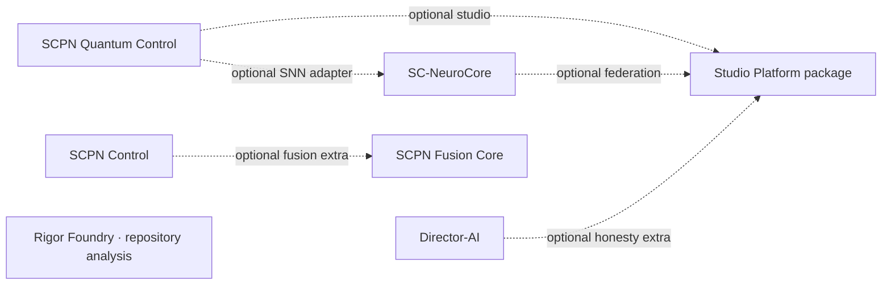

<!--
SPDX-License-Identifier: AGPL-3.0-or-later
Komerčná licencia je dostupná
© Koncepty 1996–2026 Miroslav Šotek. Všetky práva vyhradené.
© Kód 2020–2026 Miroslav Šotek. Všetky práva vyhradené.
ORCID: 0009-0009-3560-0851
Kontakt: www.anulum.li | protoscience@anulum.li
Prehľad osobného profilu GitHub
-->

  <picture>
    <source media="(prefers-color-scheme: dark)" srcset="assets/profile-header-dark.svg">
    <source media="(prefers-color-scheme: light)" srcset="assets/profile-header-light.svg">
    
  </picture>

  
  
  
  
  

  
  
  
  
  
  

  <a href="#projekty">Projekty</a> ·
  <a href="#aktuálne-zameranie">Aktuálne zameranie</a> ·
  <a href="#mapa-ekosystému">Ekosystém</a> ·
  <a href="#výskumné-výstupy">Výskumné výstupy</a> ·
  <a href="#inžinierske-štandardy">Štandardy</a> ·
  <a href="#spolupráca">Spolupráca</a>

Nezávislý výskumník a systémový inžinier pôsobiaci vo Švajčiarsku. Pod menom Anulum vyvíjam vedecký softvér a riadenú výskumnú organizáciu. Päť aktívnych skupín pokrýva reaktorové systémy, integráciu a riadenie, koordináciu a kontrolu agentov, neuromorfné a kvantové výpočty. Šiesta skupina Scientific Discovery and Experimentation sa formuje. Vydaný softvér, architektonické práce, vývoj world models a zamýšľané hardvérové výstupy majú samostatné hranice dôkazov. Výskumný inštitút a spoločnosť ponúkame na spoločné založenie s partnermi.

<table>
  <tr>
    <td width="20%"><strong>Motor</strong> Koordinácia agentov s potvrdeniami, review viazané na dôkazy, ukotvenie tvrdení, auditovateľná pamäť</td>
    <td width="20%"><strong>Reaktorové systémy</strong> Katalóg reaktorových konceptov, 3D/CAD, fyzika úrovne 0, Reactor Studio</td>
    <td width="20%"><strong>Integrácia a riadenie</strong> Studio Hub, riadiaci runtime, analýza synchronizácie, fail-closed brána k hardvéru</td>
    <td width="20%"><strong>Neuromorfné výpočty</strong> SNN Studio, Rust SIMD, Verilog RTL, syntéza na FPGA</td>
    <td width="20%"><strong>Kvantové výpočty</strong> Obvody na simulátoroch aj skutočnom hardvéri, výsledkové balíky so surovými dátami</td>
  </tr>
</table>

## Kde začať

**[Projekty](#projekty)** pre softvér a jeho dôkazy ·
**[Publikácie](https://anulum.li/papers/)** pre každú publikáciu a softvérový
archív s BibTeX · **[Kontakt](mailto:protoscience@anulum.li)** pre technický
návrh. Pre nových čitateľov: [anulum.li/start/](https://anulum.li/start/)
vyberie vstupný bod podľa profilu. Každý registrovaný projekt s filtrami podľa
skupiny, reaktorovej rodiny a dôkazov a s klikateľnou mapou:
[anulum.li/portfolio/](https://anulum.li/portfolio/).

## Projekty

Každá karta odkazuje na kontrolovateľné artefakty, nie na súhrnné tvrdenia.
Dôkazové odkazy sú pripnuté na commit, pri ktorom boli overené. Badge-y vydania a
CI hlásia stav registra a workflow; sú to prevádzkové signály, nie hodnotenie
vedeckej kvality.

<table>
  <tr>
    <td width="50%" valign="top"><strong><a href="https://github.com/anulum/synapse-channel">Synapse Channel</a></strong> · <strong>Použiteľný teraz</strong> Riadiaca rovina pre flotily programovacích agentov: tvrdenia, roly, trvalé schránky, potvrdenia, audit a federácia. <a href="https://anulum.github.io/synapse-channel/">Dokumentácia</a> · <a href="https://github.com/anulum/synapse-channel/blob/dd65c898a9693b47fad051e3baa92cef07da2e63/VALIDATION.md">Validácia</a> · <a href="https://github.com/anulum/synapse-channel/blob/dd65c898a9693b47fad051e3baa92cef07da2e63/docs/coordination-spec.md">Špecifikácia koordinácie</a> · <a href="https://github.com/anulum/synapse-channel/blob/dd65c898a9693b47fad051e3baa92cef07da2e63/docs/sandbox-threat-model.md">Model hrozieb</a>  </td>
    <td width="50%" valign="top"><strong><a href="https://github.com/anulum/director-ai">Director-AI</a></strong> · <strong>Aktívny výskum</strong> Ochrana LLM v reálnom čase: NLI/RAG ukotvenie, kontrola tvrdení, natívna akcelerácia, voliteľné zastavenie prúdu na úrovni tvrdení, deklarované hranice schopností. <a href="https://anulum.github.io/director-ai/">Dokumentácia</a> · <a href="https://github.com/anulum/director-ai/blob/fc155051367bb48180f2f5dc92f4120c2549cddd/VALIDATION.md">Validácia</a> · <a href="https://github.com/anulum/director-ai/blob/fc155051367bb48180f2f5dc92f4120c2549cddd/benchmarks/PUBLIC_BENCHMARKS.md">Verejné benchmarky</a> · <a href="https://github.com/anulum/director-ai/blob/fc155051367bb48180f2f5dc92f4120c2549cddd/docs/_generated/capability_matrix.md">Matica schopností</a>  </td>
  </tr>
  <tr>
    <td width="50%" valign="top"><strong><a href="https://github.com/anulum/rigor-foundry">Rigor Foundry</a></strong> · <strong>Použiteľný teraz</strong> Inventár repozitárov viazaný na dôkazy, kandidáti na audit, väzba na recenzie a plánovanie nápravy. <a href="https://anulum.github.io/rigor-foundry/">Dokumentácia</a>  </td>
    <td width="50%" valign="top"><strong><a href="https://github.com/anulum/remanentia">Remanentia</a></strong> · <strong>Použiteľný teraz</strong> Auditovateľná pamäť pre agentov AI a znalostné systémy: hybridné vyhľadávanie, grafy, konsolidácia, CLI, MCP a API. <a href="https://github.com/anulum/remanentia#readme">Dokumentácia</a>  </td>
  </tr>
  <tr>
    <td width="50%" valign="top"><strong><a href="https://github.com/anulum/sc-neurocore">SC-NeuroCore</a></strong> · <strong>Aktívny výskum</strong> Stochastický a neuromorfný rámec: modely v Pythone, SIMD cesty v Ruste, Verilog RTL, HDC/VSA, kompilátorové rozhrania a hardvérové dôkazy. <a href="https://anulum.github.io/sc-neurocore/">Dokumentácia</a> · <a href="https://github.com/anulum/sc-neurocore/blob/4bbc27b808eef0677848c1e484f40bd41e8ce83d/VALIDATION.md">Validácia</a> · <a href="https://github.com/anulum/sc-neurocore/blob/4bbc27b808eef0677848c1e484f40bd41e8ce83d/docs/hardware/SYNTHESIS_RESULTS.md">Výsledky syntézy</a> · <a href="https://github.com/anulum/sc-neurocore/blob/4bbc27b808eef0677848c1e484f40bd41e8ce83d/docs/safety/TRACEABILITY_MATRIX.md">Matica sledovateľnosti</a>  </td>
    <td width="50%" valign="top"><strong><a href="https://github.com/anulum/scpn-fusion-core">SCPN Fusion Core</a> · <a href="https://github.com/anulum/scpn-control">SCPN Control</a></strong> · <strong>Aktívny výskum</strong> Fyzika tokamaku, riešiče a validačné kampane s cestami k reálnym dátam (Fusion Core); riadiaci runtime s fail-closed prijímaním a dôkazmi z prehrávania (Control). <a href="https://github.com/anulum/scpn-fusion-core/blob/3c841fc13109c8efb49bb079d145f70683a4408d/VALIDATION.md">Validácia</a> · <a href="https://github.com/anulum/scpn-fusion-core/blob/3c841fc13109c8efb49bb079d145f70683a4408d/docs/VALIDATION_REAL_DIIID_145419.md">Validačný záznam DIII-D</a> · <a href="https://doi.org/10.5281/zenodo.18820864">DOI softvéru</a>   </td>
  </tr>
  <tr>
    <td width="50%" valign="top"><strong><a href="https://github.com/anulum/scpn-quantum-control">SCPN Quantum Control</a></strong> · <strong>Experimentálny</strong> Kvantová simulácia synchronizácie viazaných oscilátorov riadená dôkazmi: protokoly zapísané pred behom, hardvérové balíky výsledkov, surové početnosti a výslovné hranice bez tvrdenia o výhode. <a href="https://github.com/anulum/scpn-quantum-control/blob/2bc0f935b75ae7b85a4835caf754b2bfd8770c98/docs/layout_relaxation_preregistration.md">Protokol layout relaxation</a> · <a href="https://github.com/anulum/scpn-quantum-control/blob/2bc0f935b75ae7b85a4835caf754b2bfd8770c98/docs/hardware_result_packs.md">Kontrakt balíkov výsledkov</a> · <a href="https://doi.org/10.5281/zenodo.18821929">DOI softvéru</a>  </td>
    <td width="50%" valign="top"><strong><a href="https://github.com/anulum/scpn-phase-orchestrator">SCPN Phase Orchestrator</a></strong> · <strong>Aktívny výskum</strong> Analýza synchronizácie viazaných rytmických systémov s dôkazmi na prvom mieste a návrhy riadenia len na posúdenie; hodnotenie s vyrovnanou mierou falošných poplachov, negatívne výsledky a ohraničené tvrdenia o prenose. <a href="https://github.com/anulum/scpn-phase-orchestrator/blob/1e9eea39fa6681dde2cfbdf074c08ff03a528b58/papers/submissions/README.md">Index podaní</a> · <a href="https://doi.org/10.5281/zenodo.22113062">Preprint s negatívnym výsledkom</a> · <a href="https://doi.org/10.5281/zenodo.22113116">Preprint o mape režimov siete</a>  </td>
  </tr>
</table>

| Označenie | Význam |
|---|---|
| **Použiteľný teraz** | Inštalovateľný, zdokumentovaný a podporený CI; stále sa vyvíja |
| **Aktívny výskum** | Skutočný kód a prebiehajúca veda; nie prísľub stability |
| **Experimentálny** | Prieskumný; rozhrania ani tvrdenia nepovažujte za nemenné |
| **Viazaný na dôkazy** | Verejné tvrdenia sú spojené s meraniami alebo artefaktmi |

## Aktuálne zameranie

Stav portfólia overený <!-- verified-at -->2026-10-15<!-- /verified-at -->.

<table>
  <tr>
    <td width="33%"><strong>Reaktorové portfólio</strong> Konsolidácia spoločných jadier a riadenej pravdy zariadení v 26 verejných reaktorových repozitároch.</td>
    <td width="33%"><strong>Spoľahlivosť agentov</strong> Spojenie koordinácie, pamäte, overovania odpovedí, kontroly akcií a dôkazov o repozitároch bez zotretia hraníc vlastníctva.</td>
    <td width="33%"><strong>Od výskumu k hardvéru</strong> Vedecké modely prevedené cez natívnu akceleráciu, formálne kontroly, RTL, hardvérové behy a kontrolovateľné balíky výsledkov.</td>
  </tr>
</table>

<!-- profile-feeds:releases:start -->
### Najnovšie vydania

| Dátum | Projekt | Vydanie | Zmena |
|---|---|---|---|
| 2026-10-02 | Synapse Channel | [v0.99.37](https://doi.org/10.5281/zenodo.23095056) | published software archive |
| 2026-10-01 | Loop Timing Witness | [v0.1.0](https://doi.org/10.5281/zenodo.23092361) | published host software |
| 2026-10-01 | Synapse Channel | [v0.99.36](https://doi.org/10.5281/zenodo.23088472) | historical software archive |
| 2026-09-30 | SYNAPSE CHANNEL | [v0.99.35](https://github.com/anulum/synapse-channel/releases/tag/v0.99.35) | Shared-pool reservations with one authoritative owner (F02, not yet enforced). |
| 2026-09-30 | SYNAPSE CHANNEL | [v0.99.34](https://github.com/anulum/synapse-channel/releases/tag/v0.99.34) | Signed peers behind a TLS-terminating proxy were admitted but served nothing. 0.99.33 said a peer hub's or Fleet follower's signed log pull works behind such a proxy. It did not. |

Vykreslené z [anulum.li/news](https://anulum.li/news/) (súbory CHANGELOG projektov) a [Zenodo](https://zenodo.org/search?q=creators.orcid%3A%220009-0009-3560-0851%22) dňa 2026-10-15.
<!-- profile-feeds:releases:end -->

<!-- profile-feeds:publication:start -->
### Najnovšia publikácia

| Dátum | Typ | Výstup | DOI |
|---|---|---|---|
| 2026-10-11 | Preprint | The calibration epoch as the unit of evidence: preregistered parity-leakage and layout-transfer experiments on IQM Garnet | [10.5281/zenodo.23298119](https://doi.org/10.5281/zenodo.23298119) |

Vykreslené z [anulum.li/news](https://anulum.li/news/) (súbory CHANGELOG projektov) a [Zenodo](https://zenodo.org/search?q=creators.orcid%3A%220009-0009-3560-0851%22) dňa 2026-10-15.
<!-- profile-feeds:publication:end -->

## Časová os

| Obdobie | Verejne podložený míľnik |
|---|---|
| od 1996 | Vlastný publikovaný horizont vývoja konceptov v širšom výskumnom programe |
| 1998 | Začiatok vlastnoručne uvedenej zakladateľskej roly v ANULUM CH&LI vo verejnom ORCID zázname |
| 2018 | Založenie verejného GitHub účtu |
| 2025 | Verejné SCPN preview dokumenty, indexy rámca a technické správy uložené na Zenodo |
| 2026 | Rozšírenie verejného softvérového a výskumného portfólia v spoľahlivosti AI, agentovej infraštruktúre, neuromorfných výpočtoch, riadení plazmy a kvantovej simulácii |

Položky časovej osi rozlišujú fakty z registrov od vlastnej chronológie.
Neznamenajú akademickú afiliáciu, externú validáciu, financovanie ani ocenenia.

## Ako sa celok používa

Šípky označujú deklarované voliteľné softvérové rozhrania z architektonických záznamov skupín, nie otestovaný uzavretý vedecký cyklus. Rigor Foundry analyzuje repozitáre; nezavádzame mu vymyslenú runtime závislosť. Každá doména si ponecháva modely a oprávnenie k hardvéru. Studio Platform je publikovaný balík so súkromným repozitárom. Benchmark modálneho tlmenia siete Phase Orchestrator bol stiahnutý 12. októbra 2026; tento profil nedeklaruje výsledok na reálnej sieti ani kvantovú výhodu.

## Mapa ekosystému

<!-- profile-catalogue:inventory:start -->
**Dátovaný inventár: 2026-10-15**

97 repozitárov portfólia: 37 verejných, 6 súkromných a 54 lokálne inicializovaných, nezverejnených. Ďalších 42 položiek katalógu opisuje balíky, moduly, pracoviská alebo architektonické ciele. Na všetkých sa pracuje.

Deklarácie skupín sú z 12.–13. októbra; prítomnosť repozitárov a verejnosť boli overené 15. októbra 2026. Licencie sú deklarácie zdrojov, nie právny audit. Vydanie balíka a kvalifikácia hardvéru sú samostatné veci.

  
  
  
  

<picture>
  <source media="(prefers-color-scheme: dark)" srcset="assets/ecosystem-map-dark.svg">
  <source media="(prefers-color-scheme: light)" srcset="assets/ecosystem-map-light.svg">
  
</picture>

Detailný atlas je integrovaný v tomto repozitári. Jeho 196 položiek zahŕňa aj programy, potreby spoločnosti, partnerské úlohy a možnosti financovania; nejde o 196 repozitárov. Interaktívne zobrazenie otvoríte podľa návodu k náhľadu atlasu. Existujúce webové portfólio sa spravuje samostatne.

[Zdroj detailného atlasu a lokálny náhľad](docs/atlas/README.md) · [anulum.li/portfolio/](https://anulum.li/portfolio/)

Technické opisy nižšie citujú anglické zdrojové záznamy. Pomenovaný cieľ nie je samostatne vydaná schopnosť. Spoločné položky počítame raz v hlavnej skupine.

<strong>01 · SCPN Reactor Systems</strong> · 55 repozitárov · 55 položiek katalógu

55 vlastnených repozitárov vrátane ATLAS-REACTORUM: 26 verejných a 29 lokálne inicializovaných, nezverejnených. Modely fúzie, štiepenia, chemických a hybridných systémov, spoločné jadrá, geometria a dôkazy o reaktoroch. World models, 3D simulácie a návrhy zariadení sú vyvíjané výstupy programu; návrh nie je overený reaktor.

[Architektonické mapy skupín](https://github.com/anulum/atlas-reactorum/blob/main/docs/ecosystem.md)

| Projekt / komponent | Úloha a fáza vývoja | Repozitár / dostupnosť | Deklarovaná licencia | Dátum zdroja |
|---|---|---|---|---|
| [ATLAS-REACTORUM](https://github.com/anulum/atlas-reactorum) Source and rights library with historical reactor taxonomy and interactive citation views. | Prebieha · tool · Implementation and integration | Verejný | AGPL-3.0-or-later | 2026-10-12 |
| SCPN-ADS-CORE Subcritical blanket plus typed external source/beam-target interface. | Prebieha · component · Architecture and qualification | Lokálny, nezverejnený | AGPL-3.0-or-later | 2026-10-12 |
| [SCPN Beam Target Core](https://github.com/anulum/scpn-beam-target-core) Beam/target design and source-scoped reaction/stopping/yield. | Prebieha · component · Computational prototypes and continued development | Verejný | AGPL-3.0-or-later | 2026-10-12 |
| SCPN-BIOCHEM-CORE Source-specific enzyme/fermentation kinetics and reactor transport. | Prebieha · component · Architecture and qualification | Lokálny, nezverejnený | AGPL-3.0-or-later | 2026-10-12 |
| SCPN-BREED-BURN-CORE Source-bounded breed-and-burn fuel-management concept. | Prebieha · component · Architecture and qualification | Lokálny, nezverejnený | AGPL-3.0-or-later | 2026-10-12 |
| SCPN-BWR-CORE Boiling-channel thermal-spectrum family and void-feedback boundary. | Prebieha · component · Architecture and qualification | Lokálny, nezverejnený | AGPL-3.0-or-later | 2026-10-12 |
| SCPN-CATALYTIC-BED-CORE Fixed-bed catalyst/transport/pressure-drop coupling. | Prebieha · component · Architecture and qualification | Lokálny, nezverejnený | AGPL-3.0-or-later | 2026-10-12 |
| SCPN-CHANNEL-CORE Graphite-moderated channel reactor only; exclusive from PHWR pressure tubes. | Prebieha · component · Architecture and qualification | Lokálny, nezverejnený | AGPL-3.0-or-later | 2026-10-12 |
| SCPN-CHEM-KINETICS-CORE Ideal gas batch/CSTR/PFR named kinetics and thermo models. | Prebieha · component · Architecture and qualification | Lokálny, nezverejnený | AGPL-3.0-or-later | 2026-10-12 |
| SCPN-CHEM-PROCESS-HYBRID-CORE Chemical process/recycle/separation and carbon-capture composition. | Prebieha · component · Architecture and qualification | Lokálny, nezverejnený | AGPL-3.0-or-later | 2026-10-12 |
| [SCPN Dense Plasma Focus Core](https://github.com/anulum/scpn-dense-plasma-focus-core) Focus device/bank/axial/radial/pinch and source-scoped neutron estimates. | Prebieha · component · Computational prototypes and continued development | Verejný | AGPL-3.0-or-later | 2026-10-12 |
| SCPN-ELECTROCHEM-CORE Electrode/cell transport and charge/reaction interface. | Prebieha · component · Architecture and qualification | Lokálny, nezverejnený | AGPL-3.0-or-later | 2026-10-12 |
| [SCPN FRC Core](https://github.com/anulum/scpn-frc-core) Field-reversed configuration, radial pressure-balance and kinetic-scale model. | Prebieha · component · Computational prototypes and continued development | Verejný | AGPL-3.0-or-later | 2026-10-12 |
| [SCPN Fusion Core](https://github.com/anulum/scpn-fusion-core) Canonical plasma solver mathematics, transport/equilibrium and existing research pipeline. | Prebieha · package · Released software · ongoing development | Verejný | AGPL-3.0-or-later | 2026-10-12 |
| [SCPN Fusion-Fission Hybrid Core](https://github.com/anulum/scpn-fusion-fission-hybrid-core) Existing source-owned fusion/fission blanket device and proposed typed member couplings. | Prebieha · component · Computational prototypes and continued development | Verejný | AGPL-3.0-or-later | 2026-10-12 |
| SCPN-FUSION-PROCESS-HEAT-CORE Fusion-source to chemical-process heat/material composition. | Prebieha · component · Architecture and qualification | Lokálny, nezverejnený | AGPL-3.0-or-later | 2026-10-12 |
| SCPN-GFR-CORE Gas-cooled fast-spectrum family with high-temperature heat-removal boundary. | Prebieha · component · Architecture and qualification | Lokálny, nezverejnený | AGPL-3.0-or-later | 2026-10-12 |
| SCPN-HEAT-PIPE-CORE Solid-core heat-pipe microreactor and source-defined transport limits. | Prebieha · component · Architecture and qualification | Lokálny, nezverejnený | AGPL-3.0-or-later | 2026-10-12 |
| SCPN-HTGR-CORE Graphite/TRISO helium-cooled design and distinct process-heat interface. | Prebieha · component · Architecture and qualification | Lokálny, nezverejnený | AGPL-3.0-or-later | 2026-10-12 |
| SCPN-HYBRID-ENERGY-CORE Fission/renewable/storage electrical and thermal composition. | Prebieha · component · Architecture and qualification | Lokálny, nezverejnený | AGPL-3.0-or-later | 2026-10-12 |
| SCPN-HYDROGEN-PROCESS-CORE HTSE and named thermochemical hydrogen process routes. | Prebieha · component · Architecture and qualification | Lokálny, nezverejnený | AGPL-3.0-or-later | 2026-10-12 |
| [SCPN ICF Beam Core](https://github.com/anulum/scpn-icf-beam-core) Particle-beam illumination/capsule design with explicit coupling. | Prebieha · component · Computational prototypes and continued development | Verejný | AGPL-3.0-or-later | 2026-10-12 |
| [SCPN ICF Impact Core](https://github.com/anulum/scpn-icf-impact-core) Impact/projectile/fuel/compression design and source-limited energy relations. | Prebieha · component · Computational prototypes and continued development | Verejný | AGPL-3.0-or-later | 2026-10-12 |
| [SCPN ICF Laser Core](https://github.com/anulum/scpn-icf-laser-core) Laser-driven capsule/implosion design and source-scoped ignition/gain criteria. | Prebieha · component · Computational prototypes and continued development | Verejný | AGPL-3.0-or-later | 2026-10-12 |
| [SCPN IEC Core](https://github.com/anulum/scpn-iec-core) Gridded electrostatic device and distinct nonthermal loss/recirculation models. | Prebieha · component · Computational prototypes and continued development | Verejný | AGPL-3.0-or-later | 2026-10-12 |
| [SCPN Lattice Fusion Core](https://github.com/anulum/scpn-lattice-fusion-core) Source-bounded lattice-confinement fusion research and modelling. | Prebieha · component · Architecture and qualification | Verejný | AGPL-3.0-or-later | 2026-10-12 |
| [SCPN Levitated Dipole Core](https://github.com/anulum/scpn-levitated-dipole-core) Dipole coil/levitation/charging and anisotropic plasma model. | Prebieha · component · Computational prototypes and continued development | Verejný | AGPL-3.0-or-later | 2026-10-12 |
| SCPN-LFR-CORE Lead/LBE fast-spectrum family with materials/corrosion boundary. | Prebieha · component · Architecture and qualification | Lokálny, nezverejnený | AGPL-3.0-or-later | 2026-10-12 |
| [SCPN Magnetic Cusp Core](https://github.com/anulum/scpn-magnetic-cusp-core) Cusp coil/configuration ownership and source-specific field/particle-loss model proposal. | Prebieha · component · Computational prototypes and continued development | Verejný | AGPL-3.0-or-later | 2026-10-12 |
| SCPN-MEMBRANE-CORE Reaction-separation with explicit membrane transport. | Prebieha · component · Architecture and qualification | Lokálny, nezverejnený | AGPL-3.0-or-later | 2026-10-12 |
| SCPN-METHANE-REFORMER-CORE Steam-methane reforming kinetics and process train. | Prebieha · component · Architecture and qualification | Lokálny, nezverejnený | AGPL-3.0-or-later | 2026-10-12 |
| [SCPN MIF Core](https://github.com/anulum/scpn-mif-core) Existing magneto-inertial dynamics/runtime with maintained multi-language/RTL chain. | Prebieha · package · Released software · ongoing development | Verejný | AGPL-3.0-or-later | 2026-10-12 |
| [SCPN MIF Liner Core](https://github.com/anulum/scpn-mif-liner-core) Mechanical/magnetic liner compression and target-energy coupling. | Prebieha · component · Computational prototypes and continued development | Verejný | AGPL-3.0-or-later | 2026-10-12 |
| [SCPN MIF MagLIF Core](https://github.com/anulum/scpn-mif-maglif-core) Magnetised liner drive/preheat/compression family. | Prebieha · component · Computational prototypes and continued development | Verejný | AGPL-3.0-or-later | 2026-10-12 |
| [SCPN MIF Plasma Jet Core](https://github.com/anulum/scpn-mif-plasma-jet-core) Discrete plasma-jet array and spherical liner convergence. | Prebieha · component · Computational prototypes and continued development | Verejný | AGPL-3.0-or-later | 2026-10-12 |
| [SCPN Mirror Core](https://github.com/anulum/scpn-mirror-core) Mirror/tandem confinement and source-specific flux-tube geometry. | Prebieha · component · Computational prototypes and continued development | Verejný | AGPL-3.0-or-later | 2026-10-12 |
| SCPN-MSR-CORE Liquid-fuel molten-salt family with chemistry, circulation and depletion. | Prebieha · component · Architecture and qualification | Lokálny, nezverejnený | AGPL-3.0-or-later | 2026-10-12 |
| [SCPN Muon Fusion Core](https://github.com/anulum/scpn-muon-fusion-core) Muon-catalysed reaction models and complete energy accounting. | Prebieha · component · Architecture and qualification | Verejný | AGPL-3.0-or-later | 2026-10-12 |
| SCPN-NTP-CORE Reactor-side thermal propulsion and typed heat/flow interface. | Prebieha · component · Architecture and qualification | Lokálny, nezverejnený | AGPL-3.0-or-later | 2026-10-12 |
| SCPN-NUCLEAR-DESALINATION-CORE Fission-to-desalination thermal/material composition. | Prebieha · component · Architecture and qualification | Lokálny, nezverejnený | AGPL-3.0-or-later | 2026-10-12 |
| SCPN-NUCLEAR-HYDROGEN-CORE Typed fission-to-hydrogen thermal/electrical/material composition. | Prebieha · component · Architecture and qualification | Lokálny, nezverejnený | AGPL-3.0-or-later | 2026-10-12 |
| SCPN-PHOTOCATALYTIC-CORE Photon-flux-driven reaction and optical/source coupling. | Prebieha · component · Architecture and qualification | Lokálny, nezverejnený | AGPL-3.0-or-later | 2026-10-12 |
| SCPN-PHWR-CORE Heavy-water pressure-tube family with on-power fuel management. | Prebieha · component · Architecture and qualification | Lokálny, nezverejnený | AGPL-3.0-or-later | 2026-10-12 |
| SCPN-PWR-CORE Light-water moderated/cooled vessel and primary-circuit design. | Prebieha · component · Architecture and qualification | Lokálny, nezverejnený | AGPL-3.0-or-later | 2026-10-12 |
| SCPN-REACTOR-CATALOGUE Evidence-labelled source-authority catalogue, candidate revision/history and vocabulary. | Prebieha · component · Architecture and qualification | Lokálny, nezverejnený | AGPL-3.0-or-later | 2026-10-12 |
| [SCPN Reactor Kernels](https://github.com/anulum/scpn-reactor-kernels) Shared equations, numerical primitives and geometry/CAD/export substrate. | Prebieha · package · Implementation and integration | Verejný | AGPL-3.0-or-later | 2026-10-12 |
| SCPN-RESEARCH-REACTOR-CORE Research/isotope-production core including separately supported pulse operation. | Prebieha · component · Architecture and qualification | Lokálny, nezverejnený | AGPL-3.0-or-later | 2026-10-12 |
| [SCPN RFP Core](https://github.com/anulum/scpn-rfp-core) Reversed-field pinch relaxation/profile and toroidal device design. | Prebieha · component · Computational prototypes and continued development | Verejný | AGPL-3.0-or-later | 2026-10-12 |
| SCPN-SCWR-CORE Supercritical-water family with explicit thermophysical transition support. | Prebieha · component · Architecture and qualification | Lokálny, nezverejnený | AGPL-3.0-or-later | 2026-10-12 |
| SCPN-SFR-CORE Sodium-cooled fast-spectrum family and fuel/material/heat-removal boundary. | Prebieha · component · Architecture and qualification | Lokálny, nezverejnený | AGPL-3.0-or-later | 2026-10-12 |
| [SCPN Spheromak Core](https://github.com/anulum/scpn-spheromak-core) Relaxed compact-torus configuration, flux conserver and formation criteria. | Prebieha · component · Computational prototypes and continued development | Verejný | AGPL-3.0-or-later | 2026-10-12 |
| [SCPN Stellarator Core](https://github.com/anulum/scpn-stellarator-core) Three-dimensional magnetic-confinement configuration and coil/design ownership. | Prebieha · component · Computational prototypes and continued development | Verejný | AGPL-3.0-or-later | 2026-10-12 |
| [SCPN Theta Pinch Core](https://github.com/anulum/scpn-theta-pinch-core) Axial-field compression and pinch configuration with sharp-boundary model. | Prebieha · component · Computational prototypes and continued development | Verejný | AGPL-3.0-or-later | 2026-10-12 |
| [SCPN Tokamak Core](https://github.com/anulum/scpn-tokamak-core) Own tokamak physical modelling and reactor-design geometry, with explicitly qualified canonical plasma-solver dependencies. | Prebieha · component · Computational prototypes and continued development | Verejný | AGPL-3.0-or-later | 2026-10-12 |
| [SCPN Z-Pinch Core](https://github.com/anulum/scpn-z-pinch-core) Current-driven pinch, sheared-flow model and pulsed device design. | Prebieha · component · Computational prototypes and continued development | Verejný | AGPL-3.0-or-later | 2026-10-12 |

**Portály reaktorových rodín**: [reactor-systems](https://anulum.li/reactor-systems/) · [compare.html](https://anulum.li/reactor-systems/compare.html) · [closed-magnetic](https://anulum.li/reactor-systems/closed-magnetic/) · [open-magnetic](https://anulum.li/reactor-systems/open-magnetic/) · [pinches](https://anulum.li/reactor-systems/pinches/) · [inertial](https://anulum.li/reactor-systems/inertial/) · [magneto-inertial](https://anulum.li/reactor-systems/magneto-inertial/) · [electrostatic-hybrid](https://anulum.li/reactor-systems/electrostatic-hybrid/)

<strong>02 · SCPN Systems Integration and Control</strong> · 4 repozitárov · 4 položiek katalógu

Štyri rovnocenné produkty. Control a Phase Orchestrator sú verejné; Studio Hub aj repozitár Studio Platform sú súkromné. Verejný balík scpn-studio-platform je dostupný samostatne. Deklarované rozhrania Studio nedokazujú otestovanú federáciu.

| Projekt / komponent | Úloha a fáza vývoja | Repozitár / dostupnosť | Deklarovaná licencia | Dátum zdroja |
|---|---|---|---|---|
| [SCPN Phase Orchestrator](https://github.com/anulum/scpn-phase-orchestrator) Synchronisation analysis and evaluation of early-warning detectors on coupled phase-oscillator dynamics, with a Rust kernel. | Prebieha · package · Released software · ongoing development | Verejný | AGPL-3.0-or-later | 2026-10-13 |
| [SCPN Control](https://github.com/anulum/scpn-control) Compiler from stochastic Petri nets to controllers with runtime contracts, and plasma-control research paths. | Prebieha · package · Released software · ongoing development | Verejný | AGPL-3.0-or-later | 2026-10-13 |
| SCPN Studio Platform Domain-neutral SDK for studios: evidence bundles, capability manifests, bounded jobs and tenant-aware identity. | Prebieha · package · Released software · ongoing development | Súkromný | AGPL-3.0-or-later | 2026-10-13 |
| SCPN Studio The hub that federates studios over the platform contract: registry, cross-studio evidence audit, rendering and federation gating. | Prebieha · service · Implementation and integration | Súkromný | AGPL-3.0-or-later | 2026-10-13 |

<strong>03 · Agentic Coordination, Assurance and Continuity</strong> · 10 repozitárov · 10 položiek katalógu

Desať repozitárov pre koordináciu, kontrolu, pamäť a riadené akcie. HushLine patrí medzi nástroje skupiny; zahrnutý je aj SYNAPSE-POLICY-CHECK-ACTION. Každý produkt má vlastnú licenciu a hranice schopností.

[Architektonické mapy skupín](https://github.com/anulum/synapse-channel/blob/main/docs/ecosystem.md)

| Projekt / komponent | Úloha a fáza vývoja | Repozitár / dostupnosť | Deklarovaná licencia | Dátum zdroja |
|---|---|---|---|---|
| [Synapse Channel](https://github.com/anulum/synapse-channel) Local-first coordination bus for AI agents: presence, file-scope work claims, messages, task status, receipts and an audit journal on one hub. | Prebieha · package · Released software · ongoing development | Verejný | AGPL-3.0-or-later | 2026-10-11 |
| Synapse Channel Fleet Multi-machine operation of the bus: durable follower daemon, per-peer trust and configuration, claim forwarding and diagnostics. | Prebieha · package · Implementation and integration | Súkromný | LicenseRef-SYNAPSE-Enterprise | 2026-10-11 |
| [SYNAPSE-POLICY-CHECK-ACTION](https://github.com/anulum/synapse-policy-check-action) GitHub Action that checks a SYNAPSE CHANNEL release receipt against a policy file in CI. | Prebieha · tool · Implementation and integration | Verejný | AGPL-3.0-or-later | 2026-10-11 |
| [Director-AI](https://github.com/anulum/director-ai) Response-level guardrail for LLM output: NLI and retrieval grounding, sealed evidence packets and an optional streaming contradiction halt. | Prebieha · package · Released software · ongoing development | Verejný | Apache-2.0 AND BUSL-1.1 | 2026-10-11 |
| Director Class AI Action control between an autonomous agent and its effectors: action-policy checks, human approvals, gateway enforcement and tamper-evident action evidence. | Prebieha · package · Implementation and integration | Súkromný | BUSL-1.1 | 2026-10-11 |
| Director AI Cloud Control plane for a hosted Director-AI API: accounts, API-key lifecycle, usage metering, plan quotas and operator exports. | Prebieha · service · Implementation and integration | Súkromný | BUSL-1.1 | 2026-10-11 |
| [Rigor Foundry](https://github.com/anulum/rigor-foundry) Evidence-bound repository auditing: inventories Git-tracked content, emits reproducible audit candidates, binds review decisions to exact evidence and prepares remediation inputs. | Prebieha · package · Released software · ongoing development | Verejný | Apache-2.0 | 2026-10-11 |
| [Remanentia](https://github.com/anulum/remanentia) Local-first, auditable memory for AI agents and knowledge-intensive software: project-file indexing, hybrid retrieval, consolidation and an entity graph, through a CLI, an MCP server and an HTTP API. | Prebieha · package · Released software · ongoing development | Verejný | AGPL-3.0-or-later | 2026-10-11 |
| Remanentia Portal Account and billing or licence-request portal for the product family. It runs no customer workload. | Prebieha · service · Implementation and integration | Súkromný | AGPL-3.0-or-later | 2026-10-11 |
| [HushLine](https://github.com/anulum/HushLine) Local command-output filter: runs a command, then limits, shapes and redacts its output before it reaches a caller. Four independent cores: Go, Rust, Python and Node. | Prebieha · tool · Released software · ongoing development | Verejný | AGPL-3.0-or-later | 2026-10-11 |

<strong>04 · SC Neuromorphic Computing Systems</strong> · 4 repozitárov · 42 položiek katalógu

Základný inventár má 40 pomenovaných položiek vrátane trvalého pracoviska SC-NeuroCore a podporných nástrojov; dva ďalšie modulové/podmienené ciele tvoria spolu 42 položiek katalógu. LOOP-TIMING-WITNESS má verejný hostiteľský balík; kvalifikácia fyzickej dosky čaká. EVIDENCE-MANIFEST-TOOLKIT je nezverejnený. Moduly a odložené ciele sú označené samostatne.

[Architektonické mapy skupín](https://github.com/anulum/sc-neurocore/blob/main/docs/ecosystem.md)

| Projekt / komponent | Úloha a fáza vývoja | Repozitár / dostupnosť | Deklarovaná licencia | Dátum zdroja |
|---|---|---|---|---|
| [SC-NeuroCore](https://github.com/anulum/sc-neurocore) Permanent public development, composition and integration workbench for stochastic and spiking neural modelling, encoding, learning, simulation, selected hardware compilation and evidence inspection. | Prebieha · workbench · Released software · ongoing development | Verejný | AGPL-3.0-or-later | 2026-10-13 |
| [Loop Timing Witness](https://github.com/anulum/loop-timing-witness) Fabric-clock instrument for complete control-loop and selected accelerator timing, with simulation/host analysis separated from eventual board timing, fault response and rail-energy evidence. | Prebieha · tool · Architecture and qualification | Verejný | AGPL-3.0-or-later | 2026-10-13 |
| EVIDENCE-MANIFEST-TOOLKIT Canonicalises, references, seals and verifies evidence with explicit schemas, bounded sources and independently selected policy. | Prebieha · shared · Architecture and qualification | Lokálny, nezverejnený | AGPL-3.0-or-later | 2026-10-13 |
| RANDOMNESS-WITNESS Assesses number-source suitability for a declared stochastic-computing use; it does not certify randomness for every purpose. | Prebieha · shared · Design and preparation | Cieľ / modul / balík | undecided | 2026-10-13 |
| EXPERIMENT-LEDGER Records experiment lineage across tools without owning their raw evidence or running their computations. | Prebieha · shared · Design and preparation | Cieľ / modul / balík | undecided | 2026-10-13 |
| SC-NC-CORE Neuron/synapse primitives, network graph, simulation loop, fixed-point semantics, constants and exceptions. | Prebieha · component · Workbench transition | Cieľ / modul / balík | Undecided for independent release | 2026-10-13 |
| SC-NC-CATALOGUE Neuron models, model zoo and topology/connectome generators. | Prebieha · component · Workbench transition | Cieľ / modul / balík | Undecided for independent release | 2026-10-13 |
| SC-NC-ENGINE Accelerated execution and its maintained language/native interfaces. | Prebieha · component · Workbench transition | Cieľ / modul / balík | Undecided for independent release | 2026-10-13 |
| SC-NC-BRIDGES Interchange and cross-domain adapters including NIR, quantum, HDC/VSA and neuro-symbolic routes. | Prebieha · component · Workbench transition | Cieľ / modul / balík | Undecided for independent release | 2026-10-13 |
| SC-NC-LEARN Training and adaptation, including surrogate gradients, plasticity, online learning, quantisation-aware training and distillation. | Prebieha · component · Workbench transition | Cieľ / modul / balík | Undecided for independent release | 2026-10-13 |
| SC-NC-DATA Datasets, signal/event encoding, augmentation, codecs, sources and recording adapters. | Prebieha · component · Workbench transition | Cieľ / modul / balík | Undecided for independent release | 2026-10-13 |
| SC-NC-ANALYSIS Spike-train analysis, visualisation and explainability. | Prebieha · component · Workbench transition | Cieľ / modul / balík | Undecided for independent release | 2026-10-13 |
| SC-NC-COMPILER Equation/IR lowering and hardware collateral for supported numerical models. | Prebieha · component · Workbench transition | Cieľ / modul / balík | Undecided for independent release | 2026-10-13 |
| SC-NC-HARDWARE Target profiles, mapping, deployment, drivers and power/thermal integration. | Prebieha · component · Workbench transition | Cieľ / modul / balík | Undecided for independent release | 2026-10-13 |
| SC-NC-VERIFY Formal, fault, resilience and safety-readiness verification within explicit proof scopes. | Prebieha · component · Workbench transition | Cieľ / modul / balík | Undecided for independent release | 2026-10-13 |
| SC-NC-STUDIO Visual composition, inspection and evidence presentation workflows. | Prebieha · component · Workbench transition | Cieľ / modul / balík | Undecided for independent release | 2026-10-13 |
| SC-NC-RESEARCH Retained experimental paths, including evolutionary, biological and world-model directions. | Prebieha · component · Workbench transition | Cieľ / modul / balík | Undecided for independent release | 2026-10-13 |
| SC-NC-BENCH Catalogue/workload suites and immutable source-bound benchmark records. | Prebieha · component · Workbench transition | Cieľ / modul / balík | Undecided for independent release | 2026-10-13 |
| MODEL-PROVENANCE-PACK Binds a model's data, training, conversion, quantisation, encoding and supporting evidence into a verifiable provenance pack. | Prebieha · tool · Design and implementation | Cieľ / modul / balík | Undecided for independent release | 2026-10-13 |
| SPIKE-LOG Records, indexes, verifies, slices and replays event streams without losing their provenance or timebase identity. | Prebieha · tool · Design and implementation | Lokálny, nezverejnený | Undecided for independent release | 2026-10-13 |
| SPIKE-FORMAT-BRIDGE Converts event recordings between declared formats and reports every permitted loss rather than hiding timestamp, polarity or side-stream changes. | Prebieha · tool · Design and implementation | Cieľ / modul / balík | Undecided for independent release | 2026-10-13 |
| SPIKE-CODEC-BENCH Measures compression of existing spike trains, comparing payload ratio, distortion, encode/decode latency and memory. | Prebieha · tool · Design and implementation | Cieľ / modul / balík | Undecided for independent release | 2026-10-13 |
| SPIKE-ENCODER-CHARACTERISER Measures the information, spike-rate and latency trade-offs of sensor-to-spike encoders. | Prebieha · tool · Design and implementation | Cieľ / modul / balík | Undecided for independent release | 2026-10-13 |
| SPIKE-QUALITY-GATE Checks event data against a named quality policy for timestamp, noise, sensor-health, rate, gap and spatial defects. | Prebieha · tool · Design and implementation | Cieľ / modul / balík | Undecided for independent release | 2026-10-13 |
| SPIKE-GROUNDTRUTH Generates reproducible event-vision, audio, sensor and control stimuli with ground truth defined by the generator. | Prebieha · tool · Design and implementation | Cieľ / modul / balík | Undecided for independent release | 2026-10-13 |
| SNN-DIVERGENCE-HARNESS Compares the same network and input across implementations under bit-exact, tolerance or statistical oracles. | Prebieha · tool · Design and implementation | Cieľ / modul / balík | Undecided for independent release | 2026-10-13 |
| SC-STREAM-PROVER Compares realised stochastic-computing arithmetic error with a declared bound for a specific circuit, source and stream-length regime. | Prebieha · tool · Design and implementation | Cieľ / modul / balík | Undecided for independent release | 2026-10-13 |
| MUTATION-SNN Measures test adequacy by generating declared semantic mutants and recording what the suite detects. | Prebieha · tool · Design and implementation | Cieľ / modul / balík | Undecided for independent release | 2026-10-13 |
| NIR-CONFORMANCE Tests importer/exporter behaviour against the known semantics of a pinned Neuromorphic Intermediate Representation version. | Prebieha · tool · Design and implementation | Cieľ / modul / balík | Undecided for independent release | 2026-10-13 |
| NEURO-EVIDENCE-BENCH Executes declared neuromorphic benchmark plans and traces each scoped result back to its raw evidence. | Prebieha · tool · Design and implementation | Cieľ / modul / balík | Undecided for independent release | 2026-10-13 |
| SPIKE-CALIBRATOR Measures classifier confidence against correctness under declared signal definitions, shifts and placements. | Prebieha · tool · Design and implementation | Cieľ / modul / balík | Undecided for independent release | 2026-10-13 |
| BITSTREAM-EVIDENCE-CI Captures pinned FPGA build inputs, reports and bitstream identity in a reproducibility-aware chained build ledger. | Prebieha · tool · Design and implementation | Cieľ / modul / balík | Undecided for independent release | 2026-10-13 |
| PLASTICITY-WITNESS Compares observed learning-rule updates with an independently defined fixed-point or statistical oracle under stated spike/load/fault protocols. | Prebieha · tool · Design and implementation | Cieľ / modul / balík | Undecided for independent release | 2026-10-13 |
| AER-LINK-WITNESS Measures event-link behaviour under load, including loss, reordering, fairness, starvation and forward progress. | Prebieha · tool · Design and implementation | Cieľ / modul / balík | Undecided for independent release | 2026-10-13 |
| RELIABILITY-WITNESS Characterises reliability within a declared physical or explicitly simulated exposure, retaining conditions, gaps and rare-event uncertainty. | Prebieha · tool · Design and implementation | Cieľ / modul / balík | Undecided for independent release | 2026-10-13 |
| SIM-REAL-WITNESS Quantifies simulation-to-fabric differences for the same model, input and observable population. | Prebieha · tool · Design and implementation | Cieľ / modul / balík | Undecided for independent release | 2026-10-13 |
| DEPLOY-PACK Composes validated deployment evidence with bitstream/driver identity into a verifiable install/update package. | Prebieha · tool · Design and implementation | Cieľ / modul / balík | Undecided for independent release | 2026-10-13 |
| FIELD-OPS-WITNESS Aggregates compact field health and drift evidence against deployment-time envelopes without actuating devices. | Prebieha · tool · Design and implementation | Cieľ / modul / balík | Undecided for independent release | 2026-10-13 |
| FLIGHT-RECORDER Retains a bounded per-device event/state history for gap-honest incident reconstruction. | Prebieha · tool · Design and implementation | Cieľ / modul / balík | Undecided for independent release | 2026-10-13 |
| NEURO-SAFETY-CASE Composes scoped evidence and open gaps into an assessor-facing assurance argument; it certifies nothing itself. | Prebieha · tool · Design and implementation | Cieľ / modul / balík | Undecided for independent release | 2026-10-13 |
| SC-COMPUTE-ADAPTERS Owns the SC-NeuroCore-side wrappers and numerical/register/handshake contracts needed to put selected generated peripherals into the independent LOOP-TIMING-WITNESS DUT/capture path. | Prebieha · workbench module · Architecture and interface work | Cieľ / modul / balík | Independent distribution terms being defined | 2026-10-13 |
| SC-NC-BIO Conditional destination for separately owned biological/biohybrid work if its independent release lifecycle is accepted; current experimental bioware remains in the developmental parent. | Prebieha · conditional architecture destination · Architecture and interface work | Cieľ / modul / balík | Independent distribution terms being defined | 2026-10-13 |

<strong>05 · SCPN Quantum Computing Systems</strong> · 24 repozitárov · 28 položiek katalógu

Trvalé pracovisko SCPN-QUANTUM-CONTROL; oscillatools a SCPN-QUANTUM-ENGINE sú samostatné distribúcie, nie ďalšie pracoviská. Vyvíja sa šestnásť komponentových a osem nástrojových cieľov; QUANTUM_LAB je pracovný priestor. Licencie a vydania samostatných balíkov sa odlišujú od rodičovského projektu.

[Architektonické mapy skupín](https://github.com/anulum/scpn-quantum-control/blob/main/docs/ecosystem.md)

| Projekt / komponent | Úloha a fáza vývoja | Repozitár / dostupnosť | Deklarovaná licencia | Dátum zdroja |
|---|---|---|---|---|
| [SCPN Quantum Control](https://github.com/anulum/scpn-quantum-control) Integrated modelling, simulation, compilation, gradients, control, provider workflows, analysis and Quantum Studio. | Prebieha · workbench · Released software · ongoing development | Verejný | AGPL-3.0-or-later | 2026-10-13 |
| oscillatools Classical coupled-phase-oscillator dynamics, observables, sensitivities and control-oriented numerical tools. | Prebieha · package · Released software · ongoing development | Cieľ / modul / balík | AGPL-3.0-or-later | 2026-10-13 |
| scpn-quantum-engine Optional Rust/PyO3 numerical acceleration and native computation used by supported workbench paths. | Prebieha · package · Released software · ongoing development | Cieľ / modul / balík | AGPL-3.0-or-later | 2026-10-13 |
| QPU-RESULT-PACK Preserve raw results and their provenance, derivations and reviewable presentation. | Prebieha · tool · Implementation and integration | Lokálny, nezverejnený | not stated | 2026-10-13 |
| TRANSPILE-WITNESS Retain scoped observations about compilation semantics, layout, global phase and replay. | Prebieha · tool · Implementation and integration | Cieľ / modul / balík | AGPL-3.0-or-later by file headers; no licence field in packaging | 2026-10-13 |
| MITIGATION-WITNESS Evaluate mitigation on declared measurement panels with retained inputs and uncertainty. | Prebieha · tool · Implementation and integration | Lokálny, nezverejnený | AGPL-3.0-or-later | 2026-10-13 |
| SCPN-QC-CONTRACTS Versioned parameter, result, semantic and evidence interface contracts shared by components. | Prebieha · component · Workbench transition | Lokálny, nezverejnený | Undecided for independent release | 2026-10-13 |
| SCPN-QC-CORE Configuration, logging, resource budgets and generic Kuramoto-XY problem foundations, separated from paper-specific research assumptions. | Prebieha · component · Workbench transition | Lokálny, nezverejnený | Undecided for independent release | 2026-10-13 |
| SCPN-QC-AD Whole-program automatic differentiation, derivative transforms, batching, optimisation and explicit supported-path contracts. | Prebieha · component · Workbench transition | Lokálny, nezverejnený | Undecided for independent release | 2026-10-13 |
| SCPN-QC-SIM Classical and quantum oscillator dynamics, XY/Kuramoto solvers, open-system simulation, tensor-network paths and co-simulation. | Prebieha · component · Workbench transition | Lokálny, nezverejnený | Undecided for independent release | 2026-10-13 |
| SCPN-QC-COMPILER Model and circuit frontends, intermediate representations, interchange and code generation. | Prebieha · component · Workbench transition | Lokálny, nezverejnený | Undecided for independent release | 2026-10-13 |
| SCPN-QC-QNODE Quantum tapes, gradient execution and framework bridges for supported Qiskit, PennyLane, JAX, PyTorch and TensorFlow paths. | Prebieha · component · Workbench transition | Lokálny, nezverejnený | Undecided for independent release | 2026-10-13 |
| SCPN-QC-HAL Provider-neutral workloads, capabilities, job/result contracts and optional provider adapters. | Prebieha · component · Workbench transition | Lokálny, nezverejnený | Undecided for independent release | 2026-10-13 |
| SCPN-QC-MITIGATION Error-mitigation implementations and their method taxonomy. | Prebieha · component · Workbench transition | Lokálny, nezverejnený | Undecided for independent release | 2026-10-13 |
| SCPN-QC-QEC Quantum error-correction analysis and fault-tolerant resource-reporting surfaces. | Prebieha · component · Workbench transition | Lokálny, nezverejnený | Undecided for independent release | 2026-10-13 |
| SCPN-QC-CONTROL Feedback and co-design, chimera and topology-aware control, and DLA-constrained control paths. | Prebieha · component · Workbench transition | Lokálny, nezverejnený | Undecided for independent release | 2026-10-13 |
| SCPN-QC-ANALYSIS Observables, synchronisation witnesses, result analysis and the open-data DLA-parity pathway. | Prebieha · component · Workbench transition | Lokálny, nezverejnený | Undecided for independent release | 2026-10-13 |
| SCPN-QC-LEARN Forecasting, quantum neural models, surrogate models, kernels and variational learning paths. | Prebieha · component · Workbench transition | Lokálny, nezverejnený | Undecided for independent release | 2026-10-13 |
| SCPN-QC-APPS Domain application adapters, quantum randomness, cryptography and sensing workflows, with explicit claim boundaries. | Prebieha · component · Workbench transition | Lokálny, nezverejnený | Undecided for independent release | 2026-10-13 |
| SCPN-QC-BENCH Workload-specific benchmark suites, comparison harnesses, campaign reproduction and retained run evidence. | Prebieha · component · Workbench transition | Lokálny, nezverejnený | Undecided for independent release | 2026-10-13 |
| SCPN-QC-STUDIO Quantum Studio's visual workflows, inspectors and evidence presentation through the shared Studio platform contract. | Prebieha · component · Workbench transition | Lokálny, nezverejnený | Undecided for independent release | 2026-10-13 |
| SCPN-QC-RESEARCH Experimental SCPN theory, paper-specific assumptions and research adapters whose contracts are not stable. | Prebieha · component · Workbench transition | Lokálny, nezverejnený | Undecided for independent release | 2026-10-13 |
| NOISE-MODEL-WITNESS Compare model predictions and replay observations for the same circuit and shot identities, with uncertainty, shot floors, calibration epochs and declared tolerances. | Prebieha · tool · Design and implementation | Lokálny, nezverejnený | Undecided for independent release | 2026-10-13 |
| VENDOR-CLAIM-RECOMPUTER Recompute released-data quantum-volume, error-per-layer-gate and logical-error claims against fixed definitions, original inputs and declared computation budgets. | Prebieha · tool · Design and implementation | Lokálny, nezverejnený | Undecided for independent release | 2026-10-13 |
| DECODER-WITNESS Compare real decoder engines on released shot data with lossless adapters, declared noise conditions and uncertainty-aware reports. | Prebieha · tool · Design and implementation | Lokálny, nezverejnený | Undecided for independent release | 2026-10-13 |
| GRADIENT-WITNESS Check software derivatives against declared analytic, parameter-shift and finite-difference references, including complex, finite-shot and cross-framework cases. | Prebieha · tool · Design and implementation | Lokálny, nezverejnený | Undecided for independent release | 2026-10-13 |
| CONFORMANCE-WITNESS Check versioned OpenQASM 3, adapter behaviour, provenance fields and repository-evidence criteria against their normative clauses and actual entry points. | Prebieha · tool · Design and implementation | Lokálny, nezverejnený | Undecided for independent release | 2026-10-13 |
| QUANTUM_LAB Reserved research workspace name; implementation role is not assigned in the group map. | Prebieha · workspace · Workspace definition | Cieľ / modul / balík | Not stated | 2026-10-13 |

↔ EVIDENCE-MANIFEST-TOOLKIT · RANDOMNESS-WITNESS · EXPERIMENT-LEDGER

<strong>06 · Scientific Discovery and Experimentation</strong> · 0 repozitárov · 0 položiek katalógu

Registrovaná 12. októbra 2026; vo formovaní; nula registrovaných projektov a repozitárov. Vlastní postup hypotéza → experiment → kontrola → záznam → návrh aktualizácie modelu a spoločný formát benchmarku a správy. Doménové modely, hardvér a oprávnenie na vykonávanie zostávajú príslušným skupinám. Uzavretý vedecký cyklus sa nedeklaruje.

**Ďalší verejný výskumný záznam**

Fusion Equilibrium Challenge je verejný reprodukčný balík vytvorený 14. októbra 2026, po inventári skupín. Uvádzame ho samostatne, aby zostali zachované dátované počty skupín. Výsledky a obmedzenia sú v jeho vlastnom zázname.

- [Fusion Equilibrium Challenge](https://github.com/anulum/fusion-equilibrium-challenge) · Prebieha · AGPL-3.0-or-later · 2026-10-15
<!-- profile-catalogue:inventory:end -->

## Ciele sponzorstva

Otvorená práca je financovaná cez [GitHub Sponsors](https://github.com/sponsors/anulum).
Približne **25 000 USD mesačne** je minimum, pri ktorom lab beží bez prerušenia:
výpočty, čas na GPU, QPU a FPGA, hardvér, CI a nástroje. Sú to náklady labu,
nie plat. Nad toto minimum sa práca dá škálovať, pretože motor mení ďalší
výpočtový výkon priamo na ďalšiu vyvinutú a overenú prácu. Sponzorstvo platí
lab, nekupuje výsledky. Zistenia zverejňujeme, nech vyjdú akokoľvek.

Ak chcete podporu nasmerovať, uveďte pri sponzorovaní motor alebo jednu doménu;
peniaze sa minú tam a vykážeme ich v štvrťročnej správe. Hardvér, ktorý lab
potrebuje, je rozpísaný položku po položke v [LAB_EQUIPMENT.md](LAB_EQUIPMENT.md)
(anglicky); vybavenie možno darovať aj vecne.

### Motor

**03 · Agentic Coordination, Assurance and Continuity.** Autonómny kódovací
a overovací systém, ktorý vyvíja a overuje každý projekt na tejto stránke,
dotiahnutý do verzie 1.0 ako otvorená infraštruktúra. Tvoria ho [SYNAPSE CHANNEL](https://github.com/anulum/synapse-channel)
(koordinácia agentov s potvrdeniami), [Rigor Foundry](https://github.com/anulum/rigor-foundry) (review viazané
na dôkazy), [Director-AI](https://github.com/anulum/director-ai) (ukotvenie tvrdení) a [Remanentia](https://github.com/anulum/remanentia)
(auditovateľná pamäť). Sponzorstvo platí čas modelov a GPU pre flotilu agentov,
evaluačné benchmarky a CI.

### Štyri domény

| Doména | Cieľ | Sponzorstvo platí |
|---|---|---|
| **01 · Reactor Systems** | 55 vlastnených repozitárov vrátane ATLAS-REACTORUM: 26 verejných a 29 lokálne inicializovaných, nezverejnených. Modely fúzie, štiepenia, chemických a hybridných systémov, spoločné jadrá, geometria a dôkazy o reaktoroch. World models, 3D simulácie a návrhy zariadení sú vyvíjané výstupy programu; návrh nie je overený reaktor. | výpočty pre simulácie, CAD nástroje, dokumentácia |
| **02 · Systems Integration and Control** | **SCPN Studio Hub**, ktorý spája štúdiá všetkých skupín: katalóg štúdií, audit dôkazov naprieč doménami, každé tvrdenie zobrazené na svojej skutočnej hranici a fail-closed brána pre všetko, čo by sa mohlo dotknúť hardvéru. Skupina spravuje aj [scpn-control](https://github.com/anulum/scpn-control) a [scpn-phase-orchestrator](https://github.com/anulum/scpn-phase-orchestrator). | CI, hardware-in-the-loop replay, dokumentácia |
| **04 · SC Neuromorphic Computing** | **SNN Studio 1.0**, prehliadačové IDE pre celý životný cyklus spikových sietí: návrh modelov neurónov, stavba sietí, tréning so surogátnymi gradientmi, kompilácia do SystemVerilogu a syntéza na FPGA, s exportovateľným dôkazovým záznamom každého behu. Postavené na [sc-neurocore](https://github.com/anulum/sc-neurocore); dnes vo fáze development preview. | FPGA dosky a čas na syntézu, meracie pracovisko, CI |
| **05 · SCPN Quantum Computing** | **Quantum Studio**, pracovné prostredie nad [scpn-quantum-control](https://github.com/anulum/scpn-quantum-control): mapa toho, čo existuje a ako to súvisí, obvody navrhnuté a spustené na simulátoroch aj na skutočnom kvantovom hardvéri, a každý výsledok zabalený so surovými dátami, hashmi, písomným protokolom a rozhodovacím pravidlom, vrátane negatívnych výsledkov. | čas na QPU, GPU simulácie, dokumentácia |

### Pre organizácie

- **Výskumná dohoda.** Organizácia môže namiesto sponzorstva financovať
  vymedzenú prácu na základe písomnej výskumnej dohody s priamou fakturáciou.
  Rozsah a výstupy sa dohodnú vopred; zistenia sa zverejňujú podľa rovnakého
  pravidla ako vyššie.
- **Komerčná licencia.** Projekty pod AGPL-3.0-or-later možno licencovať za
  komerčných podmienok pre proprietárne alebo uzavreté použitie, napríklad [SYNAPSE CHANNEL](https://anulum.li/synapse/pricing.html), [SC-NeuroCore](https://anulum.li/sc-neurocore/pricing.html), [SCPN Control](https://anulum.li/scpn-control/pricing.html), [SCPN Fusion Core](https://anulum.li/scpn-fusion-core/pricing.html), [SCPN Phase Orchestrator](https://anulum.li/scpn-phase-orchestrator/pricing.html), [SCPN Quantum Control](https://anulum.li/scpn-quantum-control/pricing.html).
  Projekty pod Apache-2.0, ako Director-AI a Rigor Foundry, licenciu
  nepotrebujú; [Director-AI Pro](https://anulum.li/director-ai/pricing.html) je komerčná self-hosted edícia
  a podporu a integráciu možno zazmluvniť pre ktorýkoľvek projekt. Ktorá
  licencia platí, určuje súbor LICENSE v každom repozitári.
- **Kontakt:** [protoscience@anulum.li](mailto:protoscience@anulum.li), v predmete „výskumná dohoda“ alebo
  „komerčná licencia“ a názov projektu.

## Výskumné výstupy

| Plocha | Overená cesta |
|---|---|
| Kompletný výskumný index | [Publikácie, preprinty a softvérové archívy](PUBLICATIONS.md) |
| Hub publikácií | [anulum.li/papers/](https://anulum.li/papers/): každý záznam na Zenodo s BibTeX |
| Vydania a publikácie | [anulum.li/news/](https://anulum.li/news/) · [RSS](https://anulum.li/news/feed.xml) |
| Životopis | [Jednostranové PDF](cv/Miroslav-Sotek-CV.pdf) · [zdroj v Markdowne](cv/Miroslav-Sotek-CV.md) · [JSON Resume](cv/resume.json) |
| Výskumná identita | [ORCID 0009-0009-3560-0851](https://orcid.org/0009-0009-3560-0851) |
| Softvér | [20 uvedených distribúcií na PyPI](https://pypi.org/user/anulum/) |
| Quantum Control | [DOI 10.5281/zenodo.18821929](https://doi.org/10.5281/zenodo.18821929) |
| Fusion Core | [DOI 10.5281/zenodo.18820864](https://doi.org/10.5281/zenodo.18820864) |
| Preprinty fázových systémov | [Štúdia s vyrovnanou mierou falošných poplachov](https://doi.org/10.5281/zenodo.22113062) a [štúdia mapy režimov siete](https://doi.org/10.5281/zenodo.22113116) |
| HushLine | [DOI 10.5281/zenodo.20775432](https://doi.org/10.5281/zenodo.20775432) |

## Publikovanie na PyPI

[PyPI](https://pypi.org/user/anulum/)

<!-- profile-catalogue:packages:start -->
20 pomenovaných distribúcií bolo jednotlivo overených cez PyPI JSON API dňa 2026-10-15. Ide o overený zoznam, nie o úplný súpis celého účtu. Verzie sú metadáta balíkov, nie vedecká validácia ani zodpovedajúce historické DOI vydania.

<strong>Publikované distribúcie</strong> · 20

| PyPI | Verzia |
|---|---|
| [synapse-channel](https://pypi.org/project/synapse-channel/) | 0.99.38 |
| [scpn-phase-orchestrator](https://pypi.org/project/scpn-phase-orchestrator/) | 1.4.3 |
| [spo-kernel](https://pypi.org/project/spo-kernel/) | 0.5.10 |
| [director-ai](https://pypi.org/project/director-ai/) | 3.21.0 |
| [director-ai-lite](https://pypi.org/project/director-ai-lite/) | 3.21.0 |
| [scpn-quantum-control](https://pypi.org/project/scpn-quantum-control/) | 1.2.0 |
| [scpn-fusion-rs](https://pypi.org/project/scpn-fusion-rs/) | 4.0.0 |
| [scpn-fusion](https://pypi.org/project/scpn-fusion/) | 4.0.0 |
| [rigor-foundry](https://pypi.org/project/rigor-foundry/) | 1.0.0 |
| [scpn-control](https://pypi.org/project/scpn-control/) | 0.23.0 |
| [oscillatools](https://pypi.org/project/oscillatools/) | 0.1.0 |
| [scpn-quantum-engine](https://pypi.org/project/scpn-quantum-engine/) | 0.2.0 |
| [scpn-studio-platform](https://pypi.org/project/scpn-studio-platform/) | 0.11.2 |
| [sc-neurocore-engine](https://pypi.org/project/sc-neurocore-engine/) | 3.16.0 |
| [sc-neurocore](https://pypi.org/project/sc-neurocore/) | 3.16.0 |
| [scpn-mif-core](https://pypi.org/project/scpn-mif-core/) | 0.1.1 |
| [remanentia](https://pypi.org/project/remanentia/) | 0.5.0 |
| [backfire-kernel](https://pypi.org/project/backfire-kernel/) | 0.1.3 |
| [hushline](https://pypi.org/project/hushline/) | 0.1.5 |
| [loop-timing-witness](https://pypi.org/project/loop-timing-witness/) | 0.1.0 |

<!-- profile-catalogue:packages:end -->

## Jazyky a platformy

**Primárna implementácia**

  
  
  
  
  

<strong>Rozšírený vedecký, formálny, hardvérový a prevádzkový stack</strong>

**Vedecká, natívna a formálna práca**

  
  
  
  
  
  
  

**Hardvér, web a prevádzka**

  
  
  
  
  
  
  

Portfólio obsahuje aj udržiavané kontrakty protobuf/gRPC, mosty Python-Rust
postavené na PyO3 a Maturin, ciele WebAssembly, natívne SIMD cesty, vedecké
notebooky a viacjazyčnú dokumentáciu API.

## Inžinierske štandardy

  
  
  
  
  
  
  

Konkrétne praktiky sa vyberajú podľa rizika a rozsahu repozitára; nie každý
repozitár používa každý nástroj.

| Oblasť kvality | Používané praktiky |
|---|---|
| Správnosť | Deterministické pytest a Cargo testy, coverage gates citlivé na vetvy, paritné testy, regresné fixtures a explicitné negatívne prípady |
| Statická kvalita | Formátovanie a lint v Ruffe, strict mypy tam, kde je deklarovaný, Cargo fmt, Clippy so zakázanými warnings a kontroly API kontraktov |
| Reprodukovateľnosť | Hash-pinned závislosti, protokoly zapísané pred behom, surové balíky výsledkov, obsahové digesty, metadáta benchmarkov a opakovateľné auditné záznamy |
| Bezpečnosť | Bandit, CodeQL a scorecards tam, kde sú zapnuté, modely hrozieb, minimálna autorita, hranice tajomstiev a kontrola závislostí |
| Dodávateľský reťazec | Hlavičky SPDX, kontroly REUSE 3.x, SBOM tam, kde je relevantný, pinned CI actions, podpísané alebo digestom viazané dôkazy a release manifesty |
| Polyglotné overovanie | Parita Python/Rust, mosty PyO3 a Maturin, testy v Go a Julii, buildy Lean, ciele WebAssembly a kontroly RTL/formálne tam, kde sú relevantné |
| Dokumentácia | Buildy MkDocs/Sphinx so zlyhaním na warning alebo strict, generované API referencie, architektonické rozhodnutia, validačné záznamy a explicitné non-claims |
| Dodávanie | Lokálne preflight gates repozitárov, CI workflowy, balíky na PyPI, wheels a zdrojové distribúcie, kontajnery a benchmarkové sady |

## Dôkazy namiesto sloganov

Negatívne a nulové výsledky sa zverejňujú, keď sú skutočné. Verejné tvrdenia
zostávajú viazané na merania, protokoly zapísané pred behom, surové balíky,
recenzie viazané na zdroj alebo vykonateľné overenie.

Príklad: SCPN Quantum Control zverejňuje protokoly zapísané pred behom a balíky
výsledkov viazané hashom namiesto toho, aby experimentálnu činnosť menil na
tvrdenie o pripravenosti alebo výhode.

## Pracovné princípy

- Dôkazy pred tvrdeniami.
- Reprodukovateľné artefakty pred prezentáciou.
- Jasné hranice medzi výskumom, validáciou a produktovou pripravenosťou.
- Viacjazyčné implementácie tam, kde ich odôvodňuje výkon alebo integrácia
  hardvéru.
- Fail closed, keď je pôvod, oprávnenie alebo dôkaz neúplný.
- Negatívne výsledky a záznamy zlyhaní zostávajú súčasťou výstupu výskumu.

## Spolupráca

<!-- profile-catalogue:partner:start -->
### Zakladajúci a výskumní partneri

Hľadáme pre-seed financovanie a partnerov na spoločné založenie výskumného inštitútu, spoločnosti a neziskovej výskumnej spoločnosti. Program dnes patrí jednej fyzickej osobe; tieto subjekty a pracoviská sú návrhmi, nie už založenými inštitúciami. Počiatočná geografická predstava zahŕňa Švajčiarsko alebo Lichtenštajnsko, Česko alebo Slovensko a tretie pracovisko na Blízkom východe, ktorého miesto zostáva otvorené. Prinášame softvér, výskumný program a riadenú organizáciu agentov. Partneri môžu priniesť kapitál, nezávislú replikáciu, merané doménové dáta, návrh a výrobu čipov, laboratóriá, prístroje či pracoviská hardware-in-the-loop. Prvá spolupráca má určiť jeden problém, jeden výstup a dôkazy úspechu. Nedeklarujeme záväzok partnera ani udelené financovanie.
<!-- profile-catalogue:partner:end -->

### Licenčné modely

| Model | Typická hranica |
|---|---|
| Apache-2.0 | Permisívne verejné jadrá, napríklad Director-AI a Rigor Foundry |
| AGPL-3.0-or-later | Verejné sieťové a výskumné systémy s povinnosťami zdieľania zdroja |
| Open core | Verejné jadro so samostatne licencovanými pokročilými alebo spravovanými plochami |
| BUSL-1.1 | Vybrané súkromné komerčné systémy s deklarovanou budúcou zmenou licencie |
| Komerčná licencia | Alternatívne podmienky pre organizácie, ktoré nemôžu použiť verejnú licenciu |

| Forma | Rozsah |
|---|---|
| Výskumná spolupráca | Reprodukovateľné štúdie v spoľahlivosti AI, neuromorfných systémoch, kvantovej simulácii, fyzike plazmy a riadení |
| Technická spolupráca | Architektonické posúdenie, návrh validácie, formálne alebo hardvérové cesty a softvérové inžinierstvo viazané na dôkazy |
| Komerčné licencovanie | Dvojito licencované a spravované produktové plochy cez [licenčnú cestu Anulum](#pre-organizácie) |
| Podpora otvorenej práce | CI, výpočty, hardvérové a kvantové experimenty a verejná dokumentácia cez [GitHub Sponsors](https://github.com/sponsors/anulum) |

Vítam technicky podloženú spoluprácu v spoľahlivej infraštruktúre AI,
multiagentových systémoch, neuromorfných výpočtoch, vedeckom softvéri,
formálnom overovaní, kvantovej simulácii, fyzike plazmy a riadení.

Spolupráce prijímam selektívne. Verejný GitHub profil je aktuálne označený ako
hireable; nejde o záruku okamžitej kapacity.

Užitočná prvá správa obsahuje problém, obmedzenia, relevantné predchádzajúce
práce a dôkazy, ktoré by predstavovali úspech. Kontaktujte ma cez
[protoscience@anulum.li](mailto:protoscience@anulum.li) alebo cez
[anulum.li](https://anulum.li).

Odpovedám na technické návrhy. Neprijímam nepodloženú reklamne ladenú prácu,
vedecké divadlo „iba na ukážku“ ani tvrdenia, ktoré sa nedajú overiť.

[GitHub Sponsors](https://github.com/sponsors/anulum) pri dlhodobej otvorenej
práci financuje CI runnery, výpočty, čas na hardvérové a kvantové experimenty a
verejnú dokumentáciu, nie marketing.

> **Transparentnosť:** Tieto repozitáre zahŕňajú výskumný softvér, vývojárske
> nástroje, súkromné systémy a produktových kandidátov. Aktívny vývoj neznamená
> pripravenosť na produkciu ani vedeckú validáciu, pokiaľ projekt neposkytuje
> explicitné dôkazy.

<em>I AM THAT</em>

  

