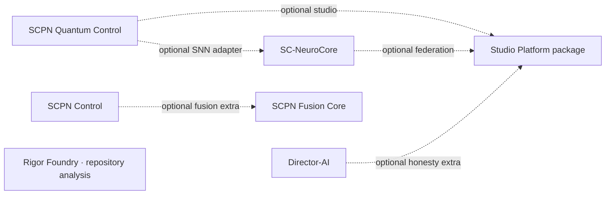

<!--
SPDX-License-Identifier: AGPL-3.0-or-later
可提供商业许可
© 概念 1996–2026 Miroslav Šotek。保留所有权利。
© 代码 2020–2026 Miroslav Šotek。保留所有权利。
ORCID: 0009-0009-3560-0851
联系方式：www.anulum.li | protoscience@anulum.li
GitHub 个人资料概览
-->

  <picture>
    <source media="(prefers-color-scheme: dark)" srcset="assets/profile-header-dark.svg">
    <source media="(prefers-color-scheme: light)" srcset="assets/profile-header-light.svg">
    
  </picture>

  
  
  
  
  

  
  
  
  
  
  

  <a href="#verified-work">已验证工作</a> · <a href="#current-focus">当前重点</a> ·
  <a href="#portfolio-ecosystem">生态系统</a> · <a href="#engineering-practice">工程标准</a> ·
  <a href="#research-output">研究产出</a> · <a href="#collaboration">合作</a>

# Miroslav Šotek

我是常驻瑞士的独立研究人员与系统工程师，以 Anulum 名义开发科学软件及受治理的研究组织。五个活跃组覆盖反应堆系统、集成与控制、智能体协调与保障、神经形态计算以及量子计算。第六组 Scientific Discovery and Experimentation 正在组建。已发布软件、架构工作、世界模型开发及预期硬件产出各有独立的证据边界。我们寻求与伙伴共同成立研究所和公司。

## 语言与平台

**主要实现：** Python、Rust、TypeScript、JavaScript 和 Go。

**科学、原生与形式化工作：** Julia、Mojo、C++、C、Lean 4、Jupyter 和 LaTeX。

**硬件、Web 与运维：** Verilog、SystemVerilog、WGSL/WebGPU、HTML/CSS、
Shell、Docker 和 Linux。

  
  
  
  
  
  
  
  
  
  
  
  

## 从这里开始

| 如果您需要… | 请前往 |
|---|---|
| 不会互相覆盖工作的并行编程智能体 | [Synapse Channel](https://github.com/anulum/synapse-channel) · [文档](https://anulum.github.io/synapse-channel/) |
| LLM 主张防护与事实一致性检查 | [Director-AI](https://github.com/anulum/director-ai) · [文档](https://anulum.github.io/director-ai/) |
| 仓库审计与修复规划 | [Rigor Foundry](https://github.com/anulum/rigor-foundry) · [文档](https://anulum.github.io/rigor-foundry/) |
| 神经形态与随机计算研究 | [SC-NeuroCore](https://github.com/anulum/sc-neurocore) · [文档](https://anulum.github.io/sc-neurocore/) |
| 耦合振荡器与量子模拟研究 | [SCPN Quantum Control](https://github.com/anulum/scpn-quantum-control) |

项目文档也发布在各仓库的 Pages 站点以及
[anulum.li](https://anulum.li)。

## 已验证工作

| 领域 | 可检查证据 |
|---|---|
| 多智能体协调 | [验证](https://github.com/anulum/synapse-channel/blob/dd65c898a9693b47fad051e3baa92cef07da2e63/VALIDATION.md)、[协调规范](https://github.com/anulum/synapse-channel/blob/dd65c898a9693b47fad051e3baa92cef07da2e63/docs/coordination-spec.md)、[威胁模型](https://github.com/anulum/synapse-channel/blob/dd65c898a9693b47fad051e3baa92cef07da2e63/docs/sandbox-threat-model.md) |
| LLM 响应保障 | [验证](https://github.com/anulum/director-ai/blob/fc155051367bb48180f2f5dc92f4120c2549cddd/VALIDATION.md)、[公开基准](https://github.com/anulum/director-ai/blob/fc155051367bb48180f2f5dc92f4120c2549cddd/benchmarks/PUBLIC_BENCHMARKS.md)、[能力矩阵](https://github.com/anulum/director-ai/blob/fc155051367bb48180f2f5dc92f4120c2549cddd/docs/_generated/capability_matrix.md) |
| 神经形态计算到 RTL | [验证](https://github.com/anulum/sc-neurocore/blob/4bbc27b808eef0677848c1e484f40bd41e8ce83d/VALIDATION.md)、[综合结果](https://github.com/anulum/sc-neurocore/blob/4bbc27b808eef0677848c1e484f40bd41e8ce83d/docs/hardware/SYNTHESIS_RESULTS.md)、[可追溯矩阵](https://github.com/anulum/sc-neurocore/blob/4bbc27b808eef0677848c1e484f40bd41e8ce83d/docs/safety/TRACEABILITY_MATRIX.md) |
| 等离子体与量子 | [聚变验证](https://github.com/anulum/scpn-fusion-core/blob/3c841fc13109c8efb49bb079d145f70683a4408d/VALIDATION.md)、[布局松弛协议](https://github.com/anulum/scpn-quantum-control/blob/2bc0f935b75ae7b85a4835caf754b2bfd8770c98/docs/layout_relaxation_preregistration.md)、[硬件结果包](https://github.com/anulum/scpn-quantum-control/blob/2bc0f935b75ae7b85a4835caf754b2bfd8770c98/docs/hardware_result_packs.md) |

## 当前重点

项目组合状态于 <!-- verified-at -->2026-10-15<!-- /verified-at --> 验证。

- 在 26 个公开 Reactor 仓库中整合共享内核和受治理的设备事实。
- 在清晰所有权边界下连接协调、记忆、响应保障、动作审查和仓库证据。
- 将科学模型推进到原生加速、形式化检查、RTL 和可检查结果包。

<!-- profile-feeds:releases:start -->
### 最新发布

| 日期 | 项目 | 版本 | 变更 |
|---|---|---|---|
| 2026-10-02 | Synapse Channel | [v0.99.37](https://doi.org/10.5281/zenodo.23095056) | published software archive |
| 2026-10-01 | Loop Timing Witness | [v0.1.0](https://doi.org/10.5281/zenodo.23092361) | published host software |
| 2026-10-01 | Synapse Channel | [v0.99.36](https://doi.org/10.5281/zenodo.23088472) | historical software archive |
| 2026-09-30 | SYNAPSE CHANNEL | [v0.99.35](https://github.com/anulum/synapse-channel/releases/tag/v0.99.35) | Shared-pool reservations with one authoritative owner (F02, not yet enforced). |
| 2026-09-30 | SYNAPSE CHANNEL | [v0.99.34](https://github.com/anulum/synapse-channel/releases/tag/v0.99.34) | Signed peers behind a TLS-terminating proxy were admitted but served nothing. 0.99.33 said a peer hub's or Fleet follower's signed log pull works behind such a proxy. It did not. |

根据 [anulum.li/news](https://anulum.li/news/)（各项目的 CHANGELOG 文件）和 [Zenodo](https://zenodo.org/search?q=creators.orcid%3A%220009-0009-3560-0851%22) 于 2026-10-15 生成。
<!-- profile-feeds:releases:end -->

<!-- profile-feeds:publication:start -->
### 最新出版物

| 日期 | 类型 | 成果 | DOI |
|---|---|---|---|
| 2026-10-11 | Preprint | The calibration epoch as the unit of evidence: preregistered parity-leakage and layout-transfer experiments on IQM Garnet | [10.5281/zenodo.23298119](https://doi.org/10.5281/zenodo.23298119) |

根据 [anulum.li/news](https://anulum.li/news/)（各项目的 CHANGELOG 文件）和 [Zenodo](https://zenodo.org/search?q=creators.orcid%3A%220009-0009-3560-0851%22) 于 2026-10-15 生成。
<!-- profile-feeds:publication:end -->

## 时间线

| 时期 | 有公开依据的里程碑 |
|---|---|
| 1996 年起 | 自行发布的概念开发时间范围 |
| 1998 | 公开 ORCID 记录中自行填写的 ANULUM CH&LI 创始人角色开始 |
| 2018 | 建立公开 GitHub 账户 |
| 2025 | 在 Zenodo 发布 SCPN 预览材料与技术报告 |
| 2026 | 公开软件与研究组合扩展至 AI 保障、神经形态、等离子体和量子系统 |

## 实验室地图

箭头表示各组架构记录中声明的可选软件接口，并非经过测试的端到端科学闭环。Rigor Foundry 分析仓库，此处不虚构运行时依赖。各领域保留模型与硬件权限。Studio Platform 是已发布软件包，其仓库仍私有。Phase Orchestrator 的电网模态阻尼基准于 2026 年 10 月 12 日撤回；本页不声称已在实际电网上获得成果或实现量子优势。

## 生态系统地图

<!-- profile-catalogue:inventory:start -->
**带日期的清单: 2026-10-15**

项目组合共有 97 个仓库：37 个公开、6 个私有、54 个已在本地初始化但尚未公开。另有 42 个目录条目说明软件包、模块、工作区或架构目标。所有工作均在进行中。

各组声明日期为 10 月 12–13 日；仓库存在及公开状态于 2026 年 10 月 15 日检查。许可证信息是来源声明，并非法律审计。软件包发布与硬件资格验证各自独立。

  
  
  
  

<picture>
  <source media="(prefers-color-scheme: dark)" srcset="assets/ecosystem-map-dark.svg">
  <source media="(prefers-color-scheme: light)" srcset="assets/ecosystem-map-light.svg">
  
</picture>

详细图谱已集成到本仓库。其 196 个条目还包括研究计划、公司需求、伙伴角色和融资路径，并非 196 个仓库。交互视图的打开方式见图谱预览说明。现有网站项目组合单独维护。

[详细图谱源码与本地预览](docs/atlas/README.md) · [anulum.li/portfolio/](https://anulum.li/portfolio/)

以下技术说明引用英文来源记录。已命名的目标不代表已单独发布的能力。共享条目仅在主要所属组中计数一次。

<strong>01 · SCPN Reactor Systems</strong> · 55 个仓库 · 55 个目录条目

55 个所属仓库，包括 ATLAS-REACTORUM：26 个公开，29 个在本地初始化且尚未公开。涵盖聚变、裂变、化学及混合模型、共享内核、几何和反应堆证据。世界模型、3D 仿真和装置设计属于正在开发的计划产出；设计不等于已验证的反应堆。

[各组架构图](https://github.com/anulum/atlas-reactorum/blob/main/docs/ecosystem.md)

| 项目 / 组件 | 职责与开发阶段 | 仓库 / 可用性 | 声明许可证 | 来源日期 |
|---|---|---|---|---|
| [ATLAS-REACTORUM](https://github.com/anulum/atlas-reactorum) Source and rights library with historical reactor taxonomy and interactive citation views. | 进行中 · tool · Implementation and integration | 公开 | AGPL-3.0-or-later | 2026-10-12 |
| SCPN-ADS-CORE Subcritical blanket plus typed external source/beam-target interface. | 进行中 · component · Architecture and qualification | 本地，尚未公开 | AGPL-3.0-or-later | 2026-10-12 |
| [SCPN Beam Target Core](https://github.com/anulum/scpn-beam-target-core) Beam/target design and source-scoped reaction/stopping/yield. | 进行中 · component · Computational prototypes and continued development | 公开 | AGPL-3.0-or-later | 2026-10-12 |
| SCPN-BIOCHEM-CORE Source-specific enzyme/fermentation kinetics and reactor transport. | 进行中 · component · Architecture and qualification | 本地，尚未公开 | AGPL-3.0-or-later | 2026-10-12 |
| SCPN-BREED-BURN-CORE Source-bounded breed-and-burn fuel-management concept. | 进行中 · component · Architecture and qualification | 本地，尚未公开 | AGPL-3.0-or-later | 2026-10-12 |
| SCPN-BWR-CORE Boiling-channel thermal-spectrum family and void-feedback boundary. | 进行中 · component · Architecture and qualification | 本地，尚未公开 | AGPL-3.0-or-later | 2026-10-12 |
| SCPN-CATALYTIC-BED-CORE Fixed-bed catalyst/transport/pressure-drop coupling. | 进行中 · component · Architecture and qualification | 本地，尚未公开 | AGPL-3.0-or-later | 2026-10-12 |
| SCPN-CHANNEL-CORE Graphite-moderated channel reactor only; exclusive from PHWR pressure tubes. | 进行中 · component · Architecture and qualification | 本地，尚未公开 | AGPL-3.0-or-later | 2026-10-12 |
| SCPN-CHEM-KINETICS-CORE Ideal gas batch/CSTR/PFR named kinetics and thermo models. | 进行中 · component · Architecture and qualification | 本地，尚未公开 | AGPL-3.0-or-later | 2026-10-12 |
| SCPN-CHEM-PROCESS-HYBRID-CORE Chemical process/recycle/separation and carbon-capture composition. | 进行中 · component · Architecture and qualification | 本地，尚未公开 | AGPL-3.0-or-later | 2026-10-12 |
| [SCPN Dense Plasma Focus Core](https://github.com/anulum/scpn-dense-plasma-focus-core) Focus device/bank/axial/radial/pinch and source-scoped neutron estimates. | 进行中 · component · Computational prototypes and continued development | 公开 | AGPL-3.0-or-later | 2026-10-12 |
| SCPN-ELECTROCHEM-CORE Electrode/cell transport and charge/reaction interface. | 进行中 · component · Architecture and qualification | 本地，尚未公开 | AGPL-3.0-or-later | 2026-10-12 |
| [SCPN FRC Core](https://github.com/anulum/scpn-frc-core) Field-reversed configuration, radial pressure-balance and kinetic-scale model. | 进行中 · component · Computational prototypes and continued development | 公开 | AGPL-3.0-or-later | 2026-10-12 |
| [SCPN Fusion Core](https://github.com/anulum/scpn-fusion-core) Canonical plasma solver mathematics, transport/equilibrium and existing research pipeline. | 进行中 · package · Released software · ongoing development | 公开 | AGPL-3.0-or-later | 2026-10-12 |
| [SCPN Fusion-Fission Hybrid Core](https://github.com/anulum/scpn-fusion-fission-hybrid-core) Existing source-owned fusion/fission blanket device and proposed typed member couplings. | 进行中 · component · Computational prototypes and continued development | 公开 | AGPL-3.0-or-later | 2026-10-12 |
| SCPN-FUSION-PROCESS-HEAT-CORE Fusion-source to chemical-process heat/material composition. | 进行中 · component · Architecture and qualification | 本地，尚未公开 | AGPL-3.0-or-later | 2026-10-12 |
| SCPN-GFR-CORE Gas-cooled fast-spectrum family with high-temperature heat-removal boundary. | 进行中 · component · Architecture and qualification | 本地，尚未公开 | AGPL-3.0-or-later | 2026-10-12 |
| SCPN-HEAT-PIPE-CORE Solid-core heat-pipe microreactor and source-defined transport limits. | 进行中 · component · Architecture and qualification | 本地，尚未公开 | AGPL-3.0-or-later | 2026-10-12 |
| SCPN-HTGR-CORE Graphite/TRISO helium-cooled design and distinct process-heat interface. | 进行中 · component · Architecture and qualification | 本地，尚未公开 | AGPL-3.0-or-later | 2026-10-12 |
| SCPN-HYBRID-ENERGY-CORE Fission/renewable/storage electrical and thermal composition. | 进行中 · component · Architecture and qualification | 本地，尚未公开 | AGPL-3.0-or-later | 2026-10-12 |
| SCPN-HYDROGEN-PROCESS-CORE HTSE and named thermochemical hydrogen process routes. | 进行中 · component · Architecture and qualification | 本地，尚未公开 | AGPL-3.0-or-later | 2026-10-12 |
| [SCPN ICF Beam Core](https://github.com/anulum/scpn-icf-beam-core) Particle-beam illumination/capsule design with explicit coupling. | 进行中 · component · Computational prototypes and continued development | 公开 | AGPL-3.0-or-later | 2026-10-12 |
| [SCPN ICF Impact Core](https://github.com/anulum/scpn-icf-impact-core) Impact/projectile/fuel/compression design and source-limited energy relations. | 进行中 · component · Computational prototypes and continued development | 公开 | AGPL-3.0-or-later | 2026-10-12 |
| [SCPN ICF Laser Core](https://github.com/anulum/scpn-icf-laser-core) Laser-driven capsule/implosion design and source-scoped ignition/gain criteria. | 进行中 · component · Computational prototypes and continued development | 公开 | AGPL-3.0-or-later | 2026-10-12 |
| [SCPN IEC Core](https://github.com/anulum/scpn-iec-core) Gridded electrostatic device and distinct nonthermal loss/recirculation models. | 进行中 · component · Computational prototypes and continued development | 公开 | AGPL-3.0-or-later | 2026-10-12 |
| [SCPN Lattice Fusion Core](https://github.com/anulum/scpn-lattice-fusion-core) Source-bounded lattice-confinement fusion research and modelling. | 进行中 · component · Architecture and qualification | 公开 | AGPL-3.0-or-later | 2026-10-12 |
| [SCPN Levitated Dipole Core](https://github.com/anulum/scpn-levitated-dipole-core) Dipole coil/levitation/charging and anisotropic plasma model. | 进行中 · component · Computational prototypes and continued development | 公开 | AGPL-3.0-or-later | 2026-10-12 |
| SCPN-LFR-CORE Lead/LBE fast-spectrum family with materials/corrosion boundary. | 进行中 · component · Architecture and qualification | 本地，尚未公开 | AGPL-3.0-or-later | 2026-10-12 |
| [SCPN Magnetic Cusp Core](https://github.com/anulum/scpn-magnetic-cusp-core) Cusp coil/configuration ownership and source-specific field/particle-loss model proposal. | 进行中 · component · Computational prototypes and continued development | 公开 | AGPL-3.0-or-later | 2026-10-12 |
| SCPN-MEMBRANE-CORE Reaction-separation with explicit membrane transport. | 进行中 · component · Architecture and qualification | 本地，尚未公开 | AGPL-3.0-or-later | 2026-10-12 |
| SCPN-METHANE-REFORMER-CORE Steam-methane reforming kinetics and process train. | 进行中 · component · Architecture and qualification | 本地，尚未公开 | AGPL-3.0-or-later | 2026-10-12 |
| [SCPN MIF Core](https://github.com/anulum/scpn-mif-core) Existing magneto-inertial dynamics/runtime with maintained multi-language/RTL chain. | 进行中 · package · Released software · ongoing development | 公开 | AGPL-3.0-or-later | 2026-10-12 |
| [SCPN MIF Liner Core](https://github.com/anulum/scpn-mif-liner-core) Mechanical/magnetic liner compression and target-energy coupling. | 进行中 · component · Computational prototypes and continued development | 公开 | AGPL-3.0-or-later | 2026-10-12 |
| [SCPN MIF MagLIF Core](https://github.com/anulum/scpn-mif-maglif-core) Magnetised liner drive/preheat/compression family. | 进行中 · component · Computational prototypes and continued development | 公开 | AGPL-3.0-or-later | 2026-10-12 |
| [SCPN MIF Plasma Jet Core](https://github.com/anulum/scpn-mif-plasma-jet-core) Discrete plasma-jet array and spherical liner convergence. | 进行中 · component · Computational prototypes and continued development | 公开 | AGPL-3.0-or-later | 2026-10-12 |
| [SCPN Mirror Core](https://github.com/anulum/scpn-mirror-core) Mirror/tandem confinement and source-specific flux-tube geometry. | 进行中 · component · Computational prototypes and continued development | 公开 | AGPL-3.0-or-later | 2026-10-12 |
| SCPN-MSR-CORE Liquid-fuel molten-salt family with chemistry, circulation and depletion. | 进行中 · component · Architecture and qualification | 本地，尚未公开 | AGPL-3.0-or-later | 2026-10-12 |
| [SCPN Muon Fusion Core](https://github.com/anulum/scpn-muon-fusion-core) Muon-catalysed reaction models and complete energy accounting. | 进行中 · component · Architecture and qualification | 公开 | AGPL-3.0-or-later | 2026-10-12 |
| SCPN-NTP-CORE Reactor-side thermal propulsion and typed heat/flow interface. | 进行中 · component · Architecture and qualification | 本地，尚未公开 | AGPL-3.0-or-later | 2026-10-12 |
| SCPN-NUCLEAR-DESALINATION-CORE Fission-to-desalination thermal/material composition. | 进行中 · component · Architecture and qualification | 本地，尚未公开 | AGPL-3.0-or-later | 2026-10-12 |
| SCPN-NUCLEAR-HYDROGEN-CORE Typed fission-to-hydrogen thermal/electrical/material composition. | 进行中 · component · Architecture and qualification | 本地，尚未公开 | AGPL-3.0-or-later | 2026-10-12 |
| SCPN-PHOTOCATALYTIC-CORE Photon-flux-driven reaction and optical/source coupling. | 进行中 · component · Architecture and qualification | 本地，尚未公开 | AGPL-3.0-or-later | 2026-10-12 |
| SCPN-PHWR-CORE Heavy-water pressure-tube family with on-power fuel management. | 进行中 · component · Architecture and qualification | 本地，尚未公开 | AGPL-3.0-or-later | 2026-10-12 |
| SCPN-PWR-CORE Light-water moderated/cooled vessel and primary-circuit design. | 进行中 · component · Architecture and qualification | 本地，尚未公开 | AGPL-3.0-or-later | 2026-10-12 |
| SCPN-REACTOR-CATALOGUE Evidence-labelled source-authority catalogue, candidate revision/history and vocabulary. | 进行中 · component · Architecture and qualification | 本地，尚未公开 | AGPL-3.0-or-later | 2026-10-12 |
| [SCPN Reactor Kernels](https://github.com/anulum/scpn-reactor-kernels) Shared equations, numerical primitives and geometry/CAD/export substrate. | 进行中 · package · Implementation and integration | 公开 | AGPL-3.0-or-later | 2026-10-12 |
| SCPN-RESEARCH-REACTOR-CORE Research/isotope-production core including separately supported pulse operation. | 进行中 · component · Architecture and qualification | 本地，尚未公开 | AGPL-3.0-or-later | 2026-10-12 |
| [SCPN RFP Core](https://github.com/anulum/scpn-rfp-core) Reversed-field pinch relaxation/profile and toroidal device design. | 进行中 · component · Computational prototypes and continued development | 公开 | AGPL-3.0-or-later | 2026-10-12 |
| SCPN-SCWR-CORE Supercritical-water family with explicit thermophysical transition support. | 进行中 · component · Architecture and qualification | 本地，尚未公开 | AGPL-3.0-or-later | 2026-10-12 |
| SCPN-SFR-CORE Sodium-cooled fast-spectrum family and fuel/material/heat-removal boundary. | 进行中 · component · Architecture and qualification | 本地，尚未公开 | AGPL-3.0-or-later | 2026-10-12 |
| [SCPN Spheromak Core](https://github.com/anulum/scpn-spheromak-core) Relaxed compact-torus configuration, flux conserver and formation criteria. | 进行中 · component · Computational prototypes and continued development | 公开 | AGPL-3.0-or-later | 2026-10-12 |
| [SCPN Stellarator Core](https://github.com/anulum/scpn-stellarator-core) Three-dimensional magnetic-confinement configuration and coil/design ownership. | 进行中 · component · Computational prototypes and continued development | 公开 | AGPL-3.0-or-later | 2026-10-12 |
| [SCPN Theta Pinch Core](https://github.com/anulum/scpn-theta-pinch-core) Axial-field compression and pinch configuration with sharp-boundary model. | 进行中 · component · Computational prototypes and continued development | 公开 | AGPL-3.0-or-later | 2026-10-12 |
| [SCPN Tokamak Core](https://github.com/anulum/scpn-tokamak-core) Own tokamak physical modelling and reactor-design geometry, with explicitly qualified canonical plasma-solver dependencies. | 进行中 · component · Computational prototypes and continued development | 公开 | AGPL-3.0-or-later | 2026-10-12 |
| [SCPN Z-Pinch Core](https://github.com/anulum/scpn-z-pinch-core) Current-driven pinch, sheared-flow model and pulsed device design. | 进行中 · component · Computational prototypes and continued development | 公开 | AGPL-3.0-or-later | 2026-10-12 |

**反应堆家族门户**: [reactor-systems](https://anulum.li/reactor-systems/) · [compare.html](https://anulum.li/reactor-systems/compare.html) · [closed-magnetic](https://anulum.li/reactor-systems/closed-magnetic/) · [open-magnetic](https://anulum.li/reactor-systems/open-magnetic/) · [pinches](https://anulum.li/reactor-systems/pinches/) · [inertial](https://anulum.li/reactor-systems/inertial/) · [magneto-inertial](https://anulum.li/reactor-systems/magneto-inertial/) · [electrostatic-hybrid](https://anulum.li/reactor-systems/electrostatic-hybrid/)

<strong>02 · SCPN Systems Integration and Control</strong> · 4 个仓库 · 4 个目录条目

四个同等地位的产品。Control 与 Phase Orchestrator 公开；Studio Hub 和 Studio Platform 仓库私有。公开的 scpn-studio-platform 软件包可单独获取。已声明的 Studio 接口不等于已测试的联邦集成。

| 项目 / 组件 | 职责与开发阶段 | 仓库 / 可用性 | 声明许可证 | 来源日期 |
|---|---|---|---|---|
| [SCPN Phase Orchestrator](https://github.com/anulum/scpn-phase-orchestrator) Synchronisation analysis and evaluation of early-warning detectors on coupled phase-oscillator dynamics, with a Rust kernel. | 进行中 · package · Released software · ongoing development | 公开 | AGPL-3.0-or-later | 2026-10-13 |
| [SCPN Control](https://github.com/anulum/scpn-control) Compiler from stochastic Petri nets to controllers with runtime contracts, and plasma-control research paths. | 进行中 · package · Released software · ongoing development | 公开 | AGPL-3.0-or-later | 2026-10-13 |
| SCPN Studio Platform Domain-neutral SDK for studios: evidence bundles, capability manifests, bounded jobs and tenant-aware identity. | 进行中 · package · Released software · ongoing development | 私有 | AGPL-3.0-or-later | 2026-10-13 |
| SCPN Studio The hub that federates studios over the platform contract: registry, cross-studio evidence audit, rendering and federation gating. | 进行中 · service · Implementation and integration | 私有 | AGPL-3.0-or-later | 2026-10-13 |

<strong>03 · Agentic Coordination, Assurance and Continuity</strong> · 10 个仓库 · 10 个目录条目

十个仓库，涵盖协调、保障、记忆及受治理的行动。HushLine 是组内工具，清单也包括 SYNAPSE-POLICY-CHECK-ACTION。各产品保留各自的许可证及能力边界。

[各组架构图](https://github.com/anulum/synapse-channel/blob/main/docs/ecosystem.md)

| 项目 / 组件 | 职责与开发阶段 | 仓库 / 可用性 | 声明许可证 | 来源日期 |
|---|---|---|---|---|
| [Synapse Channel](https://github.com/anulum/synapse-channel) Local-first coordination bus for AI agents: presence, file-scope work claims, messages, task status, receipts and an audit journal on one hub. | 进行中 · package · Released software · ongoing development | 公开 | AGPL-3.0-or-later | 2026-10-11 |
| Synapse Channel Fleet Multi-machine operation of the bus: durable follower daemon, per-peer trust and configuration, claim forwarding and diagnostics. | 进行中 · package · Implementation and integration | 私有 | LicenseRef-SYNAPSE-Enterprise | 2026-10-11 |
| [SYNAPSE-POLICY-CHECK-ACTION](https://github.com/anulum/synapse-policy-check-action) GitHub Action that checks a SYNAPSE CHANNEL release receipt against a policy file in CI. | 进行中 · tool · Implementation and integration | 公开 | AGPL-3.0-or-later | 2026-10-11 |
| [Director-AI](https://github.com/anulum/director-ai) Response-level guardrail for LLM output: NLI and retrieval grounding, sealed evidence packets and an optional streaming contradiction halt. | 进行中 · package · Released software · ongoing development | 公开 | Apache-2.0 AND BUSL-1.1 | 2026-10-11 |
| Director Class AI Action control between an autonomous agent and its effectors: action-policy checks, human approvals, gateway enforcement and tamper-evident action evidence. | 进行中 · package · Implementation and integration | 私有 | BUSL-1.1 | 2026-10-11 |
| Director AI Cloud Control plane for a hosted Director-AI API: accounts, API-key lifecycle, usage metering, plan quotas and operator exports. | 进行中 · service · Implementation and integration | 私有 | BUSL-1.1 | 2026-10-11 |
| [Rigor Foundry](https://github.com/anulum/rigor-foundry) Evidence-bound repository auditing: inventories Git-tracked content, emits reproducible audit candidates, binds review decisions to exact evidence and prepares remediation inputs. | 进行中 · package · Released software · ongoing development | 公开 | Apache-2.0 | 2026-10-11 |
| [Remanentia](https://github.com/anulum/remanentia) Local-first, auditable memory for AI agents and knowledge-intensive software: project-file indexing, hybrid retrieval, consolidation and an entity graph, through a CLI, an MCP server and an HTTP API. | 进行中 · package · Released software · ongoing development | 公开 | AGPL-3.0-or-later | 2026-10-11 |
| Remanentia Portal Account and billing or licence-request portal for the product family. It runs no customer workload. | 进行中 · service · Implementation and integration | 私有 | AGPL-3.0-or-later | 2026-10-11 |
| [HushLine](https://github.com/anulum/HushLine) Local command-output filter: runs a command, then limits, shapes and redacts its output before it reaches a caller. Four independent cores: Go, Rust, Python and Node. | 进行中 · tool · Released software · ongoing development | 公开 | AGPL-3.0-or-later | 2026-10-11 |

<strong>04 · SC Neuromorphic Computing Systems</strong> · 4 个仓库 · 42 个目录条目

核心清单有 40 个具名条目，包括永久 SC-NeuroCore 工作台及辅助工具；另外两个模块/条件目标使目录总数达到 42。 LOOP-TIMING-WITNESS 已有公开的主机端软件包；物理板卡资格验证仍待完成。EVIDENCE-MANIFEST-TOOLKIT 尚未公开。模块与延期目标分别标注。

[各组架构图](https://github.com/anulum/sc-neurocore/blob/main/docs/ecosystem.md)

| 项目 / 组件 | 职责与开发阶段 | 仓库 / 可用性 | 声明许可证 | 来源日期 |
|---|---|---|---|---|
| [SC-NeuroCore](https://github.com/anulum/sc-neurocore) Permanent public development, composition and integration workbench for stochastic and spiking neural modelling, encoding, learning, simulation, selected hardware compilation and evidence inspection. | 进行中 · workbench · Released software · ongoing development | 公开 | AGPL-3.0-or-later | 2026-10-13 |
| [Loop Timing Witness](https://github.com/anulum/loop-timing-witness) Fabric-clock instrument for complete control-loop and selected accelerator timing, with simulation/host analysis separated from eventual board timing, fault response and rail-energy evidence. | 进行中 · tool · Architecture and qualification | 公开 | AGPL-3.0-or-later | 2026-10-13 |
| EVIDENCE-MANIFEST-TOOLKIT Canonicalises, references, seals and verifies evidence with explicit schemas, bounded sources and independently selected policy. | 进行中 · shared · Architecture and qualification | 本地，尚未公开 | AGPL-3.0-or-later | 2026-10-13 |
| RANDOMNESS-WITNESS Assesses number-source suitability for a declared stochastic-computing use; it does not certify randomness for every purpose. | 进行中 · shared · Design and preparation | 目标 / 模块 / 软件包 | undecided | 2026-10-13 |
| EXPERIMENT-LEDGER Records experiment lineage across tools without owning their raw evidence or running their computations. | 进行中 · shared · Design and preparation | 目标 / 模块 / 软件包 | undecided | 2026-10-13 |
| SC-NC-CORE Neuron/synapse primitives, network graph, simulation loop, fixed-point semantics, constants and exceptions. | 进行中 · component · Workbench transition | 目标 / 模块 / 软件包 | Undecided for independent release | 2026-10-13 |
| SC-NC-CATALOGUE Neuron models, model zoo and topology/connectome generators. | 进行中 · component · Workbench transition | 目标 / 模块 / 软件包 | Undecided for independent release | 2026-10-13 |
| SC-NC-ENGINE Accelerated execution and its maintained language/native interfaces. | 进行中 · component · Workbench transition | 目标 / 模块 / 软件包 | Undecided for independent release | 2026-10-13 |
| SC-NC-BRIDGES Interchange and cross-domain adapters including NIR, quantum, HDC/VSA and neuro-symbolic routes. | 进行中 · component · Workbench transition | 目标 / 模块 / 软件包 | Undecided for independent release | 2026-10-13 |
| SC-NC-LEARN Training and adaptation, including surrogate gradients, plasticity, online learning, quantisation-aware training and distillation. | 进行中 · component · Workbench transition | 目标 / 模块 / 软件包 | Undecided for independent release | 2026-10-13 |
| SC-NC-DATA Datasets, signal/event encoding, augmentation, codecs, sources and recording adapters. | 进行中 · component · Workbench transition | 目标 / 模块 / 软件包 | Undecided for independent release | 2026-10-13 |
| SC-NC-ANALYSIS Spike-train analysis, visualisation and explainability. | 进行中 · component · Workbench transition | 目标 / 模块 / 软件包 | Undecided for independent release | 2026-10-13 |
| SC-NC-COMPILER Equation/IR lowering and hardware collateral for supported numerical models. | 进行中 · component · Workbench transition | 目标 / 模块 / 软件包 | Undecided for independent release | 2026-10-13 |
| SC-NC-HARDWARE Target profiles, mapping, deployment, drivers and power/thermal integration. | 进行中 · component · Workbench transition | 目标 / 模块 / 软件包 | Undecided for independent release | 2026-10-13 |
| SC-NC-VERIFY Formal, fault, resilience and safety-readiness verification within explicit proof scopes. | 进行中 · component · Workbench transition | 目标 / 模块 / 软件包 | Undecided for independent release | 2026-10-13 |
| SC-NC-STUDIO Visual composition, inspection and evidence presentation workflows. | 进行中 · component · Workbench transition | 目标 / 模块 / 软件包 | Undecided for independent release | 2026-10-13 |
| SC-NC-RESEARCH Retained experimental paths, including evolutionary, biological and world-model directions. | 进行中 · component · Workbench transition | 目标 / 模块 / 软件包 | Undecided for independent release | 2026-10-13 |
| SC-NC-BENCH Catalogue/workload suites and immutable source-bound benchmark records. | 进行中 · component · Workbench transition | 目标 / 模块 / 软件包 | Undecided for independent release | 2026-10-13 |
| MODEL-PROVENANCE-PACK Binds a model's data, training, conversion, quantisation, encoding and supporting evidence into a verifiable provenance pack. | 进行中 · tool · Design and implementation | 目标 / 模块 / 软件包 | Undecided for independent release | 2026-10-13 |
| SPIKE-LOG Records, indexes, verifies, slices and replays event streams without losing their provenance or timebase identity. | 进行中 · tool · Design and implementation | 本地，尚未公开 | Undecided for independent release | 2026-10-13 |
| SPIKE-FORMAT-BRIDGE Converts event recordings between declared formats and reports every permitted loss rather than hiding timestamp, polarity or side-stream changes. | 进行中 · tool · Design and implementation | 目标 / 模块 / 软件包 | Undecided for independent release | 2026-10-13 |
| SPIKE-CODEC-BENCH Measures compression of existing spike trains, comparing payload ratio, distortion, encode/decode latency and memory. | 进行中 · tool · Design and implementation | 目标 / 模块 / 软件包 | Undecided for independent release | 2026-10-13 |
| SPIKE-ENCODER-CHARACTERISER Measures the information, spike-rate and latency trade-offs of sensor-to-spike encoders. | 进行中 · tool · Design and implementation | 目标 / 模块 / 软件包 | Undecided for independent release | 2026-10-13 |
| SPIKE-QUALITY-GATE Checks event data against a named quality policy for timestamp, noise, sensor-health, rate, gap and spatial defects. | 进行中 · tool · Design and implementation | 目标 / 模块 / 软件包 | Undecided for independent release | 2026-10-13 |
| SPIKE-GROUNDTRUTH Generates reproducible event-vision, audio, sensor and control stimuli with ground truth defined by the generator. | 进行中 · tool · Design and implementation | 目标 / 模块 / 软件包 | Undecided for independent release | 2026-10-13 |
| SNN-DIVERGENCE-HARNESS Compares the same network and input across implementations under bit-exact, tolerance or statistical oracles. | 进行中 · tool · Design and implementation | 目标 / 模块 / 软件包 | Undecided for independent release | 2026-10-13 |
| SC-STREAM-PROVER Compares realised stochastic-computing arithmetic error with a declared bound for a specific circuit, source and stream-length regime. | 进行中 · tool · Design and implementation | 目标 / 模块 / 软件包 | Undecided for independent release | 2026-10-13 |
| MUTATION-SNN Measures test adequacy by generating declared semantic mutants and recording what the suite detects. | 进行中 · tool · Design and implementation | 目标 / 模块 / 软件包 | Undecided for independent release | 2026-10-13 |
| NIR-CONFORMANCE Tests importer/exporter behaviour against the known semantics of a pinned Neuromorphic Intermediate Representation version. | 进行中 · tool · Design and implementation | 目标 / 模块 / 软件包 | Undecided for independent release | 2026-10-13 |
| NEURO-EVIDENCE-BENCH Executes declared neuromorphic benchmark plans and traces each scoped result back to its raw evidence. | 进行中 · tool · Design and implementation | 目标 / 模块 / 软件包 | Undecided for independent release | 2026-10-13 |
| SPIKE-CALIBRATOR Measures classifier confidence against correctness under declared signal definitions, shifts and placements. | 进行中 · tool · Design and implementation | 目标 / 模块 / 软件包 | Undecided for independent release | 2026-10-13 |
| BITSTREAM-EVIDENCE-CI Captures pinned FPGA build inputs, reports and bitstream identity in a reproducibility-aware chained build ledger. | 进行中 · tool · Design and implementation | 目标 / 模块 / 软件包 | Undecided for independent release | 2026-10-13 |
| PLASTICITY-WITNESS Compares observed learning-rule updates with an independently defined fixed-point or statistical oracle under stated spike/load/fault protocols. | 进行中 · tool · Design and implementation | 目标 / 模块 / 软件包 | Undecided for independent release | 2026-10-13 |
| AER-LINK-WITNESS Measures event-link behaviour under load, including loss, reordering, fairness, starvation and forward progress. | 进行中 · tool · Design and implementation | 目标 / 模块 / 软件包 | Undecided for independent release | 2026-10-13 |
| RELIABILITY-WITNESS Characterises reliability within a declared physical or explicitly simulated exposure, retaining conditions, gaps and rare-event uncertainty. | 进行中 · tool · Design and implementation | 目标 / 模块 / 软件包 | Undecided for independent release | 2026-10-13 |
| SIM-REAL-WITNESS Quantifies simulation-to-fabric differences for the same model, input and observable population. | 进行中 · tool · Design and implementation | 目标 / 模块 / 软件包 | Undecided for independent release | 2026-10-13 |
| DEPLOY-PACK Composes validated deployment evidence with bitstream/driver identity into a verifiable install/update package. | 进行中 · tool · Design and implementation | 目标 / 模块 / 软件包 | Undecided for independent release | 2026-10-13 |
| FIELD-OPS-WITNESS Aggregates compact field health and drift evidence against deployment-time envelopes without actuating devices. | 进行中 · tool · Design and implementation | 目标 / 模块 / 软件包 | Undecided for independent release | 2026-10-13 |
| FLIGHT-RECORDER Retains a bounded per-device event/state history for gap-honest incident reconstruction. | 进行中 · tool · Design and implementation | 目标 / 模块 / 软件包 | Undecided for independent release | 2026-10-13 |
| NEURO-SAFETY-CASE Composes scoped evidence and open gaps into an assessor-facing assurance argument; it certifies nothing itself. | 进行中 · tool · Design and implementation | 目标 / 模块 / 软件包 | Undecided for independent release | 2026-10-13 |
| SC-COMPUTE-ADAPTERS Owns the SC-NeuroCore-side wrappers and numerical/register/handshake contracts needed to put selected generated peripherals into the independent LOOP-TIMING-WITNESS DUT/capture path. | 进行中 · workbench module · Architecture and interface work | 目标 / 模块 / 软件包 | Independent distribution terms being defined | 2026-10-13 |
| SC-NC-BIO Conditional destination for separately owned biological/biohybrid work if its independent release lifecycle is accepted; current experimental bioware remains in the developmental parent. | 进行中 · conditional architecture destination · Architecture and interface work | 目标 / 模块 / 软件包 | Independent distribution terms being defined | 2026-10-13 |

<strong>05 · SCPN Quantum Computing Systems</strong> · 24 个仓库 · 28 个目录条目

永久 SCPN-QUANTUM-CONTROL 工作台；oscillatools 与 SCPN-QUANTUM-ENGINE 是独立发行包，不是额外的工作台。16 个组件目标与 8 个工具目标正在开发；QUANTUM_LAB 是工作区。独立软件包的许可证及发布状态与父项目分开处理。

[各组架构图](https://github.com/anulum/scpn-quantum-control/blob/main/docs/ecosystem.md)

| 项目 / 组件 | 职责与开发阶段 | 仓库 / 可用性 | 声明许可证 | 来源日期 |
|---|---|---|---|---|
| [SCPN Quantum Control](https://github.com/anulum/scpn-quantum-control) Integrated modelling, simulation, compilation, gradients, control, provider workflows, analysis and Quantum Studio. | 进行中 · workbench · Released software · ongoing development | 公开 | AGPL-3.0-or-later | 2026-10-13 |
| oscillatools Classical coupled-phase-oscillator dynamics, observables, sensitivities and control-oriented numerical tools. | 进行中 · package · Released software · ongoing development | 目标 / 模块 / 软件包 | AGPL-3.0-or-later | 2026-10-13 |
| scpn-quantum-engine Optional Rust/PyO3 numerical acceleration and native computation used by supported workbench paths. | 进行中 · package · Released software · ongoing development | 目标 / 模块 / 软件包 | AGPL-3.0-or-later | 2026-10-13 |
| QPU-RESULT-PACK Preserve raw results and their provenance, derivations and reviewable presentation. | 进行中 · tool · Implementation and integration | 本地，尚未公开 | not stated | 2026-10-13 |
| TRANSPILE-WITNESS Retain scoped observations about compilation semantics, layout, global phase and replay. | 进行中 · tool · Implementation and integration | 目标 / 模块 / 软件包 | AGPL-3.0-or-later by file headers; no licence field in packaging | 2026-10-13 |
| MITIGATION-WITNESS Evaluate mitigation on declared measurement panels with retained inputs and uncertainty. | 进行中 · tool · Implementation and integration | 本地，尚未公开 | AGPL-3.0-or-later | 2026-10-13 |
| SCPN-QC-CONTRACTS Versioned parameter, result, semantic and evidence interface contracts shared by components. | 进行中 · component · Workbench transition | 本地，尚未公开 | Undecided for independent release | 2026-10-13 |
| SCPN-QC-CORE Configuration, logging, resource budgets and generic Kuramoto-XY problem foundations, separated from paper-specific research assumptions. | 进行中 · component · Workbench transition | 本地，尚未公开 | Undecided for independent release | 2026-10-13 |
| SCPN-QC-AD Whole-program automatic differentiation, derivative transforms, batching, optimisation and explicit supported-path contracts. | 进行中 · component · Workbench transition | 本地，尚未公开 | Undecided for independent release | 2026-10-13 |
| SCPN-QC-SIM Classical and quantum oscillator dynamics, XY/Kuramoto solvers, open-system simulation, tensor-network paths and co-simulation. | 进行中 · component · Workbench transition | 本地，尚未公开 | Undecided for independent release | 2026-10-13 |
| SCPN-QC-COMPILER Model and circuit frontends, intermediate representations, interchange and code generation. | 进行中 · component · Workbench transition | 本地，尚未公开 | Undecided for independent release | 2026-10-13 |
| SCPN-QC-QNODE Quantum tapes, gradient execution and framework bridges for supported Qiskit, PennyLane, JAX, PyTorch and TensorFlow paths. | 进行中 · component · Workbench transition | 本地，尚未公开 | Undecided for independent release | 2026-10-13 |
| SCPN-QC-HAL Provider-neutral workloads, capabilities, job/result contracts and optional provider adapters. | 进行中 · component · Workbench transition | 本地，尚未公开 | Undecided for independent release | 2026-10-13 |
| SCPN-QC-MITIGATION Error-mitigation implementations and their method taxonomy. | 进行中 · component · Workbench transition | 本地，尚未公开 | Undecided for independent release | 2026-10-13 |
| SCPN-QC-QEC Quantum error-correction analysis and fault-tolerant resource-reporting surfaces. | 进行中 · component · Workbench transition | 本地，尚未公开 | Undecided for independent release | 2026-10-13 |
| SCPN-QC-CONTROL Feedback and co-design, chimera and topology-aware control, and DLA-constrained control paths. | 进行中 · component · Workbench transition | 本地，尚未公开 | Undecided for independent release | 2026-10-13 |
| SCPN-QC-ANALYSIS Observables, synchronisation witnesses, result analysis and the open-data DLA-parity pathway. | 进行中 · component · Workbench transition | 本地，尚未公开 | Undecided for independent release | 2026-10-13 |
| SCPN-QC-LEARN Forecasting, quantum neural models, surrogate models, kernels and variational learning paths. | 进行中 · component · Workbench transition | 本地，尚未公开 | Undecided for independent release | 2026-10-13 |
| SCPN-QC-APPS Domain application adapters, quantum randomness, cryptography and sensing workflows, with explicit claim boundaries. | 进行中 · component · Workbench transition | 本地，尚未公开 | Undecided for independent release | 2026-10-13 |
| SCPN-QC-BENCH Workload-specific benchmark suites, comparison harnesses, campaign reproduction and retained run evidence. | 进行中 · component · Workbench transition | 本地，尚未公开 | Undecided for independent release | 2026-10-13 |
| SCPN-QC-STUDIO Quantum Studio's visual workflows, inspectors and evidence presentation through the shared Studio platform contract. | 进行中 · component · Workbench transition | 本地，尚未公开 | Undecided for independent release | 2026-10-13 |
| SCPN-QC-RESEARCH Experimental SCPN theory, paper-specific assumptions and research adapters whose contracts are not stable. | 进行中 · component · Workbench transition | 本地，尚未公开 | Undecided for independent release | 2026-10-13 |
| NOISE-MODEL-WITNESS Compare model predictions and replay observations for the same circuit and shot identities, with uncertainty, shot floors, calibration epochs and declared tolerances. | 进行中 · tool · Design and implementation | 本地，尚未公开 | Undecided for independent release | 2026-10-13 |
| VENDOR-CLAIM-RECOMPUTER Recompute released-data quantum-volume, error-per-layer-gate and logical-error claims against fixed definitions, original inputs and declared computation budgets. | 进行中 · tool · Design and implementation | 本地，尚未公开 | Undecided for independent release | 2026-10-13 |
| DECODER-WITNESS Compare real decoder engines on released shot data with lossless adapters, declared noise conditions and uncertainty-aware reports. | 进行中 · tool · Design and implementation | 本地，尚未公开 | Undecided for independent release | 2026-10-13 |
| GRADIENT-WITNESS Check software derivatives against declared analytic, parameter-shift and finite-difference references, including complex, finite-shot and cross-framework cases. | 进行中 · tool · Design and implementation | 本地，尚未公开 | Undecided for independent release | 2026-10-13 |
| CONFORMANCE-WITNESS Check versioned OpenQASM 3, adapter behaviour, provenance fields and repository-evidence criteria against their normative clauses and actual entry points. | 进行中 · tool · Design and implementation | 本地，尚未公开 | Undecided for independent release | 2026-10-13 |
| QUANTUM_LAB Reserved research workspace name; implementation role is not assigned in the group map. | 进行中 · workspace · Workspace definition | 目标 / 模块 / 软件包 | Not stated | 2026-10-13 |

↔ EVIDENCE-MANIFEST-TOOLKIT · RANDOMNESS-WITNESS · EXPERIMENT-LEDGER

<strong>06 · Scientific Discovery and Experimentation</strong> · 0 个仓库 · 0 个目录条目

2026 年 10 月 12 日注册，正在组建；已注册项目及仓库均为零。负责假设 → 实验 → 检查 → 记录 → 模型更新建议，以及共同的基准测试与报告格式。领域模型、硬件及执行权限仍归所属组。未宣称已完成闭环科学发现。

**其他公开研究记录**

Fusion Equilibrium Challenge 是 2026 年 10 月 14 日创建的公开复现软件包，晚于各组清单。为保留带日期的组内总数，在此单独列出。结果及限制见其自身记录。

- [Fusion Equilibrium Challenge](https://github.com/anulum/fusion-equilibrium-challenge) · 进行中 · AGPL-3.0-or-later · 2026-10-15
<!-- profile-catalogue:inventory:end -->

## 赞助目标

开放研究通过 [GitHub Sponsors](https://github.com/sponsors/anulum) 获得资助。
让实验室不间断运行的最低金额约为 **每月 25,000 美元**：计算资源、GPU、QPU 与 FPGA 机时、硬件、CI 和工具。这是实验室成本，而不是薪水。超过这一最低额，工作可以扩展，因为引擎会把额外的计算资源直接转化为更多经过开发和验证的工作。赞助支付实验室费用，不购买结果；无论结果如何都会公开。

如需定向支持，请在赞助时注明引擎或某一个领域；资金将用于该处，并在季度报告中说明。实验室所需的硬件逐项列在 [LAB_EQUIPMENT.md](LAB_EQUIPMENT.md)（英文）中，也欢迎实物捐赠设备。

### 引擎

**03 · Agentic Coordination, Assurance and Continuity.** 开发并检验本页所有项目的自主编码与验证系统，作为开放基础设施推进到 1.0。它由 [SYNAPSE CHANNEL](https://github.com/anulum/synapse-channel)（带回执的智能体协调）、[Rigor Foundry](https://github.com/anulum/rigor-foundry)（基于证据的评审）、[Director-AI](https://github.com/anulum/director-ai)（声明的事实依据）和 [Remanentia](https://github.com/anulum/remanentia)（可审计的记忆）组成。赞助用于智能体集群的模型与 GPU 机时、评估基准和 CI。

### 四个领域

| 领域 | 目标 | 赞助用途 |
|---|---|---|
| **01 · Reactor Systems** | 55 个所属仓库，包括 ATLAS-REACTORUM：26 个公开，29 个在本地初始化且尚未公开。涵盖聚变、裂变、化学及混合模型、共享内核、几何和反应堆证据。世界模型、3D 仿真和装置设计属于正在开发的计划产出；设计不等于已验证的反应堆。 | 仿真计算、CAD 工具、文档 |
| **02 · Systems Integration and Control** | **SCPN Studio Hub**，联结所有研究组的工作室：工作室目录、跨领域证据审计、每项声明都在其真实边界内呈现，并对任何可能触及硬件的操作进行失效关闭（fail-closed）把关。该组还维护 [scpn-control](https://github.com/anulum/scpn-control) 和 [scpn-phase-orchestrator](https://github.com/anulum/scpn-phase-orchestrator)。 | CI、硬件在环回放、文档 |
| **04 · SC Neuromorphic Computing** | **SNN Studio 1.0**：覆盖脉冲神经网络完整生命周期的浏览器 IDE：设计神经元模型、构建网络、用替代梯度训练、编译为 SystemVerilog 并综合到 FPGA，每次运行都可导出证据记录。基于 [sc-neurocore](https://github.com/anulum/sc-neurocore)，目前为开发预览版。 | FPGA 开发板与综合机时、测量平台、CI |
| **05 · SCPN Quantum Computing** | **Quantum Studio**：基于 [scpn-quantum-control](https://github.com/anulum/scpn-quantum-control) 的工作台：呈现现有内容及其关联的地图，在模拟器和真实量子硬件上设计并运行的电路，每个结果都附有原始计数、哈希以及书面协议和判定规则，包括负面结果。 | QPU 机时、GPU 仿真、文档 |

### 面向机构

- **研究协议。** 机构可以不通过赞助，而是依据书面研究协议资助一项界定明确的工作，并直接开具发票。范围和交付成果事先约定；研究发现按上述同一规则公开。
- **商业许可。** 采用 AGPL-3.0-or-later 的项目可按商业条款授权用于专有或闭源用途，例如 [SYNAPSE CHANNEL](https://anulum.li/synapse/pricing.html), [SC-NeuroCore](https://anulum.li/sc-neurocore/pricing.html), [SCPN Control](https://anulum.li/scpn-control/pricing.html), [SCPN Fusion Core](https://anulum.li/scpn-fusion-core/pricing.html), [SCPN Phase Orchestrator](https://anulum.li/scpn-phase-orchestrator/pricing.html), [SCPN Quantum Control](https://anulum.li/scpn-quantum-control/pricing.html)。Director-AI 和 Rigor Foundry 等 Apache-2.0 项目无需许可；[Director-AI Pro](https://anulum.li/director-ai/pricing.html) 是商业自托管版本，任何项目均可签约获得支持与集成服务。适用的许可以各仓库的 LICENSE 文件为准。
- **联系：** [protoscience@anulum.li](mailto:protoscience@anulum.li)，请在主题中注明“研究协议”或“商业许可”以及项目名称。

## 工程标准

  
  
  
  
  
  

具体实践依据每个仓库的风险和范围选择，并非每个仓库都运行所有工具。

| 质量维度 | 项目组合中使用的实践 |
|---|---|
| 正确性 | 确定性 pytest 与 Cargo 测试、覆盖率门槛、等价性测试、回归夹具和显式负面用例 |
| 静态质量 | Ruff、声明处的严格 mypy、Cargo fmt、禁止警告的 Clippy 以及 API 契约检查 |
| 可复现性 | 哈希固定依赖、运行前提交的协议、原始结果包、内容摘要和可重放审计记录 |
| 安全 | 按需启用 Bandit、CodeQL 和 Scorecards，并使用威胁模型、最小权限与依赖审查 |
| 供应链 | SPDX、REUSE 3.x、适用时的 SBOM、固定版本 CI Actions 和发布清单 |
| 多语言验证 | Python/Rust 等价性、PyO3/Maturin、Go 与 Julia 测试、Lean 构建、WebAssembly、RTL 和形式化检查 |
| 文档 | 严格 MkDocs/Sphinx 构建、API 参考、架构决策、验证记录和明确的非主张 |

## PyPI 发布

[PyPI](https://pypi.org/user/anulum/)

<!-- profile-catalogue:packages:start -->
于 2026-10-15 通过 PyPI JSON API 分别检查了 20 个具名发行包。这是经过核验的列表，并非整个账户的完整索引。版本属于软件包元数据，不代表科学验证，也不等于历史 DOI 发布版本。

<strong>已发布发行包</strong> · 20

| PyPI | 版本 |
|---|---|
| [synapse-channel](https://pypi.org/project/synapse-channel/) | 0.99.38 |
| [scpn-phase-orchestrator](https://pypi.org/project/scpn-phase-orchestrator/) | 1.4.3 |
| [spo-kernel](https://pypi.org/project/spo-kernel/) | 0.5.10 |
| [director-ai](https://pypi.org/project/director-ai/) | 3.21.0 |
| [director-ai-lite](https://pypi.org/project/director-ai-lite/) | 3.21.0 |
| [scpn-quantum-control](https://pypi.org/project/scpn-quantum-control/) | 1.2.0 |
| [scpn-fusion-rs](https://pypi.org/project/scpn-fusion-rs/) | 4.0.0 |
| [scpn-fusion](https://pypi.org/project/scpn-fusion/) | 4.0.0 |
| [rigor-foundry](https://pypi.org/project/rigor-foundry/) | 1.0.0 |
| [scpn-control](https://pypi.org/project/scpn-control/) | 0.23.0 |
| [oscillatools](https://pypi.org/project/oscillatools/) | 0.1.0 |
| [scpn-quantum-engine](https://pypi.org/project/scpn-quantum-engine/) | 0.2.0 |
| [scpn-studio-platform](https://pypi.org/project/scpn-studio-platform/) | 0.11.2 |
| [sc-neurocore-engine](https://pypi.org/project/sc-neurocore-engine/) | 3.16.0 |
| [sc-neurocore](https://pypi.org/project/sc-neurocore/) | 3.16.0 |
| [scpn-mif-core](https://pypi.org/project/scpn-mif-core/) | 0.1.1 |
| [remanentia](https://pypi.org/project/remanentia/) | 0.5.0 |
| [backfire-kernel](https://pypi.org/project/backfire-kernel/) | 0.1.3 |
| [hushline](https://pypi.org/project/hushline/) | 0.1.5 |
| [loop-timing-witness](https://pypi.org/project/loop-timing-witness/) | 0.1.0 |

<!-- profile-catalogue:packages:end -->

## 研究产出

| 界面 | 已验证路径 |
|---|---|
| 完整研究索引 | [出版物、预印本和软件存档](PUBLICATIONS.md) |
| 出版物中心 | [anulum.li/papers/](https://anulum.li/papers/)：每条 Zenodo 记录及 BibTeX |
| 发布与出版物流 | [anulum.li/news/](https://anulum.li/news/) · [RSS](https://anulum.li/news/feed.xml) |
| 简历 | [单页 PDF](cv/Miroslav-Sotek-CV.pdf)、[Markdown 源文件](cv/Miroslav-Sotek-CV.md)、[JSON Resume](cv/resume.json) |
| 研究身份 | [ORCID 0009-0009-3560-0851](https://orcid.org/0009-0009-3560-0851) |
| 软件发布 | [PyPI 上列出的 20 个发行包](https://pypi.org/user/anulum/) |
| Quantum Control | [DOI 10.5281/zenodo.18821929](https://doi.org/10.5281/zenodo.18821929) |
| Fusion Core | [DOI 10.5281/zenodo.18820864](https://doi.org/10.5281/zenodo.18820864) |
| 相位系统预印本 | [Matched false-alarm](https://doi.org/10.5281/zenodo.22113062)、[grid regime map](https://doi.org/10.5281/zenodo.22113116) |
| HushLine | [DOI 10.5281/zenodo.20775432](https://doi.org/10.5281/zenodo.20775432) |

## 代表性项目

| 项目 | 功能 | 成熟度 |
|---|---|---|
| [Synapse Channel](https://github.com/anulum/synapse-channel) | 面向编程智能体集群的本地优先控制平面：主张、角色、持久邮箱、回执、审计和联邦协作 | **现在可用**: 功能核心可用，持续开发中 |
| [Rigor Foundry](https://github.com/anulum/rigor-foundry) | 基于证据的仓库审计和修复规划 | **现在可用**: 持续强化中 |
| [Director-AI](https://github.com/anulum/director-ai) | 实时 LLM 防护：NLI 与 RAG 事实检查，以及可选的主张级流式停止 | **活跃研究**: 正在验证的功能系统 |
| [SC-NeuroCore](https://github.com/anulum/sc-neurocore) | 多语言随机与神经形态框架（Python、Rust SIMD、Verilog、HDC/VSA） | **活跃研究**: 持续开发的平台 |
| [SCPN Quantum Control](https://github.com/anulum/scpn-quantum-control) | 基于证据的耦合振荡器同步量子模拟 | **实验性**: 运行前提交协议的研究计划 |

相关控制与聚变研究位于 SCPN 系列中：
[control](https://github.com/anulum/scpn-control)、
[fusion-core](https://github.com/anulum/scpn-fusion-core)、
[phase orchestrator](https://github.com/anulum/scpn-phase-orchestrator)、
[MIF-core](https://github.com/anulum/scpn-mif-core)。

### 成熟度标签

| 标签 | 含义 |
|---|---|
| **现在可用** | 可安装、有文档并由 CI 支持；仍在演进 |
| **活跃研究** | 有真实代码和持续研究；不承诺接口稳定 |
| **实验性** | 探索阶段；请勿将接口或主张视为固定 |
| **证据约束** | 公开主张与测量或工件相绑定 |

## 证据，而非口号

真实的负面结果和零结果会被公开。公开主张始终绑定到测量、运行前提交的协议、
原始结果包或可执行验证等工件，而不是口号。

示例：[scpn-quantum-control](https://github.com/anulum/scpn-quantum-control)
中运行前提交的量子控制协议与哈希绑定结果包。

## 工作原则

- 证据先于主张。
- 可复现工件先于展示。
- 明确区分研究、验证和产品就绪度。
- 在性能或硬件集成确有需要时采用跨语言实现。
- 如实记录失败：负面结果也是研究产出的一部分。

## 合作

<!-- profile-catalogue:partner:start -->
### 创始与研究伙伴

我们寻求种子前融资与伙伴，共同成立研究所、公司及非营利研究公司。目前研究计划属于一名自然人；这些实体与站点仍为提议，尚非已成立机构。初步地域构想包括瑞士或列支敦士登、捷克或斯洛伐克，以及地点尚未确定的中东第三站点。我们提供软件、研究计划与受治理的智能体组织。伙伴可提供资本、独立复现、实测领域数据、芯片设计与制造、实验室、仪器或硬件在环设施。首次合作应明确一个问题、一个产出及判定成功的证据。不暗示已有伙伴承诺或获得融资。
<!-- profile-catalogue:partner:end -->

### 许可模型

| 模型 | 典型边界 |
|---|---|
| Apache-2.0 | Director-AI 和 Rigor Foundry 等宽松许可的公开核心 |
| AGPL-3.0-or-later | 带源码共享义务的公开网络与研究系统 |
| Open core | 公开核心与单独许可的高级或托管产品界面 |
| BUSL-1.1 | 声明未来许可证变更的部分私有系统 |
| 商业许可 | 无法采用公开许可证时提供的替代条款 |

| 方式 | 范围 |
|---|---|
| 研究合作 | AI 保障、神经形态系统、量子模拟、等离子体物理和控制领域的可复现研究 |
| 技术合作 | 架构审查、验证设计、形式化或硬件路径以及证据约束的软件工程 |
| 商业许可 | 通过 [Anulum licensing](#面向机构) 提供双许可证和托管产品界面 |
| 开放工作赞助 | 通过 [GitHub Sponsors](https://github.com/sponsors/anulum) 支持 CI、计算、硬件与量子实验和公开文档 |

欢迎在神经形态系统、可靠人工智能基础设施、科学计算、形式化验证和控制
领域开展有技术依据的合作。

合作会选择性接受。公开 GitHub 资料当前标记为 hireable，但这并不保证
立即可用的工作容量。

有效的首次联系应包括问题、约束、相关前期工作，以及何种证据可以视为
成功。请通过 [protoscience@anulum.li](mailto:protoscience@anulum.li) 或
[anulum.li](https://anulum.li) 的联系渠道与我联系。

我会回应技术提案，但不接受缺乏依据的炒作工作、“仅供演示”的科学表演，
或无法核验的主张。

[GitHub Sponsors](https://github.com/sponsors/anulum) 的支持用于持续开放
工作的 CI 运行器、量子与硬件实验时间以及公开文档，而非营销。

> **透明度：** 这些仓库涵盖研究软件、开发者工具和候选产品。除非项目
> 提供明确证据，否则活跃开发并不代表生产就绪或科学验证。

<em>I AM THAT</em>

  

